import { Image } from 'astro:assets';
import finished from '../../../assets/build/finished-svalboard.jpg';
import kitPhoto from '../../../assets/build/kit-hardware-photo.jpg';
import CadFigure from '../../../components/CadFigure.astro';
import YouTube from '../../../components/YouTube.astro';
import facts from '../../../data/facts.json';
export const stable = facts.firmware.stable;
export const blank = (side) => stable.assets.find((a) => a.startsWith(`svalboard_${side}_blank_`) && a.endsWith('.uf2'));
export const blankUrl = (side) => `https://github.com/svalboard/qmk/releases/download/${stable.tag}/${blank(side)}`;

	<figure class="opening-fig">
		<Image src={finished} alt="A finished Svalboard in gray and black on a white background: both halves, each with four finger clusters, a thumb cluster, a black trackball and a gray hemispherical palm rest." widths={[480, 720, 1080, 1440]} sizes="(min-width: 72rem) 22rem, (min-width: 40rem) 45vw, 100vw" loading="eager" fetchpriority="high" />
		<figcaption>A finished board</figcaption>
	</figure>
	<figure class="opening-fig">
		<Image src={kitPhoto} alt="The kit hardware laid out on a white background: FFCs, the two main PCBAs, cluster and thumb PCBAs, stainless towers, screws, square nuts, brass heat set inserts, two rods of magnets, a T10 driver and two USB-C cables." widths={[480, 720, 1080, 1280]} sizes="(min-width: 72rem) 22rem, (min-width: 40rem) 45vw, 100vw" loading="eager" />
		<figcaption>What comes in the kit</figcaption>
	</figure>

This guide covers building a Svalboard from a self-print kit. It also helps with repairs and part swaps on a finished board.

Help us improve it: [open an issue on GitHub](https://github.com/svalboard/docs/issues/new?title=Build%20guide%3A%20), or send comments on the [Svalboard Discord](https://www.svalboard.com/discord).

- Before you print, pick your key size. See [Sizing before you build](/build/#sizing-before-you-build).
- To configure your Svalboard after the build, use [Keybard](/keybard/) in Chrome or Edge: https://keybard.svalboard.com

## Video build guide

<YouTube id="fa_BZ1AKQVk" title="Svalboard build guide video by @beepbuildsathing" />

Where the video and this guide differ, follow this guide.

## What's in the kit

This is the standard packing list for Lightly FDM V2.0. It can vary a little between kit versions. We pack by weight and include a spare or two of most hardware. You can buy more of the small hardware on Amazon or AliExpress.

| Part | Minimum count |
|---|---|
| N35 magnets | about 200 (100, plus 100 spare) |
| M3x4 heat set inserts | 14 (12, plus 2 spare) |
| M5x5.7 heat set inserts | 4 |
| 1/4-20 heat set inserts | 2 |
| Cluster PCBAs | 10 (2 spare) |
| Thumb PCBAs | 2 |
| Main PCBAs (MCUs) | 2 |
| 150 mm FFCs (flat flexible cables) | 12 (10, plus 2 spare) |
| M2 x 4 mm T6 thread-cutting screws, for PCBAs and the TrackPoint holder (and the set screws of older tripod palm rests) | 46 (44, plus 2 spare) |
| M3 6 mm screws, for cases and clusters | 40 (32, plus 8 spare) |
| M3 square nuts | 32 (24, plus 8 spare) |
| M3 6 mm thread-cutting screws, for the main PCB | 9 (8, plus 1 spare) |
| M5 16 mm flat head screws, for the palm rests | 2 |
| M5 thin square nuts, for the palm rests | 2 |
| Stainless steel towers for clusters | set of 10 |
| Rubber feet (FC-036-DCW-PT) | 9 (4 per side) |
| T10 Torx driver, for the M3 x 6 mm screws | 1 |
| T6 Torx bit, for the M2 x 4 mm screws | 1 |
| 3 mm hex key, for the palm rest center screws | 1 |
| USB-C to USB-C cables | 2 |
| TrackPoint PCBA | optional |
| Trackball PCBA | optional |

{/* VERIFY: the M5 screw, M5 nut and 3 mm hex key rows are new, from the hemispherical palm rest readme and the Fit page. Does the kit include them, and in what counts (any spares)? Does the M2 count of 44 still include tripod set screws, or should it drop? */}

{/* VERIFY: the kit list says 14 M3x4 inserts (12 plus 2 spare), but Step 8 installs 7 in each base plate, which is 14 with no spare. Which count is right? */}

The kit has twice the magnets you need, so you can build simple magnet fixtures. They make assembly much more reliable and tidy (Step 2).

{/* VERIFY: the packing list on the live guide (slide 4) has no touchpad row, but the store sells a "+2x Touchpad PCBAs" option. Add "Touchpad PCBAs, optional"? Any other changes for current kits? */}

### Trackballs and static bearings

Kits don't include a trackball or the static bearing balls. Buy them separately.

{/* VERIFY: the live guide says "as of 1/6/2026" kits don't include the trackball or bearings. Is that still true? */}

- **Static bearings:** 3.175 mm ceramic (ZrO2) balls. We recommend [G5 grade on Amazon](https://www.amazon.com/uxcell-Ceramic-Bearing-Zirconium-Precision/dp/B081SNH8J5). Some older holder designs use 3 mm balls ([G5 on Amazon](https://www.amazon.com/uxcell-Ceramic-Bearing-Zirconium-Precision/dp/B081SPLWT5)).
- **Trackballs:**
  - Svalboard Bright Silver, 44 mm: in the [Trackball Upgrade Kit](https://svalboard.com/products/trackball-upgrade-kit), option "Complete with Bright Silver ball - 44mm".
  - [SANWA 44 mm red trackball](https://www.amazon.com/SANWA-Trackball-Replacement-Kensington-Compatible/dp/B0BQV1X86B)

**Trackball size:** 44 mm is the default and suits any user. Larger balls need big hands: at least 190 mm, and more likely 200 mm, from wrist to the tip of the middle finger, with a fairly arched fit. A bigger ball affects fit, so start from 44 mm.

### Handle the PCBAs safely

Static can damage the PCBAs.

- Every PCBA is tested and packed in static-dissipative bags or wrap. The exception is the finger cluster PCBAs. They aren't fully tested, so the kit includes two spares. Test them before final assembly ([Step 7](/build/#step-7-install-pcbas-and-test)).
- The odds of three bad finger PCBAs are about 1 in 1,000. If that happens, contact support@svalboard.com for a replacement.
- Use ESD-safe handling: a properly grounded ESD mat and a wrist strap. We can't take responsibility for PCBAs damaged during assembly.
- Take extra care in dry climates or on carpet.

## Tools you need

**Required:**

- A 3D printer with a 0.4 mm nozzle, or access to one (for example, at a library or makerspace). We recommend Bambu printers, but anything from a Prusa MK3S up can do the job.
- At least one full spool of filament. Black PLA is the basic choice. Any filament that isn't opaque to infrared light at 940 nm needs [silver Sharpie](https://www.amazon.com/Sharpie-39108PP-Metallic-Permanent-Blister/dp/B00009RAX4) on the key flags ([Step 5](/build/#step-5-ink-the-key-flags)). Only Sharpie-brand silver works reliably. Sharpie gold, bronze and copper are less reliable.
- [Medium CA glue, with fine applicator tips](https://a.co/d/0MWOtlK).
- Adjustable parallel pliers. We recommend the [Knipex Pliers Wrench, 180 mm](https://www.amazon.com/dp/B081K8WFTF).
- A small flat-blade screwdriver, about 4 mm wide and 1 mm thick.
- A heat set insert kit or a soldering iron, for example [this one](https://amzn.to/3TOY4MW).
- 3D printing experience. This is an advanced build. Depending on your filament and your printer, you may need to tune your slicer settings to get working parts.

**Recommended:**

- Diamond files for cleanup (200 and 400 grit).
- A #2 X-Acto knife.

## The steps

1. [Print all parts and clean them up](/build/#step-1-print-all-parts)
2. [Organize magnets for assembly](/build/#step-2-organize-magnets)
3. [Install magnets in keys and clusters](/build/#step-3-install-magnets)
4. [Insert square nuts, then keys, into clusters](/build/#step-4-insert-keys)
5. [Apply paint or ink to key flags as needed](/build/#step-5-ink-the-key-flags)
6. [Attach FFCs to PCBAs](/build/#step-6-attach-ffcs)
7. [Install PCBAs in clusters, then test them (recommended)](/build/#step-7-install-pcbas-and-test)
8. [Install inserts and nuts in base and cover](/build/#step-8-install-inserts-and-nuts)
9. [Attach towers to clusters](/build/#step-9-attach-towers-to-clusters)
10. [Install towers on baseplates and clusters on towers](/build/#step-10-install-towers-on-baseplates), then the pointing devices: [10a TrackPoint, 10b trackball, 10c touchpad](/build/#steps-10a-to-10c-pointing-devices)
11. [Route cables through baseplates](/build/#step-11-route-cables)
12. [Install MCUs on baseplates and connect cables](/build/#step-12-install-mcus)
13. [Attach palm rest carriers to baseplates](/build/#step-13-attach-palm-rest-carriers)
14. [Attach palm rests to carriers](/build/#step-14-attach-palm-rests)
15. [Flash firmware and connect the cables](/build/#step-15-flash-firmware-and-connect)
16. [Test all keys in Keybard](/build/#step-16-test-all-keys)
17. [Install back cover and rubber feet](/build/#step-17-install-back-cover-and-feet)
18. [Adjust fit for both hands](/build/#step-18-adjust-the-fit)
19. [Enjoy!](/build/#step-19-enjoy)

## Sizing before you build

Print your keys to fit your fingertips. Measure first, then print ([Step 1](/build/#step-1-print-all-parts)).

### Choose your key width

Svalboard is most comfortable with the keys as close to your fingers as possible, without being so close that you press keys by accident.

1. Print the fingertip sizer at 100%, with no scaling: [svalboard.com/sizer](http://svalboard.com/sizer).
2. Place each fingertip in the crescents. Find the smallest crescent where your fingertip width at the bottom line is the same as the line, or slightly smaller.
3. Write down the width for each finger in the table on the sizer.
4. Pick the key size that fits your **largest** fingertip.

The sizer measures fingertip width 6 mm from the tip. That is the depth of a finger cluster, from the center key surface to the edge of the side keys.

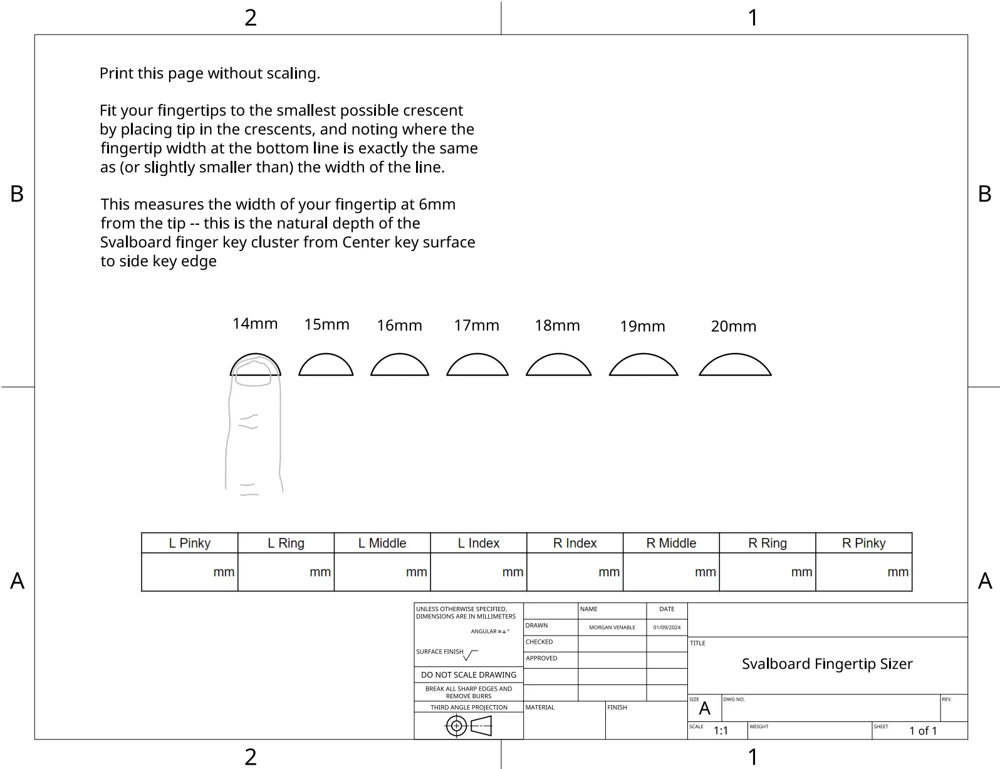

### Key sizes

There are four side key sizes. In order of increasing fingertip space:

| Size | Approximate spacing |
|---|---|
| Thick (+1) | 16 mm |
| Semi (+0.5) | 17 mm |
| Thin (0) | 18 mm |
| Backset (−1) | 20 mm |

- People with thin or pointed fingertips may prefer the thicker keys.
- People with blunt or wide fingertips may need the Backset keys for enough room to type comfortably.
- North keys come in Thick (+1) only.

The spacing is roughly the space between opposite side keys, near their tops. The numbers are approximate: use them to compare sizes, not as exact measurements.

<CadFigure name="cad-key-profiles" alt="The four side key sizes cut through the middle, side by side: Thick (+1) about 16 mm, Semi (+0.5) about 17 mm, Thin (0) about 18 mm and Backset (−1) about 20 mm. A dashed line runs along the front face of each key base. A solid line touches the bottom front edge of each key top, with a short bracket to the dashed line. On Backset, a thin dashed curve extends the key top's front face down past its lead-in ramp to that same bottom edge. The key top sits forward of the base by +1.0 mm on Thick and +0.5 mm on Semi, in line with it on Thin, and 1.0 mm behind it on Backset." caption="The four side key sizes, cut through the middle. The dashed line is the front of the key base; the solid line is the bottom front edge of the key top. On Backset, the key top's front face is extended down past the lead-in ramp. The numbers are how far the key top sits forward of the base, in mm: + is forward, − is back." />

{/* VERIFY: measured on the center-plane section of each key (the figure shows that section, so the lines sit on its edges). Key base front: the slot inner wall, x 8.55. Key top bottom-front edge, measured offset forward of the base: Thick +0.97, Semi +0.41, Thin 0.00, Backset -1.00 mm. Backset's key top is Thin's moved back (its front face is Thin's plus 1.00 mm, within 0.002 mm over its height); the lead-in ramp is bridging geometry added after that offset, so its reference is the front face extended down to the key top's bottom edge height (z 2.4), not the ramp top. Labels are rounded to 0.5 mm. */}

<CadFigure name="cad-key-sizing" alt="Four finger clusters cut through the middle, one for each side key size, with a dimension line between the East and West keys: Thick (+1) about 16 mm, Semi (+0.5) about 17 mm, Thin (0) about 18 mm, Backset (−1) about 20 mm." caption="Approximate space between opposite side keys for each key size." />

{/* VERIFY: the live build guide (slide 15) also lists a "-2mm" side key, "only for huge fingers on narrow cluster PCBAs (not standard)". Should it be listed here? */}

### Other hand measurements

Only fingertip width calls for different parts. Every Svalboard has plenty of adjustment range for the rest. Hand size can help you pick a trackball size:

- **Hand length**, wrist to the tip of the middle finger: under 170 mm is extra small, 170 mm small, 180 mm medium, 190 mm large, over 195 mm extra large.
- **Palm width** at the knuckles: under 75 mm is small, 75 to 85 mm medium, over 85 mm large.

44 mm is the default trackball size. See [Trackballs and static bearings](/build/#trackballs-and-static-bearings).

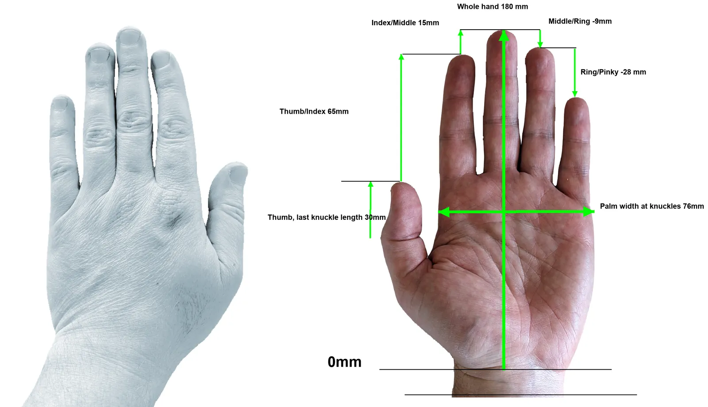

{/* VERIFY: the old fitment guide says unusual finger length differences may need longer cluster towers (98% of people fit the standard lengths), and about 10% of people may need wider keys. Should either line go on this page? */}

## Step 1: Print all parts

### Get the files

The parts are in the [svalboard-self-print repository](https://github.com/svalboard/svalboard-self-print/). If you don't have access yet, ask @claussen on the [Svalboard Discord](https://www.svalboard.com/discord).

### Which version to print

- In general, use the latest version.
- V2.0 greatly improves the key mechanism tolerances. Use it unless you're building to match older printed parts.
- Keys and clusters **must** come from the same major version, or they won't fit together.
- Many other parts didn't change from V1.3 to V2.0 and were carried forward as they are.
- The repository may hold prototypes or parts that aren't in your kit. If you're unsure whether a part fits, ask in #supporters on Discord.

### What to print

Pick your side key size first. See [Sizing before you build](/build/#sizing-before-you-build).

**Finger keys**

- 8 North keys: 11 mm tall, Thick (+1, 16 mm), medium force (0.7 mm offset).
- 24 East, South and West side keys: 6 mm tall, in your size: Thick (+1, 16 mm), Semi (+0.5, 17 mm), Thin (0, 18 mm) or Backset (−1, 20 mm). Medium force (0.7 mm offset).
- 8 tipping center keys: 0.9 mm offset is a good starting point.

**Thumb keys**

- 2 Pad, 2 Knuckle, 2 Down, Nail Left and Nail Right.
- 2 Up keys: Mode Slim 29h. Print the "Mode (Up) 29h" key from `Thumb Side Keys All v2.0 RCe.step` in the `Lightly FDM/V2.0/V2.0 Keys/Thumb Side Keys` folder.

**Clusters**

- 8 finger clusters
- Thumb L and Thumb R

**Other parts**

- Palm rests: Hemi Palm L, Hemi Palm R, two 9 mm hemi carriers ("2N-Slots"), and two hemi top washers. The files are in the Hemi Palms folder under Palmrests. Carriers from 1 mm to 15 mm tall are in its "Additional carrier variants and heights" folder.

  {/* VERIFY: the hemi palm files are in "Lightly FDM/V2.0/Palmrests/Experimental/Hemi Palms". Will they move out of Experimental now that they're the current design? */}
- Base plates and cases: L Base, L Case, R Base, R Case.
  For a compact board with no palm rest, print the [sawed-off case](/build/#sawed-off-case) instead.
- TrackPoint case, if you have a TrackPoint: top cover and bottom cover.
- Tools: mini 4x3 magnet stages (Key and Cluster), magnet dropper, mini key tray fixture.

<CadFigure name="cad-parts-one-half" alt="The printed parts for one half laid out at the same scale: finger cluster (print 4), thumb cluster, palm rest, carrier and top washer, then North key (4), side key (12), tipping center key (4), and the Nail, Knuckle, Pad, Up and Down thumb keys." caption="The printed parts for one half (right half shown). Base plate and case not shown." />

### Print tuning

- Use a smooth or satin build plate. Fully textured plates make the parts look rough. This is only about looks. We recommend the Fabreeko HoneyBadger SemiSatin plate.
- Only the palm rests and the tipping center keys need supports.
- Start by getting the 6 mm side key perfect, then the finger and thumb clusters. If you can print those, the rest is easy.

### Keys

- PLA: 0.12 mm layer height, 0.18 mm first layer.
- ABS: the same settings work, but the filament must be very dry. ABS is finicky with overhangs if it's even a little damp.
- Exterior perimeters: 0.3 mm.
- You may need to paint seam blockers on the sides of the small flag on each key.

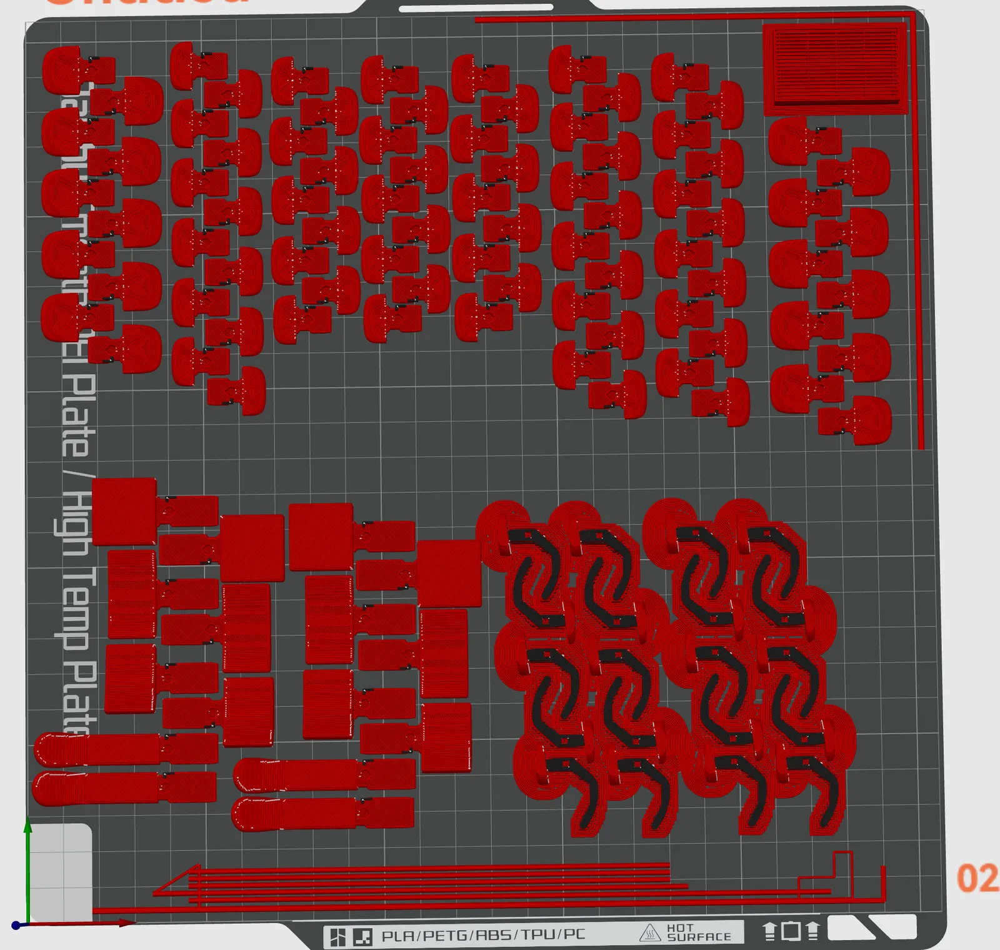

#### Key flags

The flag is the thin tab under each key that blocks the optical sensor.

- If flags form badly, place the seams at the top corner of the flag. Seams on the flag face can leave pinholes and heat artifacts that let light through.
- The flags must be about 0.8 mm thick or less for the parts to fit. With a 0.4 mm nozzle, set exterior perimeters ("outer wall" in Orca and Bambu Studio) to 0.3 mm.
- You may still need to clean up stringing. Slower printers and wet filament make stringing worse.
- If your filament isn't opaque to infrared light, coat the flags with opaque marker. Silver Sharpie works well ([Step 5](/build/#step-5-ink-the-key-flags)).

<CadFigure name="cad-key-flag" alt="A 6 mm side key lying flat as it prints, with the key top, stem, magnet pocket and flag labeled. A ring marks the top corner of the flag, where the seams should go." caption="Put the seams at the top corner of the flag." />

#### Key force

The offset sets how hard a key is to press. A larger offset gives a lighter key.

{/* VERIFY: slide 15 says "For lowest forces, use 0.8mm-1.0mm offset – this is about 10-15g", while slide 20 says the 0.9 mm tipping center key is about 20 g. Which keys does the 10-15 g figure apply to? It's left off the page until confirmed. */}

#### Tipping center keys

The tipping center key is the standard center key. The default strength is 0.9 mm offset, about 20 g. The STEP file has every offset from 0 to 1.2 mm (very light) if you want to experiment.

- Print at 0.2 mm layer height.
- Make the supports very dense: 0 or 0.1 mm base pattern spacing, and zero interface layer spacing (a very dense support interface).
- Dense supports come off as one block and leave a clean surface, so you have little or no cleanup inside the light hole.

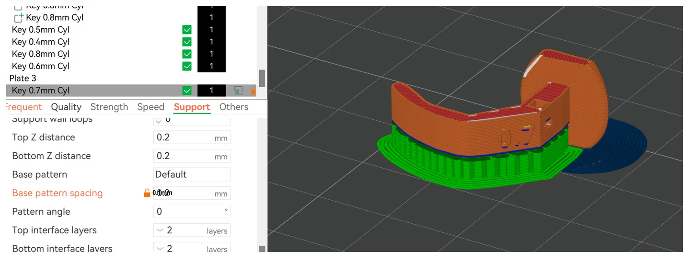

### Clusters

- 0.2 mm layer height.
- Arachne on is recommended.
- The tipping center key clusters don't need supports.
- Bridging angle 0 (automatic).<a href="#older-b-bridging" id="older-ref-b-bridging" aria-label="Older builds note">&#42;</a>
- If your printer can print two colors, print the small diffusers for the RGB layer lights in white.

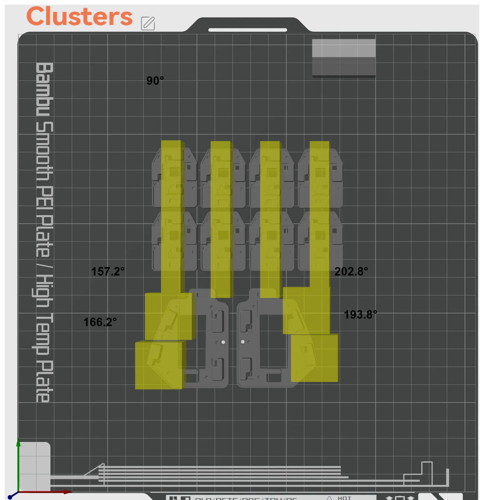

In the slicer preview, check that the first layer over each key well bridges the short way across it. The dashed outlines mark the openings.

{/* VERIFY: sliced in OrcaSlicer 2.3.2 (Bambu X1C 0.4 nozzle, 0.20mm Standard, Bambu PLA Basic) with the settings above: 0.2 mm layers, Arachne, bridging angle 0, no supports, no modifiers. The first bridge layer runs the short way over all 4 finger wells (1.9 x 5.45 mm, layer 7.8) and all 8 thumb wells (2.5 x 6.45 mm, layer 15.2). One layer up, the small step at the end of each well (finger 1.3 x 2.75 mm at layer 8.0, thumb 1.9 x 2.75 mm at layer 15.4) bridges the long way, crossing the layer below. Is that fine, or should it bridge the short way too? */}

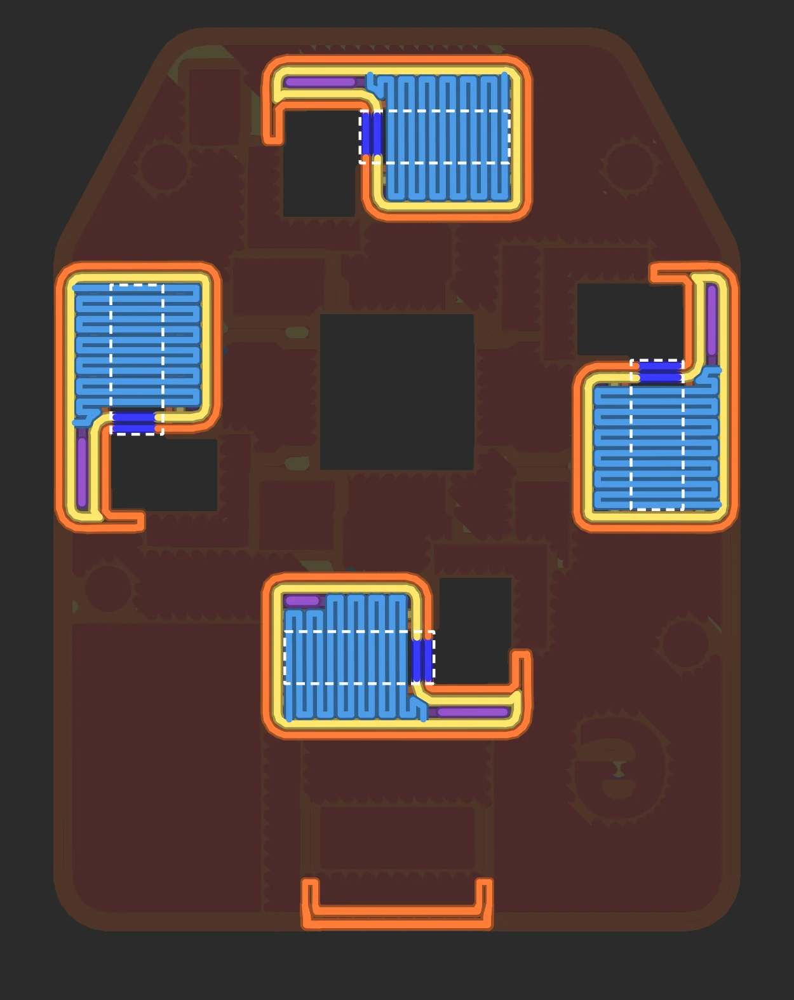

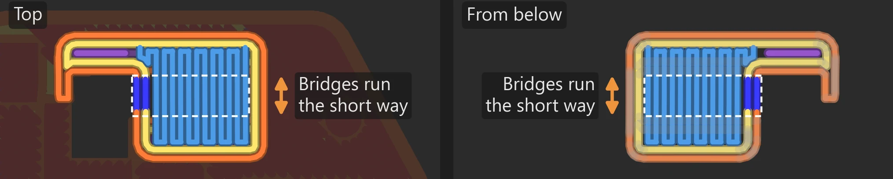

#### Thumb Down key opening

The marked edge of the thumb cluster **must** be square. Elephant's foot here makes the thumb Down key bind. A bevel here can add play to the key and change how it feels.

<CadFigure name="cad-thumb-down-edge" alt="A right thumb cluster seen from below. A heavy orange line marks the edge of the Down key opening that must stay square." caption="Keep this edge of the Down key opening square: no elephant's foot, no bevel." />

### Cases and base plates

- 0.2 mm layer height, 6 walls.
- Smooth side down.
- No supports.
- **External bridge infill direction** 0 (automatic), for cases and base plates.

The base plates also need one modifier each:

1. On each plate, add a box modifier over the index finger tower slot: the finger tower slot closest to the thumb slots. Make the box cover the whole slot without reaching the next finger tower slot.
2. In the modifier's settings, set **External bridge infill direction** to 94° on the left plate and 86° on the right plate.

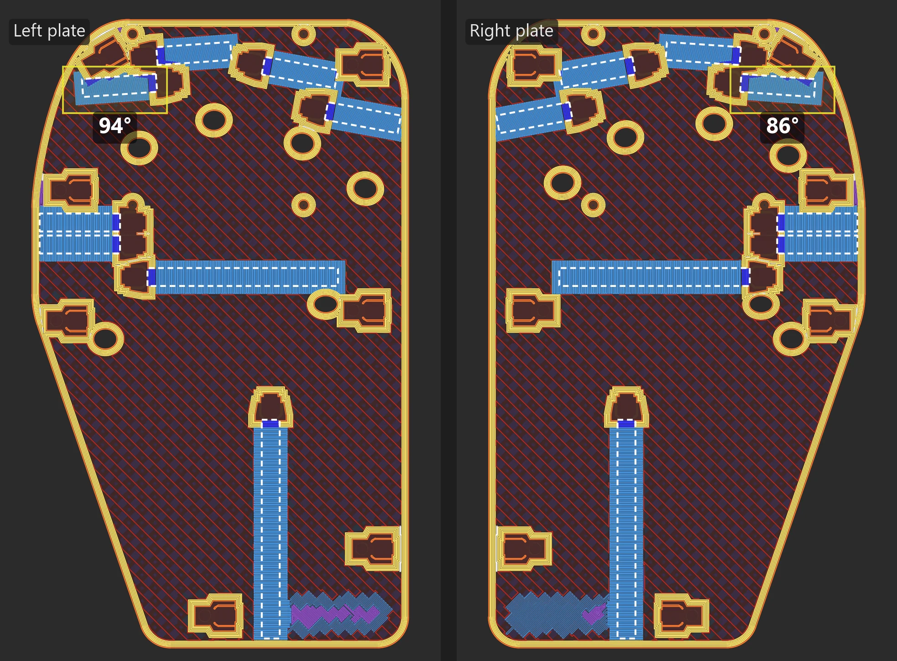

In the slicer preview, check that the first layer over each slot bridges the short way across it. The dashed outlines mark the openings.

{/* VERIFY: current base plates sliced in OrcaSlicer 2.3.2 (Bambu X1C 0.4 nozzle, 0.20mm Standard, Bambu PLA Basic): 0.2 mm layers, 6 walls, classic walls, no supports, smooth side down, bridge direction 0 (automatic) plus one box modifier per plate (94° left, 86° right) over the index finger tower slot. All 8 slots on each plate bridge the short way, within 0.1°. Without the modifier, that one slot bridges diagonally (30° on the left plate, 150° on the right); no other setting fixed it (bridge flow and density, thick bridges, internal bridge settings, walls, wall generator, vertical shell thickness, 0.16 mm layers, plate rotation). Check the exact Orca menu path for adding a box modifier and its bridge direction setting against the GUI. */}

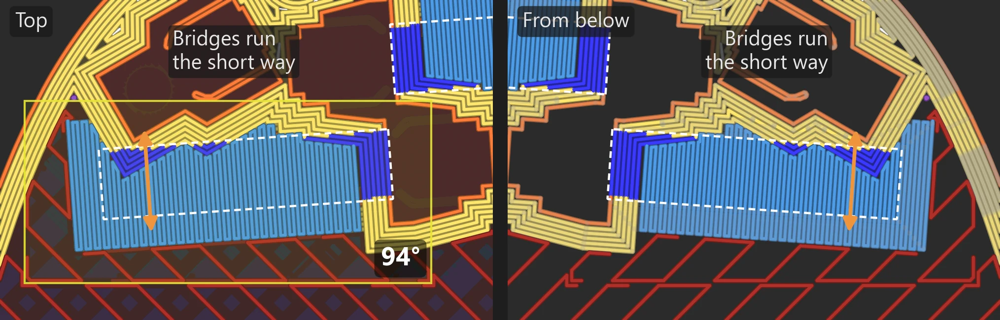

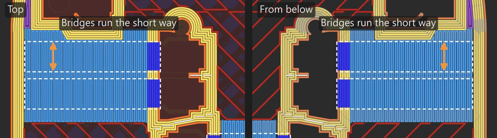

### Palm rests and carriers

- Print every palm rest part with 6 walls for strength.
- Stand each palm rest on its flat long edge, with tree supports (Auto, Default or Organic) and a brim of 5 mm or more. You may want to paint seam blockers on the visible surfaces.
- Print the carriers and the top washers flat side down. They don't need supports.

<CadFigure name="cad-hemi-print-orientation" alt="A palm rest standing on its long flat edge on a build plate, with a carrier and a top washer lying flat side down beside it." caption="Print orientation for the palm rest parts. Supports and brim are not shown." />

{/* PHOTO: slicer screenshot of one build plate with Hemi Palm L and R standing on their long edges with tree supports and brim, plus two 9 mm hemi carriers and two top washers lying flat side down. Same framing and plate as print-palm-rests.webp. */}

<CadFigure name="cad-hemi-exploded" alt="The parts of a hemispherical palm rest, pulled apart from top to bottom: the M5 flat head screw (orange), the hemispherical top washer, the palm rest with the ball on its underside, the carrier with its cup, and the M5 square nut (orange)." />

#### Older builds: tripod palm rests

Print the tripod palm rests the same way, standing on the long edge with tree supports and a brim. Print the carriers and shims without supports.

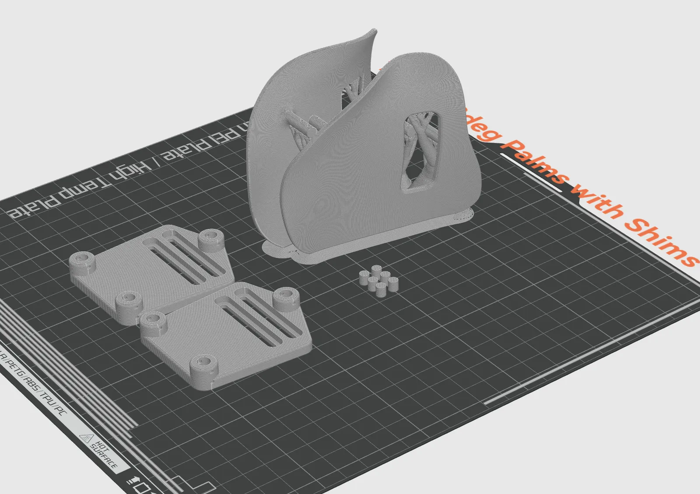

### Sawed-off case

The sawed-off case shortens each unit: base plate and back case end just behind the cluster slots, with no palm rest. It packs small for travel, and it's the one to choose if you bring your own palm rest setup.

Print the sawed-off base plates and cases from the [Sawed-off Case folder](https://github.com/svalboard/svalboard-self-print/tree/main/Lightly%20FDM/V2.0/Baseplates%20and%20Case/Sawed-off%20Case) in place of the standard ones. Its one STEP file holds both halves. Print them the same way as the [standard cases and base plates](/build/#cases-and-base-plates). Skip the palm rest parts, and skip [Steps 13 and 14](/build/#step-13-attach-palm-rest-carriers).

The sawed-off base plates have five case screw holes. Check the back of yours the same way as the standard plates ([Which base plates you have](/build/#which-base-plates-you-have)), then fit five square nuts or five heat set inserts per plate to match.

<CadFigure name="cad-sawed-off-case" alt="Two right halves at the same scale, each a base plate on its back case. The standard one on the left runs long behind the cluster slots, with the palm rest slot. The sawed-off one on the right ends just behind the cluster slots and has no palm rest slot." caption="The standard right base plate and case beside the sawed-off one, at the same scale." />

{/* VERIFY: the figure shows the B31 pop-nut sawed-off base plate (five square nut case screw holes) and case from Onshape. The Sawed-off Case folder still holds only "sawedoff test 1.X.step", the heat set insert version cut from v1.2.8. Publish the pop-nut sawed-off files there, then say "square nuts" only. */}

### TrackPoint case

- 0.2 mm layer height.
- Flat sides down.
- No supports.

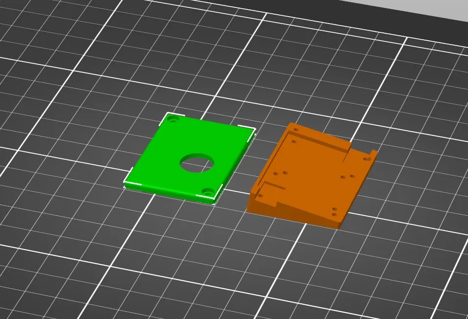

### Deprecated parts

Don't print the center key sliders (gap sliders) or the printed towers. The tipping center keys and clusters replace the sliders, and the kit includes stainless steel towers.

<aside class="older-notes" aria-label="Older builds">

Older builds

<ol>
<li id="older-b-bridging">&#42; V1.3 and earlier clusters use bridging angle 180°, plus bridging modifiers at the angles in the slicer view. <a class="older-back" href="#older-ref-b-bridging" aria-label="Back to the text">↩︎</a></li>
</ol>
</aside>

## Step 2: Organize magnets

Organize the magnets by polarity before you glue them in. Every magnet must face the right way:

- **Keys:** the **south** pole faces out of the key.
- **Clusters:** the **north** pole faces out of the cluster.

<CadFigure name="cad-magnet-polarity" alt="A cut-away close-up of an East key in its cluster. The key magnet sits in the key with its south pole facing the cluster wall; the cluster magnet sits in the wall with its north pole facing the key. Orange halves are north, blue halves are south." caption="Opposite poles face each other: south out of the key, north out of the cluster." />

If you don't have a reference to tell the poles apart, use a compass. Hold the magnet in your fingers or in something non-metal, so nothing else affects the reading.

There are several good ways to stage the magnets.

### Magnet stages

The magnet stages hold magnets in rows on their top surface, all with the same pole up.

1. Glue magnets into the back of the stage, all with the same polarity. This turns the stage into a magnetic base.
2. On the **Key** magnet stage, the working surface must hold magnets with the **south** pole up.
3. On the **Cluster** magnet stage, the working surface must hold magnets with the **north** pole up.
4. Drop as many magnets as you need onto the stage.
5. Pick them up one at a time with a small flat screwdriver, and press each into a key or cluster. They always come off the stage with the right pole out.

For a single build, print the compact 4x3 stages, or fill one row or column of the larger 8x8 stage.

<CadFigure name="cad-magnet-stages" alt="The compact 4x3 Key and Cluster magnet stages side by side, each with 12 magnets on its top face. The Key stage holds magnets south pole up, the Cluster stage north pole up." caption="The compact 4x3 magnet stages. The Key stage holds magnets south pole up; the Cluster stage, north pole up." />

{/* VERIFY: the stage drawing shows only the compact 4x3 stages; the 8x8 stage photo is no longer on the page (magnet-stages.webp is kept in src/assets). */}

### Magnet dispenser

The magnet dispenser holds a stack of magnets and drops them one at a time onto a stage. Print it at 0.3 mm layer height with no supports.

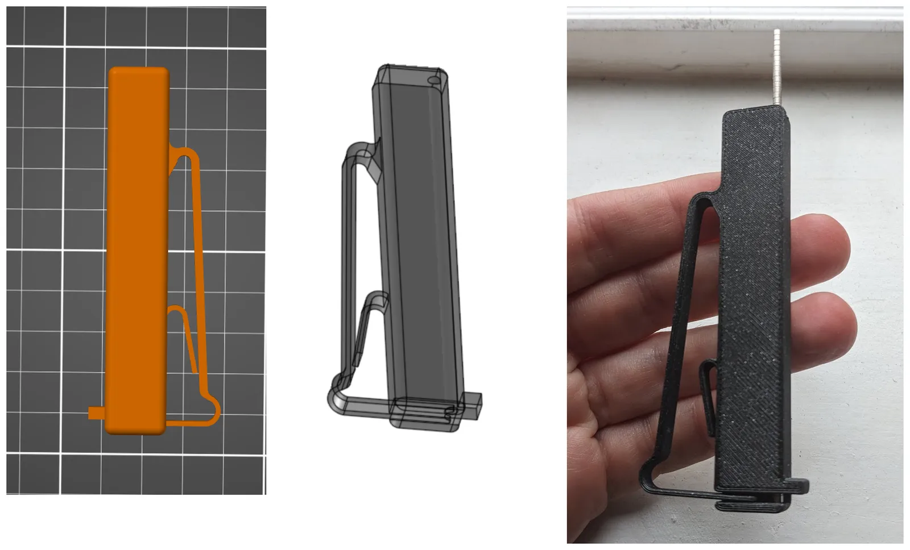

### Alternative: a MagSafe phone

You can also stage magnet stacks on the MagSafe ring of an iPhone 12 or newer. This works even with a MagSafe case on.

- The stack farther from the center has the **south** pole up. Use it for keys.
- The stack closer to the center has the **north** pole up. Use it for clusters.

Reference: page 152 of Apple's *Accessory Design Guidelines for Apple Devices*.

To install a magnet, pick one up from the correct stack with a magnetic tool, put a drop of glue in the magnet hole, and insert the magnet.

## Step 3: Install magnets

Each finger cluster has 5 keys, so a finished cluster with its keys needs 10 magnets.

All magnets are 2.0 mm x 1.5 mm N35.

- **Clusters:** the **north** pole faces out.
- **Keys:** the **south** pole faces out, so it's the visible side.

### Install key magnets: dip method

1. Use the Key stage (south pole up).
2. Put magnets on the stage.
3. Put a small blob of CA glue on a surface. A strip of painter's tape works well.
4. Pick up a magnet with a thin flat-blade screwdriver.
5. Dip the magnet in the glue.
6. Press it into the hole in the key.
7. Squeeze the magnet flush with parallel pliers.
8. Let the glue cure before you use the key.

<CadFigure name="cad-magnet-flush" alt="Two cut-away views of a key with its magnet. Before: the magnet stands proud of the key between the open jaws of parallel pliers. After: the jaws are closed and the magnet is flush." caption="Squeeze the magnet flush with parallel pliers." />

### Install key magnets: pre-applied glue method

1. Use the Key stage (south pole up).
2. Put magnets on the stage.
3. Put glue in the magnet holes of the keys.
4. Pick up a magnet with a thin flat-blade screwdriver.
5. Press it into the hole in the key.
6. Squeeze the magnet flush with parallel pliers.
7. Let the glue cure.

### Cluster magnets

Install the cluster magnets the same way, from the Cluster stage (north pole up). Orange rings mark each magnet.

<CadFigure name="cad-magnets-finger-cluster" alt="A finger cluster from above and the same cluster turned over. Orange rings mark the five magnets: one in the wall of each side key slot, and the center key magnet on the underside." caption="Finger cluster magnets: one in each side key slot, one for the center key on the underside." />

<CadFigure name="cad-magnets-thumb-cluster" alt="A right thumb cluster from above. Orange rings mark the five magnets: Nail, Knuckle, Pad, Up and Down." caption="Thumb cluster magnets (right cluster shown; the left cluster is the mirror image)." />

### Key magnets

<CadFigure name="cad-magnets-keys" alt="The keys in a row, each with its magnet in orange and ringed: North, side, tipping center, Nail, Knuckle, Pad, Up, the curved Up, and Down." caption="Where the magnet goes in each key. The south pole faces out." />

### Tipping center key

The tipping center key uses normal key polarity: the **south** pole faces out (up). Make sure the hole in the key is clear of stringing and stray filament.

<CadFigure name="cad-tipping-key-holes" alt="A tipping center key. Rings mark the magnet hole on the arm and the light hole through the stem, which must be clear of stringing." caption="Keep the light hole clear of stringing." />

## Step 4: Insert keys

### Square nut first

Each cluster takes a square nut in the back of its underside, the fixing point for the tower. Put it in **before** you install the center key: the center key covers the nut's slot.

1. Place the cluster top side down.
2. Line up the nut with small pliers or tweezers.
3. Press it **straight** down into the slot.

	<CadFigure name="cad-cluster-nut" alt="A finger cluster upside down with no keys in it. A square nut (orange) hovers above its slot at the back, and an arrow shows it pressed straight down." caption="Before the center key goes in, press the square nut straight down into the slot at the back of the cluster." />
	<CadFigure name="cad-cluster-nut-seated" alt="The same cluster, still without keys, with the square nut seated in its slot." caption="Seated: the nut sits fully in the slot." />

### Insert the keys

Every key should slide easily into place and snap to its magnet.

<CadFigure name="cad-key-insert" alt="A finger cluster with its keys in place except the East key (orange), which is above its slot with an arrow pointing straight down." caption="Slide each key straight down into its slot until it snaps to its magnet." />

If a key doesn't slide in easily or doesn't move freely:

1. File a little material off the sides of the key.
2. If it still binds, file the bottom (the chamfered back of the key base).
3. Try the fit again.

<CadFigure name="cad-key-file-areas" alt="A side key, stem down. The sides of the stem are orange, marked 1, and the chamfered bottom of the stem is blue, marked 2." caption="If a key binds, file the sides (1) first, then the chamfered bottom (2)." />

{/* VERIFY: cad-key-file-areas takes "sides" as the stem faces that run in the slot and "bottom" as the chamfered stem tip. */}

This is how each key sits in its cluster:

<CadFigure name="cad-finger-cluster-keys" alt="A finger cluster with its keys labeled: North at the back, East, South, West, and the Center key in the middle, plus the cluster body." />

<CadFigure name="cad-thumb-cluster-keys" alt="A right thumb cluster seen almost level from its outer side, keys labeled: the Nail and Knuckle keys in front, the Pad key behind, whose sloped top runs on into the Knuckle top as one line rising toward the Up key, the Up key, the Down key between them, the layer LED, and the cluster body." />

<CadFigure name="cad-thumb-cluster-keys-curved-up" alt="A right thumb cluster seen from the side, square to the Up slot, with the curved Up key in profile: its stem bows outward and its top curves back over the cluster. The Nail, Knuckle, Pad and Down keys are also labeled." caption="The curved Up key, in the same cluster." />

### Tipping center keys

1. Remove the North key.
2. Point the tip of the tipping center key's arm down into the center hole of the cluster.
3. Turn the key down so the arm follows its curve through the hole, until it snaps into place.
4. Put the North key back.

<CadFigure name="cad-tipping-insert" alt="Four cut-away steps: 1, the North key lifted out of the cluster; 2, the tipping center key tilted back with the pointed tip of its arm going down into the center hole, which is ringed and labeled; 3, the key partway through its turn, with a curved arrow showing it swing down into its seat; 4, the key seated and the North key going back in." caption="Remove North, put the arm's tip down into the center hole (ringed and labeled), turn the key down until it snaps in, then refit North." />

<CadFigure name="cad-tipping-center-key" alt="A finger cluster seen from underneath, with a tipping center key (orange) hooked through it. The key arm is marked 0.9." />

The tipping center key replaces the older slider-based center key. Slider parts are deprecated.

## Step 5: Ink the key flags

Each key has a flag that blocks an optical sensor when you press the key. If your filament isn't opaque to infrared light, the flags won't block the sensors properly. Paint or ink them to make them opaque.

- We recommend [silver metallic Sharpie](https://www.amazon.com/Sharpie-39108PP-Metallic-Permanent-Blister/dp/B00009RAX4).
- Only Sharpie-brand silver works reliably.
- Very light filaments may need several coats.

Black PLA usually doesn't need ink.

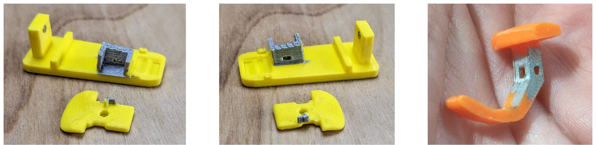

## Step 6: Attach FFCs

Every FFC connects the same way:

	<CadFigure name="cad-ffc-1-open" alt="An FFC connector on a circuit board with its black latch standing upright over the back half of the connector. A curved arrow shows the latch's back edge lifting up and over toward the cable opening." caption="1. Flip the latch up." />
	<CadFigure name="cad-ffc-2-insert" alt="An FFC end being slid into the front opening of the open connector, blue stiffener on top and the contacts on the underside, facing down. An arrow shows the direction." caption="2. Slide the cable all the way in, contacts down and blue stiffener up." />
	<CadFigure name="cad-ffc-3-latch" alt="The cable fully inserted and the latch flipped down flat at the back of the connector. A curved arrow shows the latch closing." caption="3. Flip the latch down to lock the cable." />

To remove a cable, flip the latch up and pull the cable straight out.

{/* VIDEO: a short clip of unlatch, insert, latch on one connector (shot list: ffc-latch-video). */}

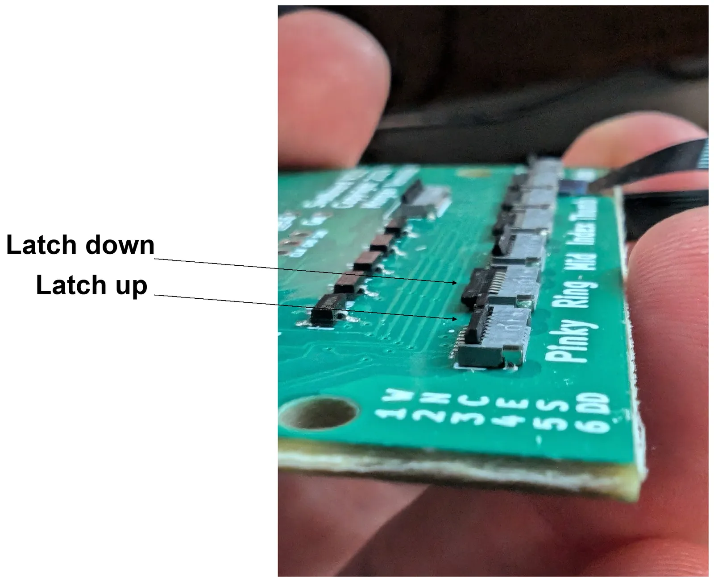

### Attach FFCs to the PCBAs

That orientation holds at both ends of every FFC, with one exception: at the TrackPoint PCBA the contacts face up ([Step 10a](/build/#10a-trackpoint)).

<CadFigure name="cad-ffc-finger-pcba" alt="An FFC latched into the connector on a finger cluster PCBA. The black latch is closed flat at the back of the connector, the blue stiffener on the cable end faces up, and the cable runs straight out of the front of the connector, past the edge of the board. The contacts face down, toward the board." caption="An FFC on a finger cluster PCBA: latch closed, blue stiffener up, contacts down." />

For the thumbs, use the 10-pin FFC if you have it; the RGB layer lights need it. On a thumb PCBA the latch sits on the side opposite the cable, so route the cable down through the slot after you close the latch.

<CadFigure name="cad-ffc-thumb-pcba" alt="A cutaway of a right thumb cluster with its PCBA in place, at the 10-pin FFC connector. The black latch is closed on the side of the connector away from the cable, the blue stiffener on the cable end faces up, and the cable runs out to the edge of the board, then folds down through the slot between the board and the cluster wall." caption="An FFC on a thumb PCBA: latch closed, blue stiffener up, then the cable folds down through the slot." />

<CadFigure name="cad-ffc-trackball-pcba" alt="An FFC latched into the connector on the trackball PCBA. The black latch is closed flat at the back of the connector, the blue stiffener on the cable end faces up, and the cable runs straight out of the front of the connector, past the edge of the board. The contacts face down, toward the board." caption="An FFC on the trackball PCBA: latch closed, blue stiffener up, contacts down." />

### FFCs on the MCU

You connect the other end of each FFC to the MCU in [Step 12](/build/#step-12-install-mcus), the same way. The MCU's 8-pin thumb connector is for older builds; use the 10-pin one.

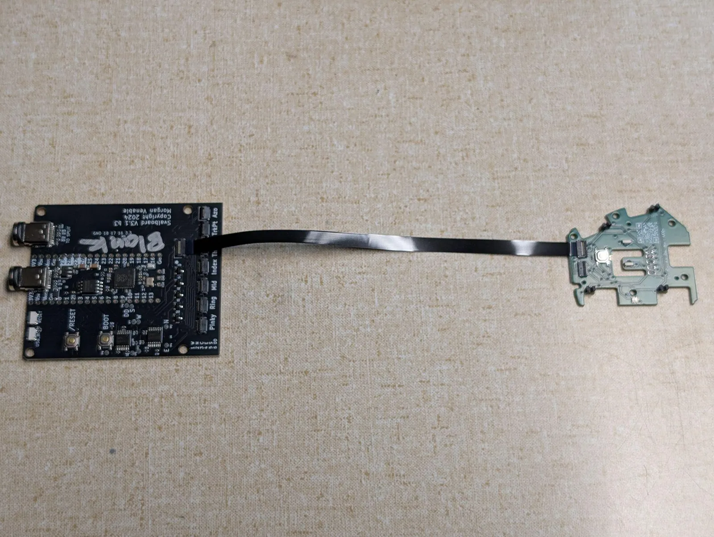

## Step 7: Install PCBAs and test

### Install the PCBAs

- Line each PCBA up squarely with the cluster before you press it in. Installing it at an angle can damage the optical sensors.
- **Finger clusters:** use just the two screws shown. If one strips, use one of the other two holes.
- Make sure the bottom-left corner of the PCBA is fully seated in the cluster. If it isn't, the East or South key may not register.
- **Thumb clusters:** put a screw in every hole.
- You don't need to remove the finger center key to replace a PCBA.

Use the M2 x 4 mm T6 thread-cutting screws and the T6 bit.

<CadFigure name="cad-pcba-finger" alt="A finger cluster from below with its PCBA in place. Two M2 x 4 mm T6 screws (orange) sit in opposite corners; rings mark the two spare holes and the bottom-left corner that must be fully seated." caption="Finger cluster: two M2 x 4 mm T6 screws in opposite corners. If one strips, use a spare hole. Make sure the bottom-left corner is fully seated." />

<CadFigure name="cad-pcba-thumb" alt="A right thumb cluster from the PCBA side with the keys removed. An M2 x 4 mm T6 screw (orange) sits in each of the six screw holes." caption="Thumb cluster: an M2 x 4 mm T6 screw in every hole." />

{/* VERIFY: the finger figure's "bottom-left corner" follows the old photo's orientation. */}

{/* PHOTO: replace with current-design photos (shot list: pcba-install). */}

### Test the clusters (recommended)

Test each cluster before final assembly. A bad PCBA is much easier to swap now.

Use the **blank** firmware for this test. No key does anything, so the Matrix Tester shows exactly which switches register.

1. Connect the cluster FFCs to the MCU: unlatch, insert contacts down, latch.
2. Download the blank file for that side from the {stable.tag} release: <a href={blankUrl('left')}><code>{blank('left')}</code></a> or <a href={blankUrl('right')}><code>{blank('right')}</code></a>. Every file is listed in [Firmware files](/firmware/#firmware-files).
3. Flash it to the MCU. For how, see [Step 15](/build/#step-15-flash-firmware-and-connect) and [Flashing firmware](/firmware/#flashing-firmware).
4. Open [Keybard](/keybard/) (https://keybard.svalboard.com), choose **Connect Keyboard**, then **Matrix Tester**.
5. Press every key on the cluster. Check that each one lights up in the Matrix Tester.
6. When you're done, disconnect the FFCs: unlatch, pull the FFC out, latch.

Flash the normal `sval` firmware in [Step 15](/build/#step-15-flash-firmware-and-connect).

## Step 8: Install inserts and nuts

The case screws hold each base plate to its back case. Depending on your base plates, those screws thread into square nuts or into heat set inserts.

### Which base plates you have

Our latest base plates use square nuts at the case screw holes. Earlier base plates, including v1.2.8, use heat set inserts, and builds of every version are out there. To check yours, turn a base plate over and look at the seven case screw holes on the back.

- If each hole has a small rectangular opening beside it, your base plates take square nuts. Follow [Square nuts at the case screw holes](#square-nuts-at-the-case-screw-holes).
- If the holes are plain and round, your base plates take heat set inserts. Follow [Heat set inserts in the base plates](#heat-set-inserts-in-the-base-plates).

The back cases take heat set inserts either way.

<CadFigure name="cad-plate-identify" alt="Two close-ups of a case screw hole on the back of a base plate. The latest plate has a rectangular opening beside the hole; the earlier plate has a plain round hole." caption="Back of the base plate at a case screw hole. Latest plates have a square nut opening beside the hole; earlier plates have a plain round hole for a heat set insert." />

### Square nuts at the case screw holes

Square nuts need no soldering iron. Each one clicks into a pocket on the back of the base plate and stays there, ready for its case screw. You need 7 M3 square nuts per base plate, DIN 562 (the thin kind: 5.5 mm across and 1.8 mm thick).

<CadFigure name="cad-popnut-locations" alt="The back of the right base plate with every square nut it holds, each seen through a small window cut in the back layer. Orange circles mark the seven case screw nuts, each over its screw hole beside a small rectangular opening. Blue circles mark the five tower slot nuts, one for each finger tower and one for the thumb tower, and the two palm rest slot nuts." caption="All the square nuts in the right base plate: seven case screw nuts (orange), five tower slot nuts and two palm rest slot nuts (blue). Small windows in the back layer show each nut." />

{/* VERIFY: the figure puts the thumb tower nut in the thumb slot nearer the fingers, one nut per tower as in Step 10 and the kit count. Some builds use a screw in each thumb slot. */}

The left base plate is a mirror image. In the close-ups below, the thin layer of plastic over the pocket is cut away so you can see the nut.

1. Lay the base plate on the table with the back facing up.
2. Drop a nut flat into the rectangular opening beside a case screw hole.

   <CadFigure name="cad-popnut-1-drop" alt="Close-up of a case screw hole from the back of the base plate. A square nut (orange) hovers above the rectangular opening, and an arrow shows it dropping in. A blue spring arm runs along each side of the opening." />

3. Push the nut sideways toward the screw hole, with a fingertip or a small screwdriver. The two spring arms bend outward to let it pass.

   <CadFigure name="cad-popnut-2-push" alt="The nut lies in the opening between the blue spring arms, and an arrow shows the push toward the screw hole." />

4. Keep pushing until the nut clicks into the pocket over the hole. The arms spring back behind it and hold it in place.

   <CadFigure name="cad-popnut-3-seated" alt="The nut sits in its pocket, centered over the screw hole, with the blue arm tips behind it. A dashed line shows where the case screw goes in." />

5. Repeat for the other six holes, then do the other base plate.

Look through each screw hole. You should see the nut's thread centered in it.

### Heat set inserts

#### General process

- Set the soldering iron to about 280 °C for PLA. Lower and slower also works.
- A heat set insert tip sized for each insert is easiest. [Kits with every size are on Amazon](https://www.amazon.com/Virtjoule-Heat-Insert-Tips-Sizes/dp/B08B17VQLD). A single 3 mm tip also works for all of them. It's slower to heat the big inserts, but you don't need to swap tips.
- A plain tapered soldering iron tip works too, but the insert is less stable and more likely to tip and foul the part.

1. Let the iron preheat for a few minutes.
2. Pick up an insert with the tip. On the base plates and cases, you can instead set the inserts in their holes and press down vertically.
3. Press the insert gently into the hole. Let the heat do the work. Forcing it can deform and ruin the part.
4. **Don't insert it all the way.** Stop about 0.5 mm short.
5. Finish by pressing the part against a flat surface, or with a flat tool, so the insert sits flush and flat.

	<CadFigure name="cad-heatset-1-stop" alt="A cut-away of a base plate hole with a heat set insert (orange) pressed in by the iron tip, stopped about 0.5 mm short of flush." caption="Stop about 0.5 mm short." />
	<CadFigure name="cad-heatset-2-flush" alt="The same cut-away with a flat tool pressing the insert down until it sits flush with the surface. An arrow shows the press." caption="Finish with a flat tool so the insert sits flush and flat." />

#### Heat set inserts in the base plates

If your base plates have plain round case screw holes, install 7 M3 inserts in each base plate.

<CadFigure name="cad-inserts-baseplates" alt="The backs of the right and left v1.2.8 base plates. Orange rings mark the seven M3 insert holes on each." caption="The seven M3 insert holes on each base plate (v1.2.8 shown, back side up)." />

#### Back cases

Install a 1/4-20 insert in the middle of each back case, and the M5 inserts on the side. The M5 inserts are for screw-in legs.

<CadFigure name="cad-inserts-back-case" alt="The bottom of the right back case. Two M5 inserts (orange) sit near the inner edge and a 1/4-20 insert (blue) in the middle." caption="Back case, bottom: two M5 inserts for screw-in legs and one 1/4-20 insert in the middle." />

### Square nuts in the base plate slots

The square nuts in the slots let each cluster tower bolt to the base plate anywhere along its slot.

Slot nuts go in from the front of the base plate, the side the towers mount on.

- **Latest base plates:** each slot has a nut opening on the back of the plate, with two spring arms like the case screw pockets. Drop a nut into the opening and push it along the slot past the arms.

  

  	<CadFigure name="cad-slot-nut-latest-1-drop" alt="The back of the latest base plate at a slot end, with the back layer over the slot cut away. A square nut (orange) drops into the opening between two spring arms." caption="Latest base plates: drop a nut into the opening on the back of the plate. (The back layer over the slot is cut away so you can see the nut.)" />
  	<CadFigure name="cad-slot-nut-latest-2-push" alt="The nut in the opening, with an arrow showing it pushed along the slot past the spring arms." caption="Push it along the slot, past the spring arms." />
  

- **Earlier base plates:** drop a nut into each slot opening and tip it into position on one side of the slot.

  

  	<CadFigure name="cad-slot-nut-earlier-1-drop" alt="The front of an earlier base plate at a slot end, top layer over the slot cut away. A square nut drops into the square opening." caption="Earlier base plates: drop a nut into the slot opening." />
  	<CadFigure name="cad-slot-nut-earlier-2-push" alt="The nut in the opening of an earlier plate, with an arrow showing it moved into the slot." caption="Tip it into position in the slot." />
  

{/* VERIFY: the earlier-plate drawings show "tip it into position" as moving the nut from the opening into the slot channel. Check against a real earlier plate. */}

## Step 9: Attach towers to clusters

Attach each tower to its cluster first. Then attach the assembly to the nut in the base plate slot ([Step 10](/build/#step-10-install-towers-on-baseplates)).

Put an M3 x 6 mm pan head T10 screw through the tower and into the square nut in the cluster, with the T10 driver. Tighten it a little to keep the cluster roughly in place. You adjust it later.

<CadFigure name="cad-tower-exploded" alt="An exploded view on one axis: an M3 x 6 mm pan head T10 screw, the index tower (orange), and the finger cluster, with the square nut (blue) below its slot in the cluster." caption="The M3 x 6 mm pan head T10 screw passes through the tower and into the square nut in the cluster." />

Make sure each tower goes in the right place:

- **Thumb:** the acute-angle tower, long side down.
- **Index fingers:** the tall oblique tower, tall side up.
- **Middle, ring and pinky:** the shorter, symmetric towers.

<CadFigure name="cad-tower-types" alt="Three stainless towers seen from the side, stacked: the thumb tower with its long side down, the tall index tower with its tall side up, and the shorter tower used for middle, ring and pinky." caption="Thumb: long side down. Index: tall side up. Middle, ring and pinky: the shorter towers." />

<CadFigure name="cad-tower-on-cluster" alt="An index tower (orange) screwed to a finger cluster with an M3 x 6 mm pan head T10 screw." />

## Step 10: Install towers on baseplates

1. Take a cluster and tower assembly. Feed the cluster's FFC through the matching hole in the base plate.
2. Put an M3 x 6 mm pan head T10 screw through the tower base and into the square nut in the base plate slot.
3. Tighten it enough to hold the tower. You'll move the towers later to fit your hand ([Step 18](/build/#step-18-adjust-the-fit)), so don't tighten them hard.

<CadFigure name="cad-tower-on-plate" alt="An index tower and cluster lifted above the base plate. The cluster's FFC (blue) passes down through its hole in the plate, and an M3 x 6 mm pan head T10 screw lines up with the tower base slot and the square nut (blue) in the plate slot." caption="Feed the FFC through the base plate, then screw the tower base to the square nut in the slot." />

If you have a TrackPoint, trackball or touchpad, install it next: see [Steps 10a to 10c](/build/#steps-10a-to-10c-pointing-devices).

## Steps 10a to 10c: Pointing devices

Use one pointing device per half. Connect its FFCs as in [Step 6](/build/#step-6-attach-ffcs).

### 10a TrackPoint

- Attach a same-side FFC to the TrackPoint: unlatch, insert the contacts **up**, latch.
- Mount the TrackPoint in its holder with three M2 x 4 mm T6 thread-cutting screws.
- Attach the cover with two more M2 x 4 mm T6 screws.
- Route the cable with the finger cluster cables ([Step 10](/build/#step-10-install-towers-on-baseplates)).
- This half needs TrackPoint firmware. See [Step 15](/build/#step-15-flash-firmware-and-connect).
- The TrackPoint half must be the half you connect to your computer ([Step 15](/build/#step-15-flash-firmware-and-connect)).

<CadFigure name="cad-trackpoint-exploded" alt="An exploded TrackPoint holder: the holder bottom, the TrackPoint module (blue) with its stick up, three M2 x 4 mm T6 screws, the cover, and two more M2 x 4 mm T6 screws for the cover, with dashed lines to their holes." caption="TrackPoint holder: module stick up, held with three M2 x 4 mm T6 screws, then the cover with two more." />

{/* VERIFY: a photo of the FFC contacts-up end is still needed. */}

### 10b Trackball

#### Trackball holder

- Print the holder at 0.2 mm layer height with 6 or more walls. You can add supports under the large bridges, but in PLA the holders work fine without them.
- The holder takes four static bearing balls, 3.175 mm. Some older holder designs use 3 mm balls. See [Trackballs and static bearings](/build/#trackballs-and-static-bearings).

<CadFigure name="cad-trackball-holder" alt="The trackball holder from above with its cover beside it. Orange rings mark the four bearing balls: three in the cup and one in the keeper arm." caption="The four bearing balls: three in the cup and one in the keeper." />

1. Remove the supports. Make sure the ball cavities are clear of stray material.
2. Put a small drop of medium CA glue in each bearing location, and drop a bearing into each.
3. After a moment, press each bearing into its seat with a screwdriver blade, so it seats fully.
4. Test the ball fit. The top arm (the keeper) should be very close to the ball but not touch it in normal use: 0 to 0.2 mm.
5. If needed, heat the keeper and bend it slightly to get the hold you want. Use hot water for PLA, or a heat gun on low for ABS. This is easier before the sensor is installed.

<CadFigure name="cad-trackball-keeper" alt="A section through the holder and a 44 mm trackball (blue). A ring marks the small gap between the ball and the keeper's bearing ball." caption="The keeper sits very close to the ball without touching it: 0 to 0.2 mm." />

If you don't carry your Svalboard around and don't tent it steeply, you don't strictly need the keeper.

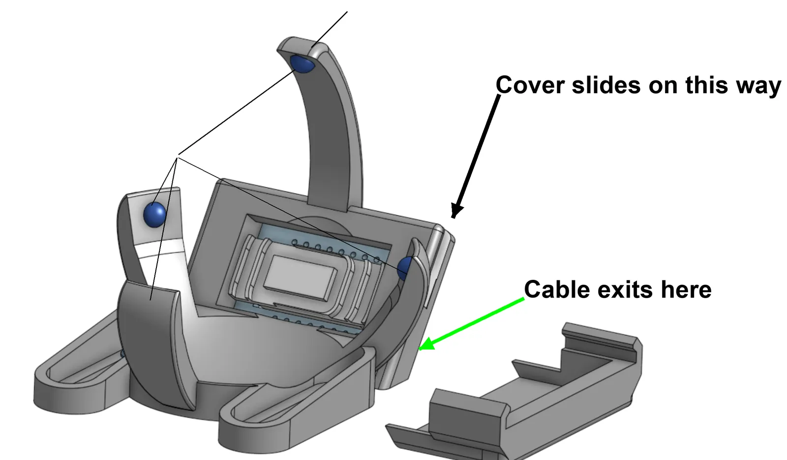

{/* VERIFY: cad-trackball-holder can replace this photo once the cover's slide direction and the cable exit are confirmed and drawn on it. */}

#### Trackball PCBA

- Attach a same-side FFC to the trackball PCBA: unlatch, insert the contacts **down**, latch.
- Check which sensor the PCBA has. You need this to pick the firmware in [Step 15](/build/#step-15-flash-firmware-and-connect).
  - Current PCBAs use the **PMW3389**.
  - Older PCBAs may use the **PMW3360** (deprecated).
  - Look for silver marker on the PCBA, or read the tiny text on the sensor itself.
- Flashing the wrong image does no harm.
- Mount the trackball PCBA in its holder with the M2 x 4 mm T6 thread-cutting screws. Attach the cover.
- Route the cable with the finger cluster cables ([Step 10](/build/#step-10-install-towers-on-baseplates)).
- Connect the trackball cable to the 8-pin FFC connector marked "TrkPt", "Trackball" or "Ball", depending on your MCU: unlatch, insert the contacts down, latch.

### 10c Touchpad

Each half can have one touchpad. It sits between the finger clusters and the thumb cluster, on the same rail as the trackball, so you can swap them. It needs MCU v3.1 or newer.

You need, for each touchpad half:

- The touchpad module. One side is glass; the other side is the circuit board, marked with an **N** on its north side.
- The touchpad holder. The same holder fits either half.
- A 6-pin FFC.
- One M3 x 6 mm pan head T10 screw, and a square nut in the rail ([Step 8](/build/#square-nuts-in-the-base-plate-slots)).

#### Which way it goes

The holder turns around between the halves. The module never does.

- **Module: N side north, glass up.** On both halves, the module's **N** side faces north, toward your fingers. The circuit board faces down, into the holder.
- **Holder: flange on the pinky side.** The holder has a flat flange with a long slot on one side. Turn the holder so the flange is toward your pinky, with the slot over the rail. On the right half the flange is on the right; on the left half it's on the left.
- **The holder's tall side is toward your thumb.** The glass slopes down toward your pinky.

	<CadFigure name="cad-touchpad-orientation-right" alt="The right half's touchpad from above, on the base plate. North, toward the fingers, is up. The holder (orange) has its flange and slot on the right, the pinky side, with the screw where the slot crosses the rail. A dashed line shows the rail under the holder. The module's glass (blue) faces up, with its N side to the north." caption="Right half: flange and screw on the pinky side (right), the module's N side north." />
	<CadFigure name="cad-touchpad-orientation-left" alt="The left half's touchpad from above. The same holder is turned around: its flange and slot are on the left, the pinky side, with the screw where the slot crosses the rail. The module's N side still faces north." caption="Left half: the same holder turned around, flange and screw on the pinky side (left). The module's N side is still north." />
	<CadFigure name="cad-touchpad-orientation-wrong" alt="The right half with the holder turned the wrong way. The flange and its slot are on the left, the thumb side, past the end of the rail, so the slot never crosses it." caption="Wrong: on the right half, the flange is toward the thumb, and its slot misses the rail." />

#### Connect the FFC

1. Connect the 6-pin FFC to the touchpad: unlatch, insert the FFC with its contacts facing **down**, against the circuit board, and latch.
2. Lay the module in the holder, glass up, N side north.
3. Lead the FFC out of the holder on its left side, through whichever notch gets it there. Then feed it down through the base plate.
4. Connect the other end to the 6-pin "Azo" connector on the MCU: unlatch, insert the contacts **down**, latch.
5. Route the cable with the finger cluster cables ([Step 11](/build/#step-11-route-cables)).

#### Mount the holder

1. Set the holder on the base plate with the flange on the pinky side and its slot over the rail.
2. Put an M3 x 6 mm pan head T10 screw through the flange slot and into the square nut in the rail. Use the T10 driver. This is the only screw: the cross-shaped slot in the holder's floor isn't used.
3. Slide the holder along its slot, toward or away from your fingers, until no key touches it. Then tighten the screw.

<CadFigure name="cad-touchpad-installed" alt="The installed touchpad on the right half's base plate, seen from the front and the pinky side. The holder (orange) holds the glass (blue) facing up, with the module's N side to the north. The holder's tall side is toward the thumb. The flange with its slot is on the pinky side, and one M3 x 6 mm pan head T10 screw passes through the slot into the rail." caption="Installed on the right half: glass up, N side north, flange and screw on the pinky side." />

#### Check the orientation

- The glass faces up and sits just below the holder's rim.
- The module's N side faces north.
- The flange and its screw are on the pinky side, and the screw is in the rail.
- The holder's tall side is toward your thumb.
- The FFC leaves on the holder's left side, and the holder doesn't pinch it.
- After you flash the firmware ([Step 15](/build/#step-15-flash-firmware-and-connect)), slide a finger on the pad toward your fingers. The pointer moves up the screen. If it moves down, the module is turned around: take it out and put it back with its N side north.

This half needs touchpad firmware, or firmware that detects its pointing module automatically. See [Step 15](/build/#step-15-flash-firmware-and-connect).

{/* VERIFY: where the N mark is on the module (board side, which edge), so the parts list can describe it exactly. */}
{/* VERIFY: photos needed: the touchpad end of the FFC (contacts down, latch closed); the module's N mark; the MCU end in the "Azo" connector (contacts down, latch closed); the touchpad mounted on the rail, from above and from the side. */}

## Step 11: Route cables

{/* PHOTO: replace with a current build: black FFCs, current base plate, every cable routed including the trackball or TrackPoint cable at the MCU (shot list: cable-routing). */}

The photos show routing through the channels in the base plate. You don't have to use the channels: connecting the cables directly, without them, is easier to work with in the long run. Either way, make sure every cable keeps the right orientation: contacts down at the MCU, blue stiffener up.

- You can put twists and creases in the FFCs wherever you like, under the PCBA or in the free sections below it.
- Don't cut or tear the FFCs, and don't drive screws into them.

The right half is shown.

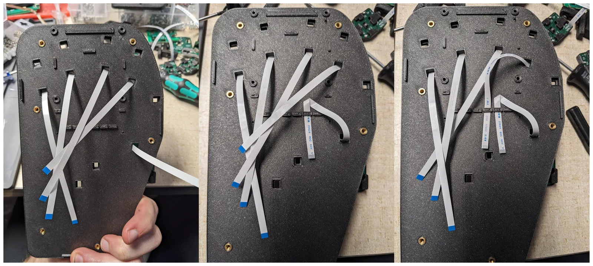

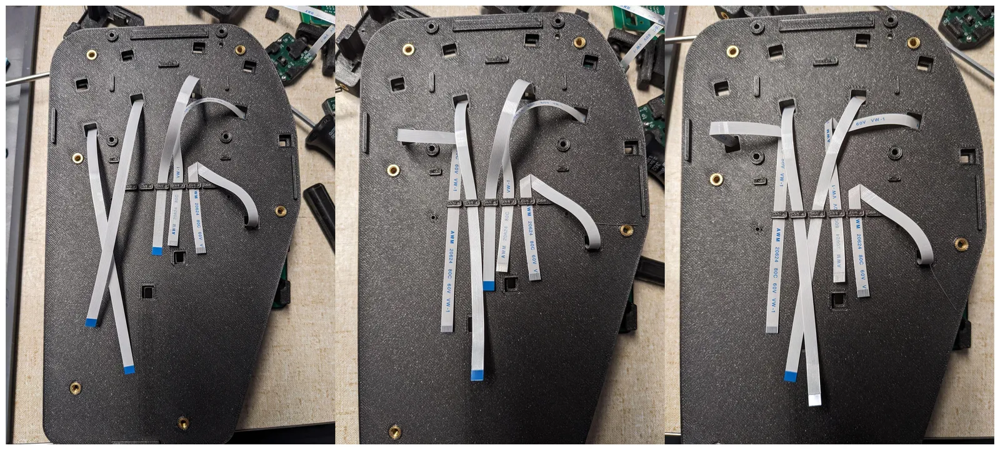

### Left half

On the left half, the thumb FFC has to cross all the way to the opposite side.

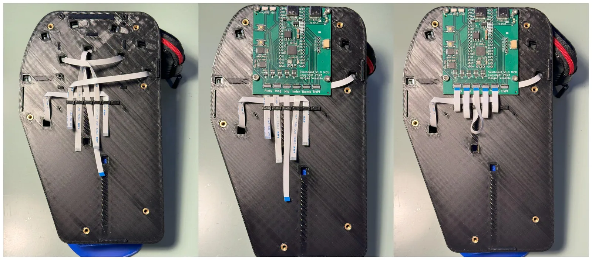

## Step 12: Install MCUs

Screw the MCU (the main PCBA) to the base plate with four M3 6 mm thread-cutting screws. Then connect each FFC to its connector.

<CadFigure name="cad-mcu-screws" alt="The underside of a right base plate. Rings mark the four MCU screw bosses, with an M3 x 6 mm thread-cutting screw (orange) lined up over each." caption="Four screws hold each MCU." />

- {/* PHOTO: replace with a current build: MCU installed, black FFCs latched, trackball or TrackPoint cable connected (shot list: mcu-install). */}

The black latches on the connectors flip up to open and down to close.
- Every FFC connects to the MCU with the blue stiffener **up** and the metal contacts **down**: unlatch, insert, latch.
- On the TrackPoint PCBA end, the FFC connects with the metal contacts **up** and the blue stiffener down.

{/* VERIFY: "four" per MCU comes from the base plate model, which has 4 MCU screw bosses; that matches the kit's 9 (8 plus 1 spare). */}

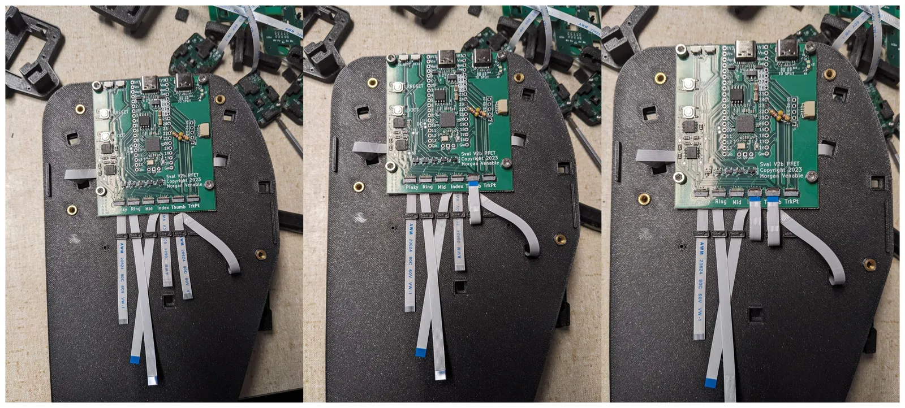

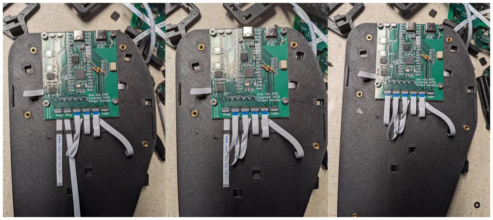

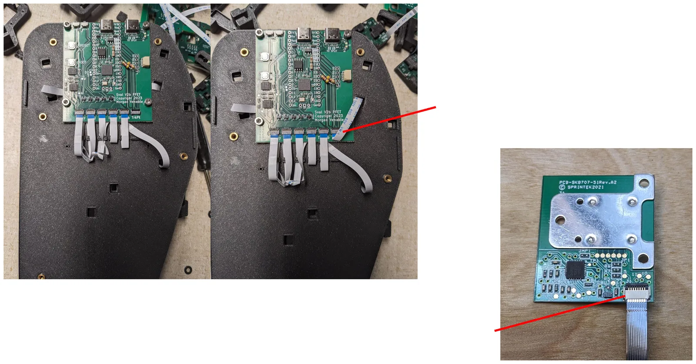

## Step 13: Attach palm rest carriers

If you're building the [sawed-off case](/build/#sawed-off-case), skip this step and Step 14.

The carrier holds the palm rest. Its cup takes the ball on the underside of the rest, and its two curved slots let it slide and turn on the base plate.

<CadFigure name="cad-hemi-exploded" alt="The parts of a hemispherical palm rest, pulled apart from top to bottom: the M5 flat head screw (orange), the hemispherical top washer, the palm rest with the ball on its underside, the carrier with its cup, and the M5 square nut (orange)." />

This step mounts the carrier and its nut, the bottom of the stack. Step 14 adds the palm rest, washer and screw on top.

1. Push an M5 square nut into the pocket on the underside of the carrier. It holds the palm rest's center screw in Step 14.
2. Insert **two** square nuts into the palm rest slot in the base plate.
3. Place the carrier on the base plate, with its slots toward the finger clusters.
4. Put an M3x6 mm screw through each slot in the carrier and into a nut.
5. Tighten gently. It takes very little to hold the carrier. You set its final position in [Step 18](/build/#step-18-adjust-the-fit).

<CadFigure name="cad-carrier-mount" alt="A hemispherical palm rest carrier lifted above a cut-away corner of the base plate. Two M3 screws (orange) line up over the carrier's two curved slots and down to two M3 square nuts (orange) in the base plate's palm rest slot. An M5 square nut (blue) sits under the carrier, with an arrow up into its pocket." caption="Push the M5 nut into the carrier's pocket, then screw the carrier to the two nuts in the palm rest slot, slots toward the clusters." />

{/* VERIFY: are the carrier screws still M3x6 mm socket head screws into the two square nuts in the base plate slot, as for the tripod carrier? The close-up carrier photo (palm-rest-hemisphere-carrier.webp, no longer on the page) shows button heads. Is it right that the carrier goes on with its slots toward the finger clusters, so the screws sit under the window in the palm rest? */}

### Older builds: tripod carrier

The tripod carrier (also called the sled) mounts the same way, with two M3x6 mm screws through its straight slots into two square nuts. Washers are no longer needed, but you can use them for smoother sliding.

<CadFigure name="cad-tripod-carrier" alt="A tripod carrier (sled) on the base plate, with one M3 x 6 mm screw (orange) in each of its two straight slots." />

## Step 14: Attach palm rests

The palm rest has a ball on its underside that sits in the cup of the carrier. One M5 flat head screw through the center holds it, so the rest can tilt in pitch and roll. The parts stack up as shown in the figure in [Step 13](/build/#step-13-attach-palm-rest-carriers).

1. Put the M5x16 mm flat head screw through the top washer, from the flat side.
2. Set the washer, round side down, in the recess in the top of the palm rest.
3. Set the palm rest on its carrier, with the ball in the cup and the window over the carrier slots.
4. Tighten the screw into the nut under the carrier with the 3 mm hex key. Leave it just loose enough to tilt the rest for now. You set the angle in [Step 18](/build/#step-18-adjust-the-fit).

<CadFigure name="cad-hemi-section" alt="Cut-away side view of an assembled hemispherical palm rest. The M5 flat head screw passes through the top washer and the palm rest's ball, which sits in the carrier's cup, into the M5 square nut in the carrier." caption="The assembled stack, cut through the center screw." />

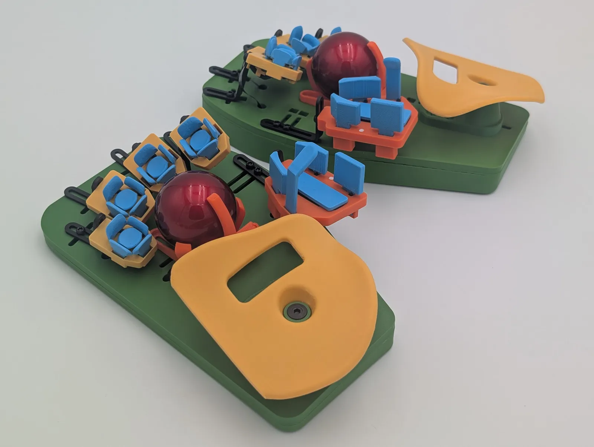

The rests ship on 9 mm carriers. For a higher or lower rest, print a carrier from 1 mm to 15 mm tall from the parts repository.

<CadFigure name="cad-carrier-heights" alt="Three hemispherical palm rest carriers side by side, from the side: 1 mm, 9 mm (the one that ships, in orange) and 15 mm tall." caption="Carriers come in heights from 1 mm to 15 mm; 9 mm ships." />

For a softer rest, add [Squishy Palmrests](https://svalboard.com/products/squishy-palmrests). Adhesive memory foam (1/4 inch) or adhesive-backed leather also work as padding. Foam is less durable.

<CadFigure name="cad-squishy-pad" alt="A Squishy Palmrest pad, a soft pad with a honeycomb grid on top, held above a hemispherical palm rest on its carrier, with an arrow pointing down onto the top of the palm rest." caption="The pad goes on the top of the palm rest." />

{/* VERIFY: the repository readme says the 12 mm carrier matches the tripod rest's default height, and suggests 9 mm or shorter without palm rest covers. Should the page recommend a carrier height for Squishy Palmrests or other padding? */}

### Older builds: tripod palm rests

The tripod palm rest drops into its sled on three legs. M2 x 4 mm T6 thread-cutting set screws clamp it at the sides. Don't overtighten these screws.

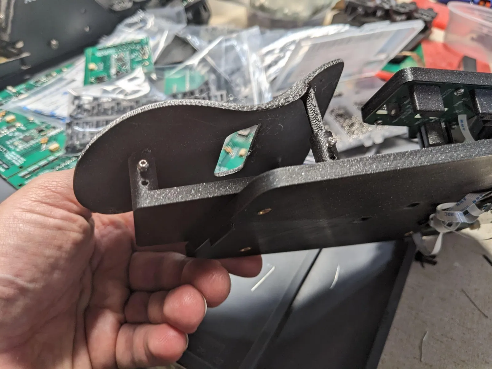

You can shim a tripod rest to any height. The holes line up for 0 mm and 5 mm of lift with the default 5 mm shims. If you plan to add padding on top, you'll probably want the low position. The fixing screws are the 4 mm M2 thread-cutting screws, the same as for the PCBAs.

<CadFigure name="cad-tripod-shims" alt="Exploded view of a tripod palm rest: the rest at the top, a 5 mm shim (orange) under each of its three legs, the sled with its three leg sockets, and an M2 x 4 mm screw (blue) beside each socket." caption="With the 5 mm shims in, the legs sit 5 mm higher and the M2 screws go in the upper holes." />

## Step 15: Flash firmware and connect

Your MCUs ship with **no firmware**, and they aren't set to left or right. Flash both.

### Pick your firmware

Svalboard runs **Svalboard QMK**, configured with **Keybard**.

1. Go to the latest release: https://github.com/svalboard/qmk/releases/latest
2. Download one `sval` `.uf2` file for each half. Pick by side, and by the pointing device on that half (none, trackball, TrackPoint or touchpad). The full list of files is in [Firmware files](/firmware/#firmware-files).

- Use the newest release, and the same release on both halves.
- The `blank` files have no keys assigned. Use them only for the cluster test in [Step 7](/build/#test-the-clusters-recommended).
- Flashing the wrong image does no harm. Flash the right one and try again.

### Flash each half

Do this once for each half.

1. Connect the half to your computer with a USB-C cable in the port marked **U**.
2. Double-tap the **reset** button on the bottom of the half.
3. A drive named **RPI-RP2** appears.
4. Copy that half's `.uf2` file onto the drive.
5. The half restarts by itself and the drive disappears. That half is done.

Flashing resets the layout to the default. Later, export a `.svil` from Keybard before you flash, and import it afterward. More detail: [Flashing firmware](/firmware/#flashing-firmware).

#### Staying on Vial

Svalboard's Vial firmware also works with the board. To use it, flash the `v2025-11-01` files from https://github.com/svalboard/vial-qmk/releases and configure the board with Vial (https://vial.rocks). The rest of this guide uses Keybard.

### Connect the cables

- Use the two USB-C cables from the kit.
- **Split cable:** the shorter cable joins the two ports marked **S** (or ↔).
- **Computer cable:** the longer cable goes from the port marked **U** on one half to your computer. That half is the main half.
- If you have a TrackPoint, the TrackPoint half must be the main half.
- Otherwise, make the half with your main pointing device the main half. The main half performs better.
- You can connect or disconnect the split cable while the board is plugged in.

### Connect Keybard

1. Open https://keybard.svalboard.com in Chrome or Edge on a desktop computer.
2. Choose **Connect Keyboard**, then pick your Svalboard in the browser's list.
3. Your layout loads. You can now edit it. Changes apply right away, with no flashing.
4. Keybard backs up each board automatically. After you change your layout, also choose **Export Layout** and keep the `.svil` file somewhere safe.

See [Keybard](/keybard/) for more.

#### On Linux

Linux won't let the browser open the board until you add a udev rule. See [Linux: the udev rule](/firmware/#linux-the-udev-rule).

## Step 16: Test all keys

Do this before you screw on the back cover.

1. Open [Keybard](/keybard/) and connect ([Step 15](/build/#connect-keybard)).
2. In the editor toolbar, choose **Matrix Tester**.
3. Press each finger key in every direction, and each thumb key. Hold each press for a moment.
4. Check that every key activates, and that the key that lights up is the one you pressed.
5. Use **Clear Matrix** to start over. This doesn't change your layout.
6. Choose **Exit Matrix Tester** when you're done.

If you have a pointing device, move it and check that the pointer moves.

{/* VERIFY: the live guide's photo for this step is a Vial Matrix Tester screenshot. A Keybard Matrix Tester screenshot is needed here. */}

### If a key doesn't register

- Check that the key moves freely.
- Check that its flag is intact and opaque. Light filaments need silver marker ([Step 5](/build/#step-5-ink-the-key-flags)).
- Check that the PCBA sits flat in the cluster, including the bottom-left corner ([Step 7](/build/#step-7-install-pcbas-and-test)).
- Check that the FFC is fully inserted and latched at both ends, contacts down.
- If the Matrix Tester shows the key but typing is wrong, the switch is fine. Check that key's layer and binding.

### On Vial

On Svalboard's Vial firmware, use Vial's **Matrix Tester** tab instead.

## Step 17: Install back cover and feet

When every key works ([Step 16](/build/#step-16-test-all-keys)):

1. Screw on the back cover with 7 M3 6 mm screws per side.
2. Add 4 rubber feet per side, in the holes closest to the four corners.
3. Trim the feet on the thin side of the case, so they don't press against the base plate and deform it. Leave enough material that they stay in place.

<CadFigure name="cad-back-cover-screws" alt="A half turned upside down and pulled apart: the back cover lifted off the base plate, with seven M3 x 6 mm screws (orange) lined up over its screw holes." caption="Seven M3 x 6 mm screws hold the back cover to the base plate." />

If the board rocks, shave the bottoms of the feet with a craft knife. The silicone is very soft and easy to trim. You can also work on reducing warping in your prints.

### Feet sizes

- Recent cases have 4.8 mm holes for the larger rubber feet.
- Case version 1.2.6 and later also fit the small plug feet: 6 mm across, about 3 mm long, in soft 70A silicone. They lower the stack by more than a millimeter. On an older case, drill 3 mm holes to fit them.

<CadFigure name="cad-back-cover-feet" alt="The bottom of a right back case. Rubber feet (orange) sit in the four 4.8 mm holes closest to the corners, and a line points to one of the seven case screw counterbores." />

{/* VERIFY: the current case has six 4.8 mm feet holes and no 3 mm holes for the small plug feet. Which cases fit the small plug feet? */}

## Step 18: Adjust the fit

Adjust each part of the Svalboard to fit your hands. You'll keep making small adjustments over the first days or weeks of use. This is normal. Shaping the palm rests can also make typing much more comfortable.

**Don't overtighten.** The screws go into metal nuts, but there's plastic between them. Too much force can crack or break it.

### Palm rest

The carrier slides in X and Y on the base plate. Keep it square to the plate, slots running north–south. The palm rest itself turns on the carrier for yaw and tilts for pitch and roll.

	<CadFigure name="cad-palm-motion-1-slide" alt="A palm rest carrier on the base plate, with its two screws. Arrows show it sliding along the slot (Y) and across it (X)." caption="Loosen the two carrier screws to slide the carrier. Keep it square to the base plate." />
	<CadFigure name="cad-palm-motion-2-tilt" alt="A hemispherical palm rest on its carrier. Arrows show it turning on the carrier (Yaw), tilting front to back (Pitch) and side to side (Roll). Lines point to the center screw and to the carrier screws, seen through the window in the rest." caption="Loosen the center screw to turn the rest (yaw) and tilt it (pitch and roll)." />

1. Reach the two carrier screws through the window in the palm rest, and loosen them slightly.
2. With a relaxed hand, your fingers should rest comfortably on the center keys. Slide the carrier to get a good starting position, keeping it square to the base plate. You can always tweak it later.
3. The base knuckles of each hand usually rest just in front of the front edge of the palm rest.
4. Tighten both carrier screws gently snug to fix the position.
5. To set yaw, pitch and roll, loosen the large center screw slightly with the 3 mm hex key. Turn the rest to the angle your hand wants, tilt it until your palm lies flat on it, then tighten the center screw firmly.

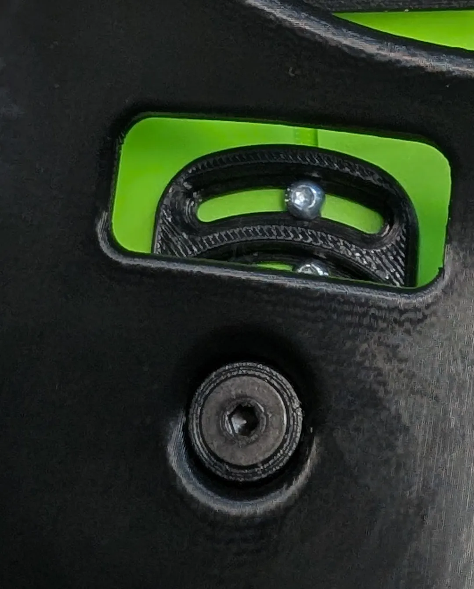

{/* VERIFY: which driver fits the carrier screws through the window: the T10 driver, or a hex key? */}

#### Older builds: tripod palm rests

Loosen both carrier screws slightly, slide and turn the carrier as above, then tighten the screws gently snug. To change the height, add or remove shims under the legs ([Step 14](/build/#step-14-attach-palm-rests)).

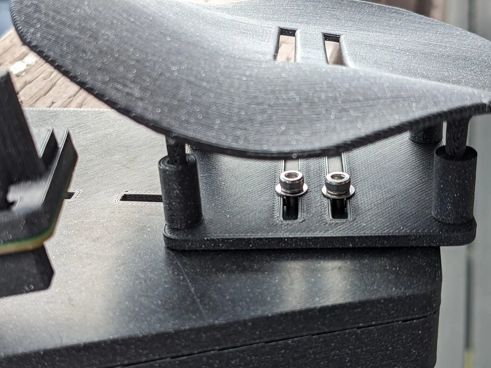

### Finger clusters

Each cluster moves in X, Y and yaw.

1. Loosen the tower base screw (M3 x 6 mm pan head, T10) slightly with the T10 driver.
2. Tighten it gently to test and fine-tune.
3. After you set the palm rest, adjust how far forward or back each cluster sits, so each finger feels equally relaxed. Fingers should rest only on the center keys, and on the South keys if you prefer.
4. Tighten snug, without overdoing it, to fix the position.

To move one finger farther away than its slot allows, move the other fingers closer instead, and move the palm rest farther from the clusters to make room.

<CadFigure name="cad-fit-cluster-xy" alt="An index tower (orange) and finger cluster on a corner of the base plate. A line points to the tower base screw; arrows show the cluster moving along the tower foot (Y), along the plate slot (X), and turning (Yaw)." />

### Height and roll

1. Loosen the cluster height screws (M3 x 6 mm pan head, T10) slightly with the T10 driver. The washer may bind a little. Don't unscrew too far. Wiggle it gently, or lift the edge of the washer to break it free of the plastic.
2. **Roll:** set it so each finger presses the East and West keys equally easily. If you have to favor one side, make the inboard key slightly higher, so it's easier to press: West on the right hand, East on the left hand.
3. **Height:** set it so each finger rests with the same light pressure on its center key, without touching any other key.

{/* VERIFY: the live guide warns that clusters set all the way down can hit the base plate and block the "center key slider mechanism" (it needs 1.5 mm of clearance). Does this also apply to the tipping center keys? Left off the page until confirmed. */}

<CadFigure name="cad-fit-height-roll" alt="A finger cluster on its tower, seen from behind the tower. A line points to the cluster height screw; arrows show the cluster sliding up and down the tower (Z) and turning on the screw (Roll)." />

### Palm rest shaping (PLA only)

Watch the [palm rest shaping video](https://www.youtube.com/watch?v=feAgCKpLzhQ).

- Only shape the palm rest while it's attached to the carrier. On a tripod rest, this keeps the legs in the right places.
- Dip the area you want to shape in water at about 90 °C. Swish it gently for 5 to 10 seconds until it's pliable.
- Quickly shake off the hot water and form it to your hand. It cools and hardens quickly.
- Work a little at a time. Don't rush, and don't force a bend, or the layers may split.
- Keep a bowl of cool water nearby. If the plastic gets too soft, dip it to set the shape quickly.

{/* VERIFY: is hot-water shaping supported on PLA hemispherical rests? Should they stay on the carrier while shaping, so the ball and the screw recess keep their shape? */}

## Step 19: Enjoy!

- Your Svalboard starts with the default QWERTY layout.
- To change keys, layers, macros, combos or tap dances, use [Keybard](/keybard/): https://keybard.svalboard.com
- For other letter layouts and number layers, open Keybard's **Layouts** panel and drag a layer onto yours. It has Dvorak, Colemak, the Hands Down variants (HD Promethium, HD Neu), Graphite, and NavNAS number layers.
- Read the [Svalboard Manual](https://svalboard.com/manual) to get the most from your Svalboard.
- Questions? Ask on the [Svalboard Discord](https://www.svalboard.com/discord), or email support@svalboard.com.

### Thumb cluster layer lights

Thumb clusters in kits shipped after May 2024 have an RGB layer light. It shows the active layer. The default colors are:

- Green: layer 0 (base)
- Orange: layer 1 (NavNAS)
- Azure: layer 2 (Function)
- Magenta: layer 15 (mouse layer)

You can change each layer's color in Keybard. On Svalboard's Vial firmware, colors are set in the firmware source.

If you print the thumb cluster in a dark color, turn the brightness up, or print the diffuser in white. The diffuser is a separate part in the STEP file.

### Brightness

- Set the brightness in Keybard: click the color dot beside the layer name, then the gear button (**Custom layer color**). Select **LED color** and drag **Brightness**. Choose **Apply**. It applies to every layer.
- Or add **Bright +** and **Bright -** to keys (Keybard's **Special Keys** panel, **Backlight and RGB Keys**), then press them on the board.
- **RGB Toggle** turns the layer lights on and off.

<CadFigure name="cad-led-brightness" alt="The same right thumb cluster with its keys, shown twice side by side. On the left, labeled Dim, the layer light window between the Nail and Knuckle keys glows faint green. On the right, labeled Bright, the window glows bright green and lights up the cluster around it." caption="Before and after turning up the brightness." />
