import facts from '../../../data/facts.json';
export const stable = facts.firmware.stable;
export const blank = (side) => stable.assets.find((a) => a.startsWith(`svalboard_${side}_blank_`) && a.endsWith('.uf2'));
export const blankUrl = (side) => `https://github.com/svalboard/qmk/releases/download/${stable.tag}/${blank(side)}`;

This guide covers building a Svalboard from a self-print kit. It also helps with repairs and part swaps on a finished board.

Help us improve it: send comments on the [Svalboard Discord](https://www.svalboard.com/discord).

- Before you print, pick your key size. See [Sizing before you build](/build/#sizing-before-you-build).
- To configure your Svalboard after the build, use [Keybard](/keybard/) in Chrome or Edge: https://keybard.svalboard.com

## Video build guide

[@beepbuildsathing](https://youtube.com/@beepbuildsathing) made a video build guide to go with this one: [watch it on YouTube](https://youtu.be/fa_BZ1AKQVk).

Some of the video is out of date, and it doesn't cover steps added since it was made. Where the video and this guide differ, follow this guide.

## What's in the kit

This is the standard packing list for Lightly FDM V2.0. It can vary a little between kit versions. We pack by weight and include a spare or two of most hardware. You can buy more of the small hardware on Amazon or AliExpress.

| Part | Minimum count |
|---|---|
| N35 magnets | about 200 (100, plus 100 spare) |
| M3x4 heat set inserts | 14 (12, plus 2 spare) |
| M5x5.7 heat set inserts | 4 |
| 1/4-20 heat set inserts | 2 |
| Cluster PCBAs | 10 (2 spare) |
| Thumb PCBAs | 2 |
| Main PCBAs (MCUs) | 2 |
| 150 mm FFCs (flat flexible cables) | 12 (10, plus 2 spare) |
| M2 thread-cutting screws, for PCBAs (and the set screws of older tripod palm rests) | 46 (44, plus 2 spare) |
| M3 6 mm screws, for cases and clusters | 40 (32, plus 8 spare) |
| M3 square nuts | 32 (24, plus 8 spare) |
| M3 6 mm thread-cutting screws, for the main PCB | 9 (8, plus 1 spare) |
| M5 16 mm flat head screws, for the palm rests | 2 |
| M5 thin square nuts, for the palm rests | 2 |
| Stainless steel towers for clusters | set of 10 |
| Rubber feet (FC-036-DCW-PT) | 9 (4 per side) |
| T10 Torx driver | 1 |
| T6 Torx bit | 1 |
| 3 mm hex key, for the palm rest center screws | 1 |
| USB-C to USB-C cables | 2 |
| TrackPoint PCBA | optional |
| Trackball PCBA | optional |

{/* VERIFY: the M5 screw, M5 nut and 3 mm hex key rows are new, from the hemispherical palm rest readme and the Fit page. Does the kit include them, and in what counts (any spares)? Does the M2 count of 44 still include tripod set screws, or should it drop? */}

{/* VERIFY: the kit list says 14 M3x4 inserts (12 plus 2 spare), but Step 8 installs 7 in each base plate, which is 14 with no spare. Which count is right? */}

The kit has twice the magnets you need, so you can build simple magnet fixtures. They make assembly much more reliable and tidy (Step 2).

{/* VERIFY: the packing list on the live guide (slide 4) has no touchpad row, but the store sells a "+2x Touchpad PCBAs" option. Add "Touchpad PCBAs, optional"? Any other changes for current kits? */}

### Trackballs and static bearings

Kits don't include a trackball or the static bearing balls. Buy them separately.

{/* VERIFY: the live guide says "as of 1/6/2026" kits don't include the trackball or bearings. Is that still true? */}

- **Static bearings:** 3.175 mm ceramic (ZrO2) balls. We recommend [G5 grade on Amazon](https://www.amazon.com/uxcell-Ceramic-Bearing-Zirconium-Precision/dp/B081SNH8J5). Some older holder designs use 3 mm balls ([G5 on Amazon](https://www.amazon.com/uxcell-Ceramic-Bearing-Zirconium-Precision/dp/B081SPLWT5)).
- **Trackballs:**
  - Svalboard Bright Silver, 44 mm: in the [Trackball Upgrade Kit](https://svalboard.com/products/trackball-upgrade-kit), option "Complete with Bright Silver ball - 44mm".
  - [SANWA 44 mm red trackball](https://www.amazon.com/SANWA-Trackball-Replacement-Kensington-Compatible/dp/B0BQV1X86B)

**Trackball size:** 44 mm is the default and suits any user. Larger balls need big hands: at least 190 mm, and more likely 200 mm, from wrist to the tip of the middle finger, with a fairly arched fit. A bigger ball affects fit, so start from 44 mm. An average man can probably use a 50 mm ball. Example of a larger ball: [SANWA 55 mm](https://www.amazon.com/SANWA-Trackball-Replacement-Kensington-Compatible/dp/B0DF7S4YJK).

### Handle the PCBAs safely

Static can damage the PCBAs.

- Every PCBA is tested and packed in static-dissipative bags or wrap. The exception is the finger cluster PCBAs. They aren't fully tested, so the kit includes two spares. Test them before final assembly ([Step 7](/build/#step-7-install-pcbas-and-test)).
- About 97.5% of finger cluster PCBAs work. The odds of three bad ones are about 1 in 1,000. If that happens, contact support@svalboard.com for a replacement.
- Use ESD-safe handling: a properly grounded ESD mat and a wrist strap. We can't take responsibility for PCBAs damaged during assembly.
- Take extra care in dry climates or on carpet.

## Tools you need

**Required:**

- A Prusa MK3S or better 3D printer with a 0.4 mm nozzle, or access to one (for example, at a library or makerspace).
- At least one full spool of filament. Black PLA is the basic choice. Any filament that isn't opaque to infrared light at 940 nm needs [silver Sharpie](https://www.amazon.com/Sharpie-39108PP-Metallic-Permanent-Blister/dp/B00009RAX4) on the key flags ([Step 5](/build/#step-5-ink-the-key-flags)). Only Sharpie-brand silver works reliably. Sharpie gold, bronze and copper are less reliable.
- [Medium CA glue, with fine applicator tips](https://a.co/d/0MWOtlK).
- Adjustable parallel pliers. We recommend the [Knipex Pliers Wrench, 180 mm](https://www.amazon.com/dp/B081K8WFTF).
- A small flat-blade screwdriver, about 4 mm wide and 1 mm thick.
- A heat set insert kit or a soldering iron, for example [this one](https://amzn.to/3TOY4MW).
- 3D printing experience. This is an advanced build. Depending on your filament and your printer, you may need to tune your slicer settings to get working parts.

**Recommended:**

- Diamond files for cleanup (200 and 400 grit).
- A #2 X-Acto knife.

## The steps

1. [Print all parts and clean them up](/build/#step-1-print-all-parts)
2. [Organize magnets for assembly](/build/#step-2-organize-magnets)
3. [Install magnets in keys and clusters](/build/#step-3-install-magnets)
4. [Insert keys into clusters](/build/#step-4-insert-keys)
5. [Apply paint or ink to key flags as needed](/build/#step-5-ink-the-key-flags)
6. [Attach FFCs to PCBAs](/build/#step-6-attach-ffcs)
7. [Install PCBAs in clusters, then test them (recommended)](/build/#step-7-install-pcbas-and-test)
8. [Install inserts and nuts in base and cover](/build/#step-8-install-inserts-and-nuts)
9. [Attach towers to clusters](/build/#step-9-attach-towers-to-clusters)
10. [Install towers on baseplates and clusters on towers](/build/#step-10-install-towers-on-baseplates), then the pointing devices: [10a TrackPoint, 10b trackball, 10c touchpad](/build/#steps-10a-to-10c-pointing-devices)
11. [Route cables through baseplates](/build/#step-11-route-cables)
12. [Install MCUs on baseplates and connect cables](/build/#step-12-install-mcus)
13. [Attach palm rest carriers to baseplates](/build/#step-13-attach-palm-rest-carriers)
14. [Attach palm rests to carriers](/build/#step-14-attach-palm-rests)
15. [Flash firmware and connect the cables](/build/#step-15-flash-firmware-and-connect)
16. [Test all keys in Keybard](/build/#step-16-test-all-keys)
17. [Install back cover and rubber feet](/build/#step-17-install-back-cover-and-feet)
18. [Adjust fit for both hands](/build/#step-18-adjust-the-fit)
19. [Enjoy!](/build/#step-19-enjoy)

## Sizing before you build

Print your keys to fit your fingertips. Measure first, then print ([Step 1](/build/#step-1-print-all-parts)).

### Choose your key width

Svalboard is most comfortable with the keys as close to your fingers as possible, without being so close that you press keys by accident.

1. Print the fingertip sizer at 100%, with no scaling: [svalboard.com/sizer](http://svalboard.com/sizer).
2. Place each fingertip in the crescents. Find the smallest crescent where your fingertip width at the bottom line is the same as the line, or slightly smaller.
3. Write down the width for each finger in the table on the sizer.
4. Pick the key size that fits your **largest** fingertip.

The sizer measures fingertip width 6 mm from the tip. That is the depth of a finger cluster, from the center key surface to the edge of the side keys.

### Key sizes

There are four side key sizes. In order of increasing fingertip space:

| Size | Spacing |
|---|---|
| Thick | 16 mm |
| Semi | 17 mm |
| Thin | 18 mm |
| Backset | 20 mm |

- People with thin or pointed fingertips may prefer the thicker keys.
- People with blunt or wide fingertips may need the Backset keys for enough room to type comfortably.
- North keys come in Thick only.

The spacing is the minimum distance between the keys, measured at the top of the center key.

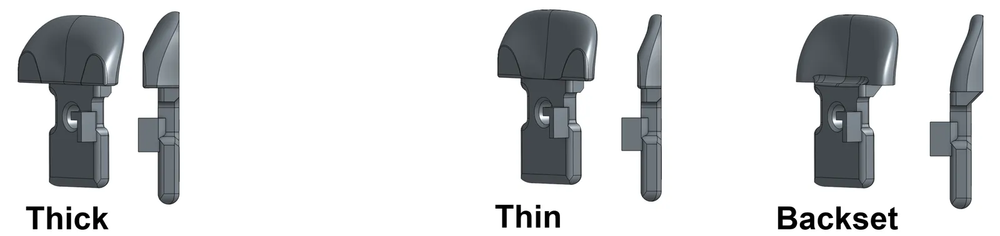

{/* VERIFY: the live build guide (slide 15) also lists a "-2mm" side key, "only for huge fingers on narrow cluster PCBAs (not standard)". Should it be listed here? */}

### Example

Svalboard's creator has slightly wide ring fingertips and uses the Thick keys without a problem. The Thin keys work for him too.

### Other hand measurements

Only fingertip width calls for different parts. Every Svalboard has plenty of adjustment range for the rest. Hand size can help you pick a trackball size:

- **Hand length**, wrist to the tip of the middle finger: under 170 mm is extra small, 170 mm small, 180 mm medium, 190 mm large, over 195 mm extra large.
- **Palm width** at the knuckles: under 75 mm is small, 75 to 85 mm medium, over 85 mm large.

44 mm is the default trackball size. A 55 mm ball only fits very large hands. See [Trackballs and static bearings](/build/#trackballs-and-static-bearings).

{/* VERIFY: the old fitment guide says unusual finger length differences may need longer cluster towers (98% of people fit the standard lengths), and about 10% of people may need wider keys. Should either line go on this page? */}

## Step 1: Print all parts

### Get the files

The parts are in the [svalboard-self-print repository](https://github.com/svalboard/svalboard-self-print/). If you don't have access yet, ask @claussen on the [Svalboard Discord](https://www.svalboard.com/discord).

### Which version to print

- In general, use the latest version.
- V2.0 greatly improves the key mechanism tolerances. Use it unless you're building to match older printed parts.
- Keys and clusters **must** come from the same major version, or they won't fit together.
- Many other parts didn't change from V1.3 to V2.0 and were carried forward as they are.
- The repository may hold prototypes or parts that aren't in your kit. If you're unsure whether a part fits, ask in #supporters on Discord.

### What to print

Pick your side key size first. See [Sizing before you build](/build/#sizing-before-you-build).

**Finger keys**

- 8 North keys: 11 mm tall, Thick (16 mm), medium force (0.7 mm offset).
- 24 East, South and West side keys: 6 mm tall, in your size: Thick (16 mm), Semi (17 mm), Thin (18 mm) or Backset (20 mm). Medium force (0.7 mm offset).
- 8 tipping center keys: 0.9 mm offset is a good starting point.

**Thumb keys**

- 2 Pad, 2 Knuckle, 2 Down, Nail Left, Nail Right, and 2 Up (Mode) keys.

**Clusters**

- 8 finger clusters
- Thumb L and Thumb R

**Other parts**

- Palm rests: Hemi Palm L, Hemi Palm R, two 9 mm hemi carriers, and two hemi top washers. The files are in the Hemi Palms folder under Palmrests. Carriers from 1 mm to 15 mm tall are in its "Additional carrier variants and heights" folder.

  {/* VERIFY: the hemi palm files are in "Lightly FDM/V2.0/Palmrests/Experimental/Hemi Palms". Will they move out of Experimental now that they're the current design? Which carrier ships: "2N-Slots" (both slots on the window side) or "Split-Slots"? The page and the carrier render assume 2N-Slots. */}
- Base plates and cases: L Base, L Case, R Base, R Case.
- TrackPoint case, if you have a TrackPoint: top cover and bottom cover.
- Tools: mini 4x3 magnet stages (Key and Cluster), magnet dropper, mini key tray fixture.

### Print tuning

- Use a smooth or satin build plate. Fully textured plates make the parts look rough. This is only about looks. We recommend the Fabreeko HoneyBadger SemiSatin plate.
- Only the palm rests and the tipping center keys need supports.
- Start by getting the 6 mm side key perfect, then the finger and thumb clusters. If you can print those, the rest is easy.

### Keys

- PLA: 0.12 mm layer height, 0.18 mm first layer.
- ABS: the same settings work, but the filament must be very dry. ABS is finicky with overhangs if it's even a little damp.
- Exterior perimeters: 0.3 mm.
- You may need to paint seam blockers on the sides of the small flag on each key.

#### Key flags

The flag is the thin tab under each key that blocks the optical sensor.

- If flags form badly, place the seams at the top corner of the flag. Seams on the flag face can leave pinholes and heat artifacts that let light through.
- The flags must be about 0.8 mm thick or less for the parts to fit. With a 0.4 mm nozzle, set exterior perimeters ("outer wall" in Orca and Bambu Studio) to 0.3 mm.
- You may still need to clean up stringing. Slower printers and wet filament make stringing worse.
- If your filament isn't opaque to infrared light, coat the flags with opaque marker. Silver Sharpie works well ([Step 5](/build/#step-5-ink-the-key-flags)).

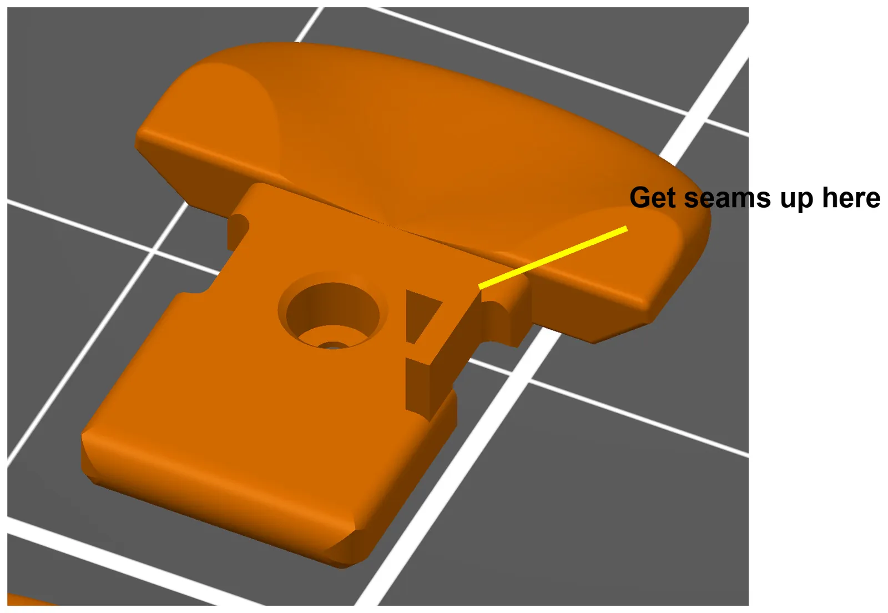

#### Key force

The offset sets how hard a key is to press. A larger offset gives a lighter key.

{/* VERIFY: slide 15 says "For lowest forces, use 0.8mm-1.0mm offset – this is about 10-15g", while slide 20 says the 0.9 mm tipping center key is about 20 g. Which keys does the 10-15 g figure apply to? It's left off the page until confirmed. */}

#### Tipping center keys

The tipping center key is the standard center key. The default strength is 0.9 mm offset, about 20 g. The STEP file has every offset from 0 to 1.2 mm (very light) if you want to experiment.

- Print at 0.2 mm layer height.
- Make the supports very dense: 0 or 0.1 mm base pattern spacing, and zero interface layer spacing (a very dense support interface).
- Dense supports come off as one block and leave a clean surface, so you have little or no cleanup inside the light hole.

### Clusters

- 0.2 mm layer height.
- Arachne on is recommended.
- The tipping center key clusters don't need supports.
- V2 and later: bridging angle 0 (automatic).
- V1.3 and earlier: bridging angle 180°, plus bridging modifiers at the angles shown below.
- If your printer can print two colors, print the small diffusers for the RGB layer lights in white.

#### Thumb Down key opening

The marked edge of the thumb cluster **must** be square. Elephant's foot here makes the thumb Down key bind. A bevel here can add play to the key and change how it feels.

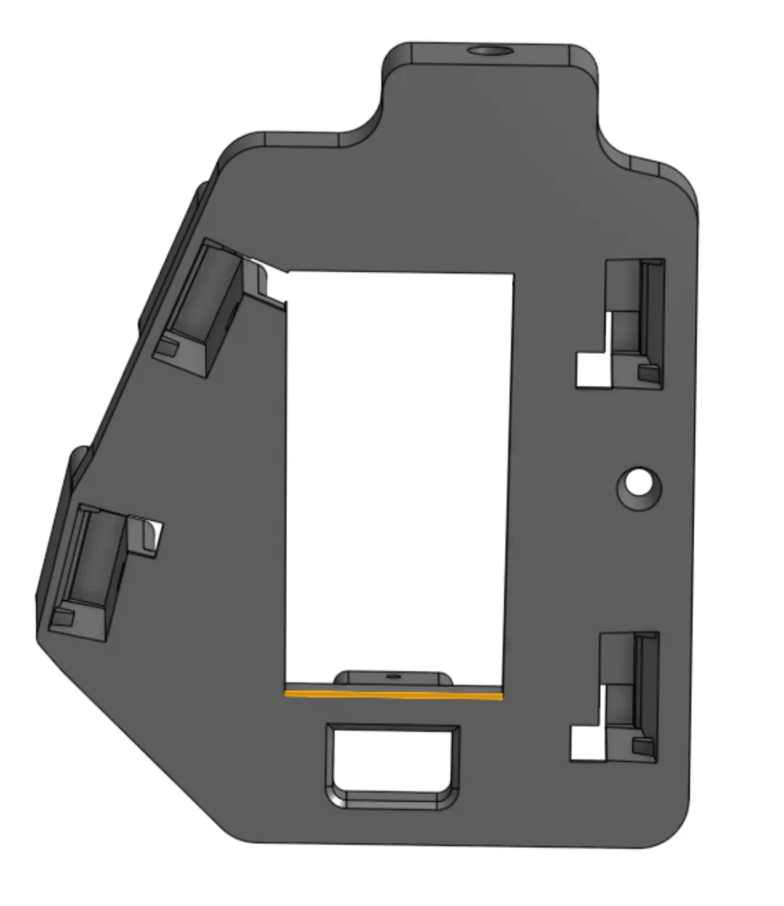

### Cases and base plates

- 0.2 mm layer height, 6 walls.
- Default bridging angle 180°.
- Bridging modifiers in the slot areas, as shown.
- Smooth side down.
- No supports.

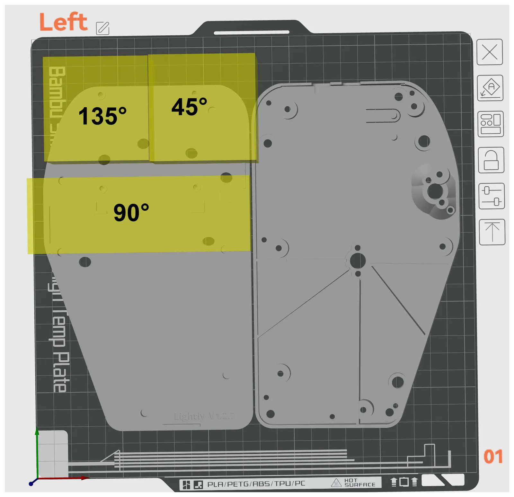

### Palm rests and carriers

- Print every palm rest part with 6 walls for strength.
- Stand each palm rest on its flat long edge, with tree supports (Auto, Default or Organic) and a brim of 5 mm or more. You may want to paint seam blockers on the visible surfaces.
- Print the carriers and the top washers flat side down. They don't need supports.

{/* PHOTO: slicer screenshot of one build plate with Hemi Palm L and R standing on their long edges with tree supports and brim, plus two 9 mm hemi carriers and two top washers lying flat side down. Same framing and plate as print-palm-rests.webp. */}

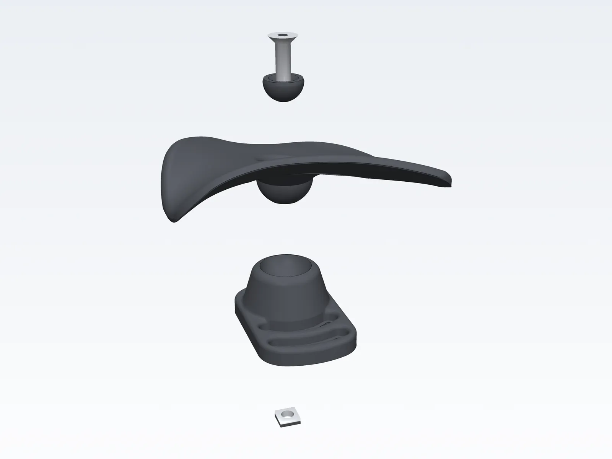

#### Older builds: tripod palm rests

Print the tripod palm rests the same way, standing on the long edge with tree supports and a brim. Print the carriers and shims without supports.

### TrackPoint case

- 0.2 mm layer height.
- Flat sides down.
- No supports.

### Deprecated parts

Don't print the center key sliders (gap sliders) or the printed towers. The tipping center keys and clusters replace the sliders, and the kit includes stainless steel towers.

## Step 2: Organize magnets

Organize the magnets by polarity before you glue them in. Every magnet must face the right way:

- **Keys:** the **south** pole faces out of the key.
- **Clusters:** the **north** pole faces out of the cluster.

If you don't have a reference to tell the poles apart, use a compass. Hold the magnet in your fingers or in something non-metal, so nothing else affects the reading.

There are several good ways to stage the magnets.

### Magnet stages

The magnet stages hold magnets in rows on their top surface, all with the same pole up.

1. Glue magnets into the back of the stage, all with the same polarity. This turns the stage into a magnetic base.
2. On the **Key** magnet stage, the working surface must hold magnets with the **south** pole up.
3. On the **Cluster** magnet stage, the working surface must hold magnets with the **north** pole up.
4. Drop as many magnets as you need onto the stage.
5. Pick them up one at a time with a small flat screwdriver, and press each into a key or cluster. They always come off the stage with the right pole out.

For a single build, print the compact 4x3 stages, or fill one row or column of the larger 8x8 stage.

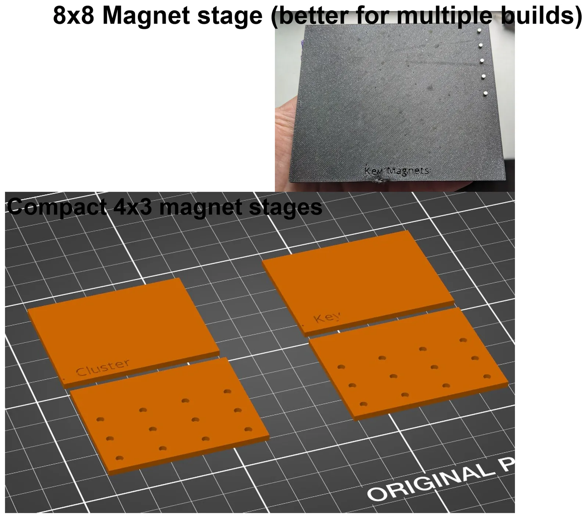

### Magnet dispenser

The magnet dispenser holds a stack of magnets and drops them one at a time onto a stage. Print it at 0.3 mm layer height with no supports.

### Alternative: a MagSafe phone

You can also stage magnet stacks on the MagSafe ring of an iPhone 12 or newer. This works even with a MagSafe case on.

- The stack farther from the center has the **south** pole up. Use it for keys.
- The stack closer to the center has the **north** pole up. Use it for clusters.

Reference: page 152 of Apple's *Accessory Design Guidelines for Apple Devices*.

To install a magnet, pick one up from the correct stack with a magnetic tool, put a drop of glue in the magnet hole, and insert the magnet.

## Step 3: Install magnets

Each finger cluster has 5 keys, so a finished cluster with its keys needs 10 magnets.

All magnets are 2.0 mm x 1.5 mm N35.

- **Clusters:** the **north** pole faces out.
- **Keys:** the **south** pole faces out, so it's the visible side.

### Install key magnets: dip method

1. Use the Key stage (south pole up).
2. Put magnets on the stage.
3. Put a small blob of CA glue on a surface. A strip of painter's tape works well.
4. Pick up a magnet with a thin flat-blade screwdriver.
5. Dip the magnet in the glue.
6. Press it into the hole in the key.
7. Squeeze the magnet flush with parallel pliers.
8. Let the glue cure before you use the key.

### Install key magnets: pre-applied glue method

1. Use the Key stage (south pole up).
2. Put magnets on the stage.
3. Put glue in the magnet holes of the keys.
4. Pick up a magnet with a thin flat-blade screwdriver.
5. Press it into the hole in the key.
6. Squeeze the magnet flush with parallel pliers.
7. Let the glue cure.

### Cluster magnets

Install the cluster magnets the same way, from the Cluster stage (north pole up). Red arrows mark each magnet hole.

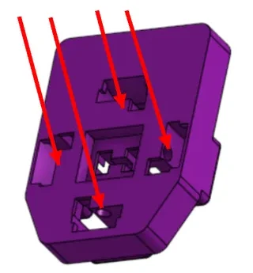

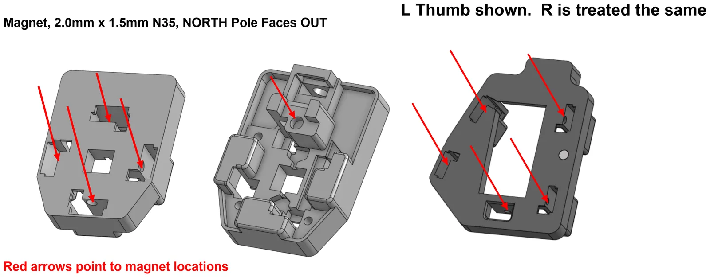

### Key magnets

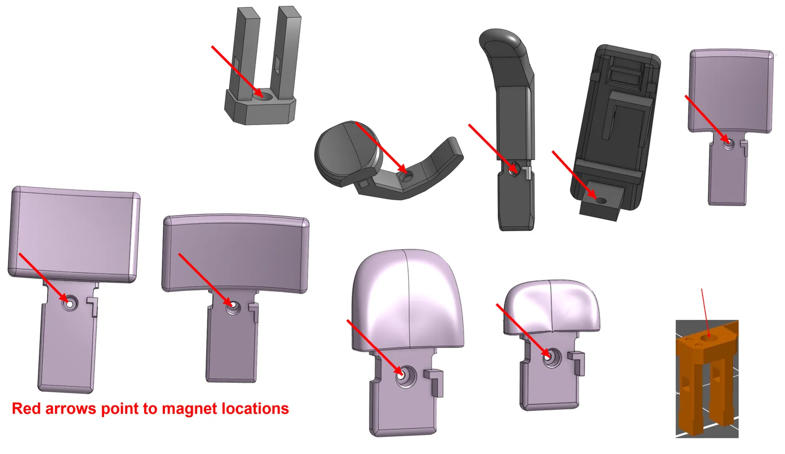

### Tipping center key

The tipping center key uses normal key polarity: the **south** pole faces out (up). Make sure the hole in the key is clear of stringing and stray filament.

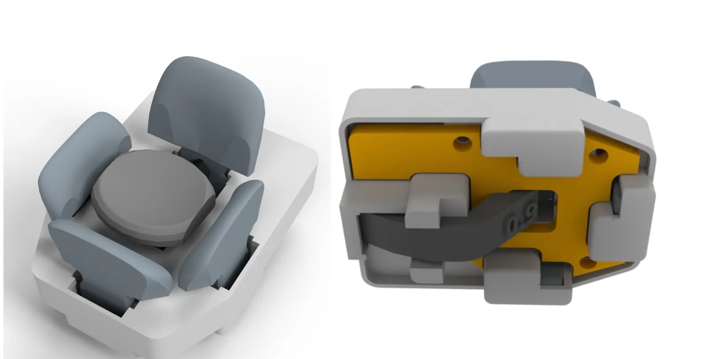

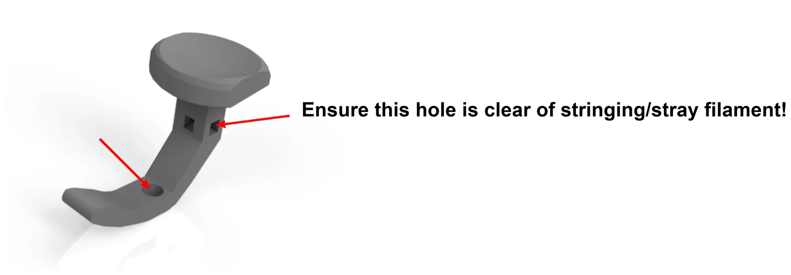

## Step 4: Insert keys

Every key should slide easily into place and snap to its magnet.

If a key doesn't slide in easily or doesn't move freely:

1. File a little material off the sides of the key.
2. If it still binds, file the bottom (the chamfered back of the key base).
3. Try the fit again.

This is how each key sits in its cluster:

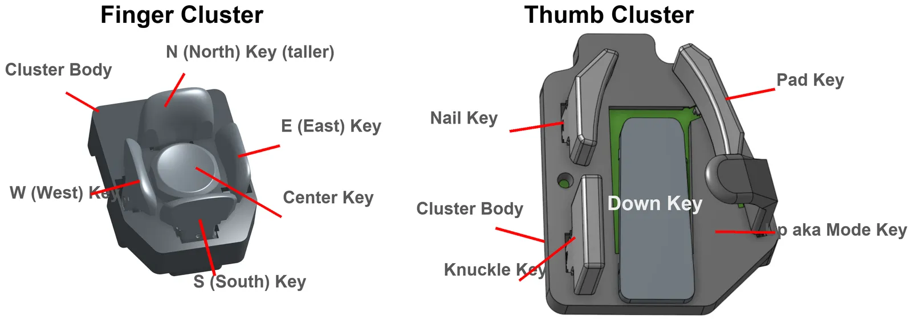

### Tipping center keys

1. Remove the North key.
2. Hook the base of the tipping center key through the hole on the North side of the cluster.
3. Let it snap into place.
4. Put the North key back.

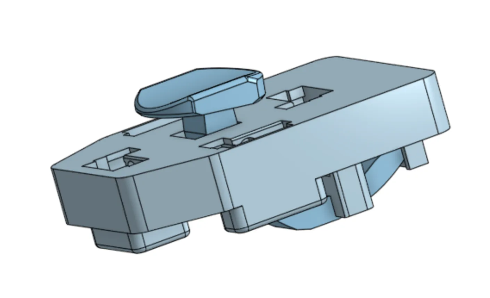

The tipping center key replaces the older slider-based center key. Slider parts are deprecated.

## Step 5: Ink the key flags

Each key has a flag that blocks an optical sensor when you press the key. If your filament isn't opaque to infrared light, the flags won't block the sensors properly. Paint or ink them to make them opaque.

- We recommend [silver metallic Sharpie](https://www.amazon.com/Sharpie-39108PP-Metallic-Permanent-Blister/dp/B00009RAX4).
- Only Sharpie-brand silver works reliably.
- Very light filaments may need several coats.

Black PLA usually doesn't need ink.

## Step 6: Attach FFCs

Every FFC connector has a small black latch. Flip the latch up, slide the cable all the way in, then flip the latch down to lock it. To remove a cable, flip the latch up and pull the cable straight out.

{/* VIDEO: a short clip of unlatch, insert, latch on one connector (shot list: ffc-latch-video). */}

### Attach FFCs to the PCBAs

At both ends of every FFC, the contacts face down and the blue stiffener faces up. The one exception is the TrackPoint PCBA, where the contacts face up ([Step 10a](/build/#10a-trackpoint)).

For the thumbs, use the 10-pin FFC if you have it; the RGB layer lights need it. On a thumb PCBA the latch sits on the side opposite the cable, so route the cable down through the slot after you close the latch.

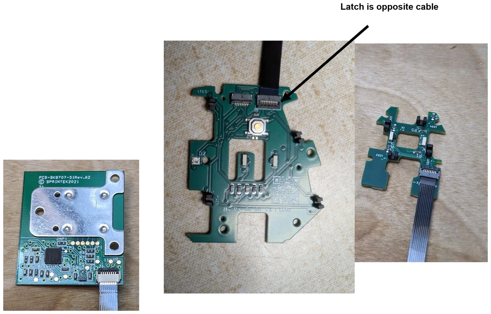

### FFCs on the MCU

You connect the other end of each FFC to the MCU in [Step 12](/build/#step-12-install-mcus), the same way. The MCU's 8-pin thumb connector is for older builds; use the 10-pin one.

## Step 7: Install PCBAs and test

### Install the PCBAs

- Line each PCBA up squarely with the cluster before you press it in. Installing it at an angle can damage the optical sensors.
- **Finger clusters:** use just the two screws shown. If one strips, use one of the other two holes.
- Make sure the bottom-left corner of the PCBA is fully seated in the cluster. If it isn't, the East or South key may not register.
- **Thumb clusters:** use 3 to 5 screws, as you prefer.
- You don't need to remove the finger center key to replace a PCBA.

Use the M2 thread-cutting screws.

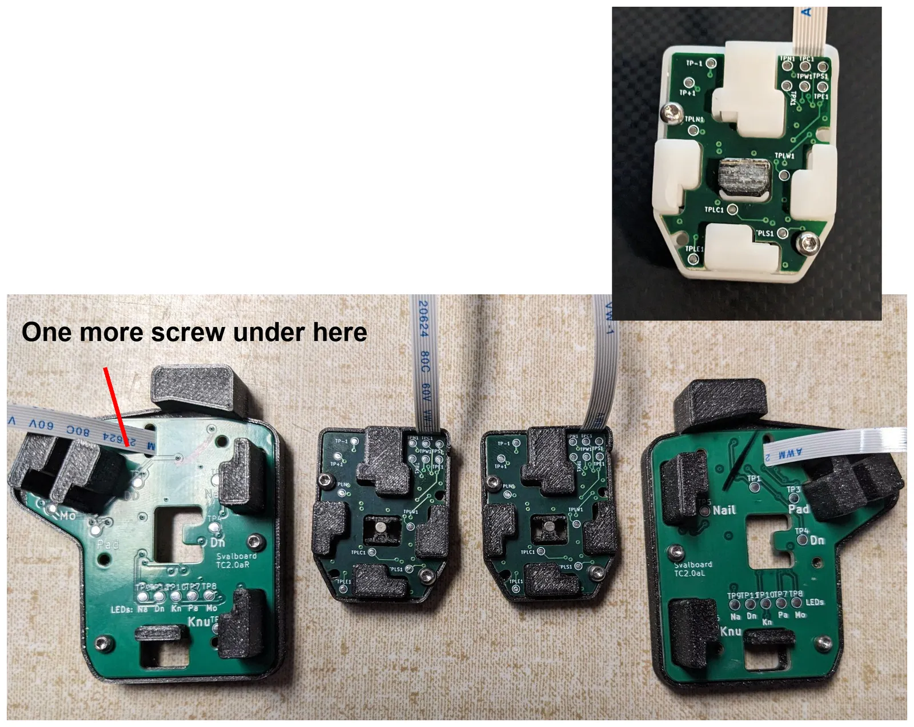

{/* PHOTO: replace with current-design photos (shot list: pcba-install). */}

### Insert the square nuts

A square nut goes in the back underside of each cluster. It's the fixing point for the tower.

1. Place the cluster top side down.
2. Line up the nut with small pliers or tweezers.
3. Press it **straight** down into the slot.

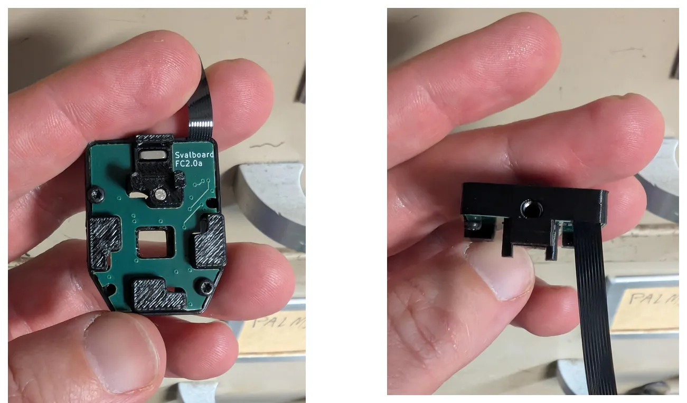

### Test the clusters (recommended)

Test each cluster before final assembly. A bad PCBA is much easier to swap now.

Use the **blank** firmware for this test. No key does anything, so the Matrix Tester shows exactly which switches register.

1. Connect the cluster FFCs to the MCU: unlatch, insert contacts down, latch.
2. Download the blank file for that side from the {stable.tag} release: <a href={blankUrl('left')}><code>{blank('left')}</code></a> or <a href={blankUrl('right')}><code>{blank('right')}</code></a>. Every file is listed in [Firmware files](/firmware/#firmware-files).
3. Flash it to the MCU. For how, see [Step 15](/build/#step-15-flash-firmware-and-connect) and [Flashing firmware](/firmware/#flashing-firmware).
4. Open [Keybard](/keybard/) (https://keybard.svalboard.com), choose **Connect Keyboard**, then **Matrix Tester**.
5. Press every key on the cluster. Check that each one lights up in the Matrix Tester.
6. When you're done, disconnect the FFCs: unlatch, pull the FFC out, latch.

Flash the normal `sval` firmware in [Step 15](/build/#step-15-flash-firmware-and-connect).

## Step 8: Install inserts and nuts

The case screws hold each base plate to its back case. Depending on your base plates, those screws thread into square nuts or into heat set inserts.

### Which base plates you have

Our latest base plates use square nuts at the case screw holes. Earlier base plates, including v1.2.8, use heat set inserts, and builds of every version are out there. To check yours, turn a base plate over and look at the seven case screw holes on the back.

- If each hole has a small rectangular opening beside it, your base plates take square nuts. Follow [Square nuts at the case screw holes](#square-nuts-at-the-case-screw-holes).
- If the holes are plain and round, your base plates take heat set inserts. Follow [Heat set inserts in the base plates](#heat-set-inserts-in-the-base-plates).

The back cases take heat set inserts either way.

### Square nuts at the case screw holes

Square nuts need no soldering iron. Each one clicks into a pocket on the back of the base plate and stays there, ready for its case screw. You need 7 M3 square nuts per base plate, DIN 562 (the thin kind: 5.5 mm across and 1.8 mm thick).

The left base plate is a mirror image. In the close-ups below, the thin layer of plastic over the pocket is cut away so you can see the nut.

1. Lay the base plate on the table with the back facing up.
2. Drop a nut flat into the rectangular opening beside a case screw hole.

   

3. Push the nut sideways toward the screw hole, with a fingertip or a small screwdriver. The two spring arms bend outward to let it pass.

   

4. Keep pushing until the nut clicks into the pocket over the hole. The arms spring back behind it and hold it in place.

   

5. Repeat for the other six holes, then do the other base plate.

Look through each screw hole. You should see the nut's thread centered in it.

### Heat set inserts

#### General process

- Set the soldering iron to about 280 °C for PLA. Lower and slower also works.
- A heat set insert tip sized for each insert is easiest. [Kits with every size are on Amazon](https://www.amazon.com/Virtjoule-Heat-Insert-Tips-Sizes/dp/B08B17VQLD). A single 3 mm tip also works for all of them. It's slower to heat the big inserts, but you don't need to swap tips.
- A plain tapered soldering iron tip works too, but the insert is less stable and more likely to tip and foul the part.

1. Let the iron preheat for a few minutes.
2. Pick up an insert with the tip. On the base plates and cases, you can instead set the inserts in their holes and press down vertically.
3. Press the insert gently into the hole. Let the heat do the work. Forcing it can deform and ruin the part.
4. **Don't insert it all the way.** Stop about 0.5 mm short.
5. Finish by pressing the part against a flat surface, or with a flat tool, so the insert sits flush and flat.

#### Heat set inserts in the base plates

If your base plates have plain round case screw holes, install 7 M3 inserts in each base plate.

#### Back cases

Install a 1/4-20 insert in the middle of each back case, and the M5 inserts on the side. The M5 inserts are for screw-in legs.

### Square nuts in the base plate slots

The square nuts in the slots let each cluster tower bolt to the base plate anywhere along its slot.

Slot nuts go in from the front of the base plate, the side the towers mount on.

- **Latest base plates:** each slot opening has two spring arms, like the case screw pockets. Drop a nut into the opening and push it along the slot past the arms.
- **Earlier base plates:** drop a nut into each slot opening and tip it into position on one side of the slot.

{/* VERIFY: the live guide's slide for this ("Insert nuts in baseplate") says "Need pic". A photo of the nuts seated in the slots would help. */}

## Step 9: Attach towers to clusters

Attach each tower to its cluster first. Then attach the assembly to the nut in the base plate slot ([Step 10](/build/#step-10-install-towers-on-baseplates)).

Put an M3x6 mm screw through the tower and into the square nut in the cluster. Tighten it a little to keep the cluster roughly in place. You adjust it later.

Make sure each tower goes in the right place:

- **Thumb:** the acute-angle tower, long side down.
- **Index fingers:** the tall oblique tower, tall side up.
- **Middle, ring and pinky:** the shorter, symmetric towers.

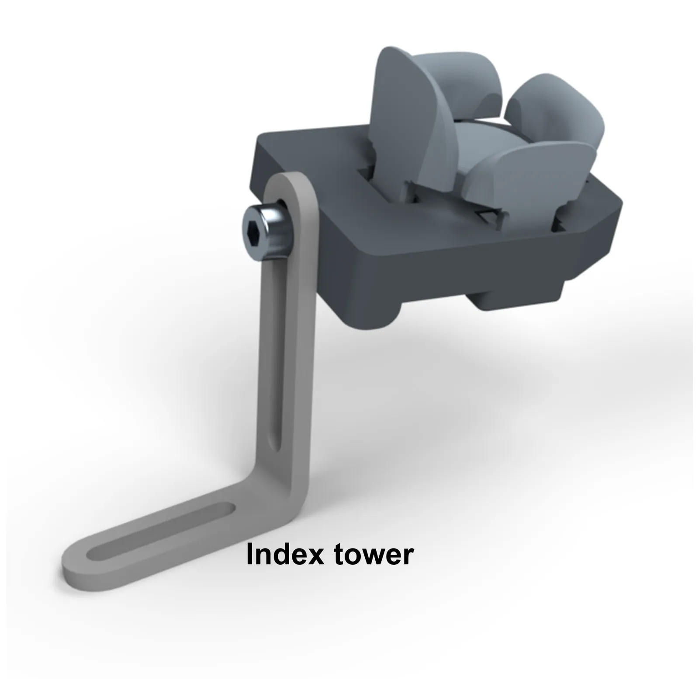

## Step 10: Install towers on baseplates

1. Take a cluster and tower assembly. Feed the cluster's FFC through the matching hole in the base plate.
2. Put an M3x6 mm screw through the tower base and into the square nut in the base plate slot.
3. Tighten it enough to hold the tower. You'll move the towers later to fit your hand ([Step 18](/build/#step-18-adjust-the-fit)), so don't tighten them hard.

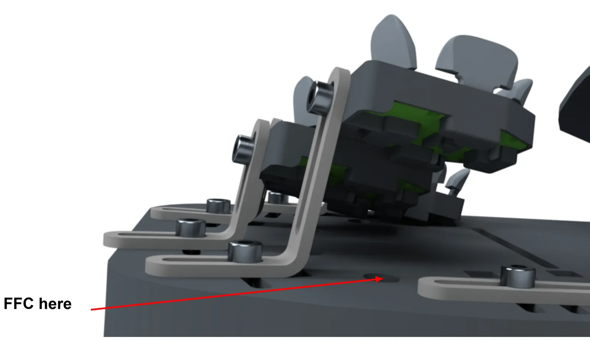

If you have a TrackPoint, trackball or touchpad, install it next: see [Steps 10a to 10c](/build/#steps-10a-to-10c-pointing-devices).

## Steps 10a to 10c: Pointing devices

Use one pointing device per half. Connect its FFCs as in [Step 6](/build/#step-6-attach-ffcs).

### 10a TrackPoint

- Attach a same-side FFC to the TrackPoint: unlatch, insert the contacts **up**, latch.
- Mount the TrackPoint in its holder with the M2 thread-cutting screws. Attach the cover.
- Route the cable with the finger cluster cables ([Step 10](/build/#step-10-install-towers-on-baseplates)).
- This half needs TrackPoint firmware. See [Step 15](/build/#step-15-flash-firmware-and-connect).
- The TrackPoint half must be the half you connect to your computer ([Step 15](/build/#step-15-flash-firmware-and-connect)).

{/* VERIFY: the live guide's TrackPoint slide says "[needs pics]". Photos of the TrackPoint in its holder and of the FFC contacts-up end would help. */}

### 10b Trackball

#### Trackball holder

- Print the holder at 0.2 mm layer height with 6 or more walls. You can add supports under the large bridges, but in PLA the holders work fine without them.
- The holder takes four static bearing balls, 3.175 mm. Some older holder designs use 3 mm balls. See [Trackballs and static bearings](/build/#trackballs-and-static-bearings).

1. Remove the supports. Make sure the ball cavities are clear of stray material.
2. Put a small drop of medium CA glue in each bearing location, and drop a bearing into each.
3. After a moment, press each bearing into its seat with a screwdriver blade, so it seats fully.
4. Test the ball fit. The top arm (the keeper) should be very close to the ball but not touch it in normal use: 0 to 0.2 mm.
5. If needed, heat the keeper and bend it slightly to get the hold you want. Use hot water for PLA, or a heat gun on low for ABS. This is easier before the sensor is installed.

If you don't carry your Svalboard around and don't tent it steeply, you don't strictly need the keeper.

#### Trackball PCBA

- Attach a same-side FFC to the trackball PCBA: unlatch, insert the contacts **down**, latch.
- Check which sensor the PCBA has. You need this to pick the firmware in [Step 15](/build/#step-15-flash-firmware-and-connect).
  - Current PCBAs use the **PMW3389**.
  - Older PCBAs may use the **PMW3360** (deprecated).
  - Look for silver marker on the PCBA, or read the tiny text on the sensor itself.
- Flashing the wrong image does no harm.
- Mount the trackball PCBA in its holder with the M2 thread-cutting screws. Attach the cover.
- Route the cable with the finger cluster cables ([Step 10](/build/#step-10-install-towers-on-baseplates)).
- Connect the trackball cable to the 8-pin FFC connector marked "TrkPt", "Trackball" or "Ball", depending on your MCU: unlatch, insert the contacts down, latch.

### 10c Touchpad

- The touchpad uses the same mounting rail as the trackball, so you can swap them.
- It needs MCU v3.1 or newer.
- Connect the 6-pin FFC to the touchpad: unlatch, insert the contacts **down**, latch.
- Connect the other end to the 6-pin "Azo" connector on the MCU: unlatch, insert the contacts **down**, latch.
- Mount the touchpad on the rail.
- Route the cable with the finger cluster cables ([Step 10](/build/#step-10-install-towers-on-baseplates)).
- This half needs touchpad firmware, or firmware that detects its pointing module automatically. See [Step 15](/build/#step-15-flash-firmware-and-connect).

{/* VERIFY: the touchpad mounting steps (screws, holder, cover) for this section. */}
{/* VERIFY: photos needed: the touchpad end of the FFC (contacts down, latch closed); the MCU end in the "Azo" connector (contacts down, latch closed); the touchpad mounted on the rail, from above and from the side. */}

## Step 11: Route cables

{/* PHOTO: replace with a current build: black FFCs, current base plate, every cable routed including the trackball or TrackPoint cable at the MCU (shot list: cable-routing). */}

The photos show routing through the channels in the base plate. You don't have to use the channels: connecting the cables directly, without them, is easier to work with in the long run. Either way, make sure every cable keeps the right orientation: contacts down at the MCU, blue stiffener up.

- You can put twists and creases in the FFCs wherever you like, under the PCBA or in the free sections below it.
- Don't cut or tear the FFCs, and don't drive screws into them.

The right half is shown.

### Left half

On the left half, the thumb FFC has to cross all the way to the opposite side.

## Step 12: Install MCUs

Screw the MCU (the main PCBA) to the base plate with the M3 6 mm thread-cutting screws. Then connect each FFC to its connector.

- {/* PHOTO: replace with a current build: MCU installed, black FFCs latched, trackball or TrackPoint cable connected (shot list: mcu-install). */}

The black latches on the connectors flip up to open and down to close.
- Every FFC connects to the MCU with the blue stiffener **up** and the metal contacts **down**: unlatch, insert, latch.
- On the TrackPoint PCBA end, the FFC connects with the metal contacts **up** and the blue stiffener down.

{/* VERIFY: the live guide's Step 12 slide doesn't say which screws hold the MCU. The kit list has "Thread cutting M3 6mm for main PCB, 9 (8+1 spare)". Is that right, and how many per MCU? */}

## Step 13: Attach palm rest carriers

The carrier holds the palm rest. Its cup takes the ball on the underside of the rest, and its two curved slots let it slide and turn on the base plate.

1. Push an M5 square nut into the pocket on the underside of the carrier. It holds the palm rest's center screw in Step 14.
2. Insert **two** square nuts into the palm rest slot in the base plate.
3. Place the carrier on the base plate, with its slots toward the finger clusters.
4. Put an M3x6 mm screw through each slot in the carrier and into a nut.
5. Tighten gently. It takes very little to hold the carrier. You set its final position in [Step 18](/build/#step-18-adjust-the-fit).

{/* VERIFY: are the carrier screws still M3x6 mm socket head screws into the two square nuts in the base plate slot, as for the tripod carrier? The close-up photo shows button heads. Is it right that the carrier goes on with its slots toward the finger clusters, so the screws sit under the window in the palm rest? */}

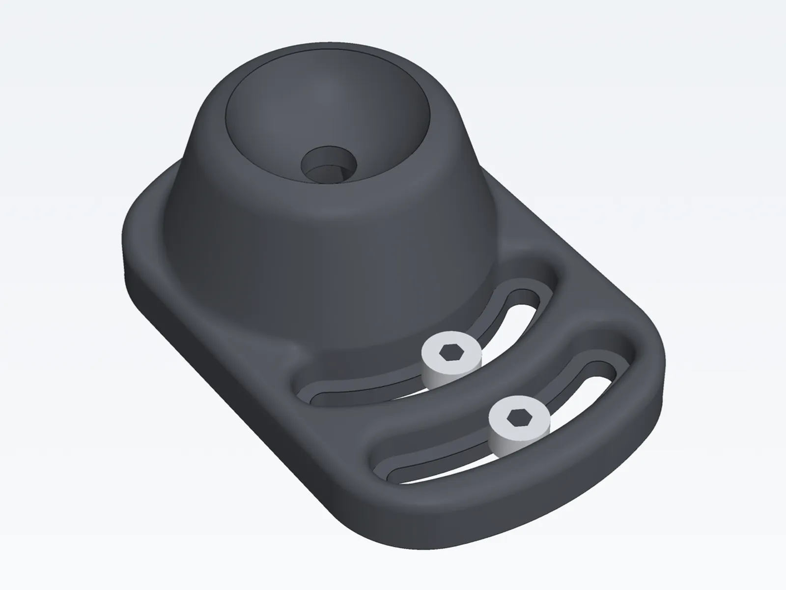

### Older builds: tripod carrier

The tripod carrier (also called the sled) mounts the same way, with two M3x6 mm screws through its straight slots into two square nuts. Washers are no longer needed, but you can use them for smoother sliding.

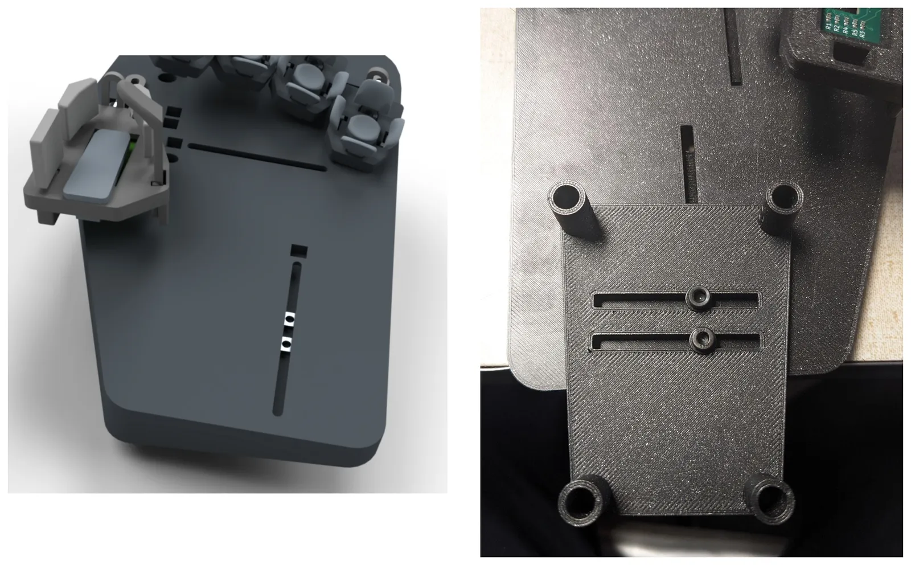

## Step 14: Attach palm rests

The palm rest has a ball on its underside that sits in the cup of the carrier. One M5 flat head screw through the center holds it, so the rest can tilt in pitch and roll.

1. Put the M5x16 mm flat head screw through the top washer, from the flat side.
2. Set the washer, round side down, in the recess in the top of the palm rest.
3. Set the palm rest on its carrier, with the ball in the cup and the window over the carrier slots.
4. Tighten the screw into the nut under the carrier with the 3 mm hex key. Leave it just loose enough to tilt the rest for now. You set the angle in [Step 18](/build/#step-18-adjust-the-fit).

The rests ship on 9 mm carriers. For a higher or lower rest, print a carrier from 1 mm to 15 mm tall from the parts repository.

For a softer rest, add [Squishy Palmrests](https://svalboard.com/products/squishy-palmrests). Adhesive memory foam (1/4 inch) or adhesive-backed leather also work as padding. Foam is less durable.

{/* VERIFY: the repository readme says the 12 mm carrier matches the tripod rest's default height, and suggests 9 mm or shorter without palm rest covers. Should the page recommend a carrier height for Squishy Palmrests or other padding? */}

### Older builds: tripod palm rests

The tripod palm rest drops into its sled on three legs. M2 thread-cutting screws clamp it at the sides. Don't overtighten these screws.

You can shim a tripod rest to any height. The holes line up for 0 mm and 5 mm of lift with the default 5 mm shims. If you plan to add padding on top, you'll probably want the low position. The fixing screws are the 4 mm M2 thread-cutting screws, the same as for the PCBAs.

## Step 15: Flash firmware and connect

Your MCUs ship with **no firmware**, and they aren't set to left or right. Flash both.

### Pick your firmware

Svalboard runs **Svalboard QMK**, configured with **Keybard**.

1. Go to the latest release: https://github.com/svalboard/qmk/releases/latest
2. Download one `sval` `.uf2` file for each half. Pick by side, and by the pointing device on that half (none, trackball, TrackPoint or touchpad). The full list of files is in [Firmware files](/firmware/#firmware-files).

- Use the newest release, and the same release on both halves.
- The `blank` files have no keys assigned. Use them only for the cluster test in [Step 7](/build/#test-the-clusters-recommended).
- Flashing the wrong image does no harm. Flash the right one and try again.

### Flash each half

Do this once for each half.

1. Connect the half to your computer with a USB-C cable in the port marked **U**.
2. Double-tap the **reset** button on the bottom of the half.
3. A drive named **RPI-RP2** appears.
4. Copy that half's `.uf2` file onto the drive.
5. The half restarts by itself and the drive disappears. That half is done.

Flashing resets the layout to the default. Later, export a `.svil` from Keybard before you flash, and import it afterward. More detail: [Flashing firmware](/firmware/#flashing-firmware).

#### Staying on Vial

Svalboard's Vial firmware is still available, with no new releases planned. To use it, flash the `v2025-11-01` files from https://github.com/svalboard/vial-qmk/releases and configure the board with Vial (https://vial.rocks). The rest of this guide uses Keybard.

### Connect the cables

- Use the two USB-C cables from the kit.
- **Split cable:** the shorter cable joins the two ports marked **S** (or ↔).
- **Computer cable:** the longer cable goes from the port marked **U** on one half to your computer. That half is the main half.
- If you have a TrackPoint, the TrackPoint half must be the main half.
- Otherwise, make the half with your main pointing device the main half. The main half performs better.
- You can connect or disconnect the split cable while the board is plugged in.

### Connect Keybard

1. Open https://keybard.svalboard.com in Chrome or Edge on a desktop computer.
2. Choose **Connect Keyboard**, then pick your Svalboard in the browser's list.
3. Your layout loads. You can now edit it. Changes apply right away, with no flashing.
4. Keybard backs up each board automatically. After you change your layout, also choose **Export Layout** and keep the `.svil` file somewhere safe.

See [Keybard](/keybard/) for more.

#### On Linux

Linux won't let the browser open the board until you add a udev rule. See [Linux: the udev rule](/firmware/#linux-the-udev-rule).

## Step 16: Test all keys

Do this before you screw on the back cover.

1. Open [Keybard](/keybard/) and connect ([Step 15](/build/#connect-keybard)).
2. In the editor toolbar, choose **Matrix Tester**.
3. Press each finger key in every direction, and each thumb key. Hold each press for a moment.
4. Check that every key activates, and that the key that lights up is the one you pressed.
5. Use **Clear Matrix** to start over. This doesn't change your layout.
6. Choose **Exit Matrix Tester** when you're done.

If you have a pointing device, move it and check that the pointer moves.

{/* VERIFY: the live guide's photo for this step is a Vial Matrix Tester screenshot. A Keybard Matrix Tester screenshot is needed here. */}

### If a key doesn't register

- Check that the key moves freely.
- Check that its flag is intact and opaque. Light filaments need silver marker ([Step 5](/build/#step-5-ink-the-key-flags)).
- Check that the PCBA sits flat in the cluster, including the bottom-left corner ([Step 7](/build/#step-7-install-pcbas-and-test)).
- Check that the FFC is fully inserted and latched at both ends, contacts down.
- If the Matrix Tester shows the key but typing is wrong, the switch is fine. Check that key's layer and binding.

### On Vial

On Svalboard's Vial firmware, use Vial's **Matrix Tester** tab instead.

## Step 17: Install back cover and feet

When every key works ([Step 16](/build/#step-16-test-all-keys)):

1. Screw on the back cover with 7 M3 6 mm screws per side.
2. Add 4 rubber feet per side, in the holes closest to the four corners.
3. Trim the feet on the thin side of the case, so they don't press against the base plate and deform it. Leave enough material that they stay in place.

If the board rocks, shave the bottoms of the feet with a craft knife. The silicone is very soft and easy to trim. You can also work on reducing warping in your prints.

### Feet sizes

- Recent cases have 4 mm holes for the larger rubber feet.
- Case version 1.2.6 and later also fit the small plug feet: 6 mm across, about 3 mm long, in soft 70A silicone. They lower the stack by more than a millimeter. On an older case, drill 3 mm holes to fit them.

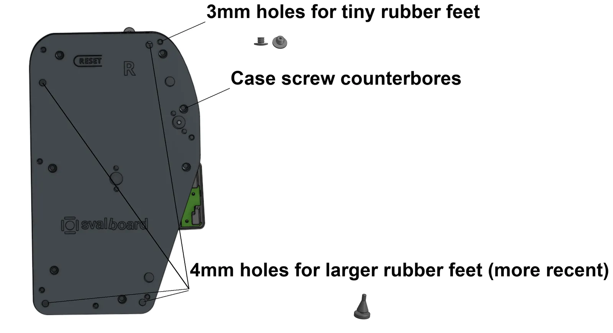

## Step 18: Adjust the fit

Adjust each part of the Svalboard to fit your hands. You'll keep making small adjustments over the first days or weeks of use. This is normal. Shaping the palm rests can also make typing much more comfortable.

**Don't overtighten.** The screws go into metal nuts, but there's plastic between them. Too much force can crack or break it.

### Palm rest

The carrier moves in X, Y and yaw on the base plate. The palm rest tilts in pitch and roll on the carrier.

1. Reach the two carrier screws through the window in the palm rest, and loosen them slightly.
2. With a relaxed hand, your fingers should rest comfortably on the center keys. Slide and turn the palm rest to get a good starting position. You can always tweak it later.
3. The base knuckles of each hand usually rest just in front of the front edge of the palm rest.
4. Tighten both carrier screws gently snug to fix the position.
5. To set pitch and roll, loosen the large center screw slightly with the 3 mm hex key. Tilt the rest until your palm lies flat on it, then tighten the center screw firmly.

{/* VERIFY: which driver fits the carrier screws through the window: the T10 driver, or a hex key? */}

#### Older builds: tripod palm rests

Loosen both carrier screws slightly, slide and turn the carrier as above, then tighten the screws gently snug. To change the height, add or remove shims under the legs ([Step 14](/build/#step-14-attach-palm-rests)).

### Finger clusters

Each cluster moves in X, Y and yaw.

1. Loosen the tower base screw slightly with a 2.5 mm hex wrench.

   {/* VERIFY: the kit list has a T10 Torx driver and no hex key, and the Fit page says to use the included T10 driver. Should this say T10 (or "2.5 mm hex or T10") instead of a 2.5 mm hex wrench? */}

2. Tighten it gently to test and fine-tune.
3. After you set the palm rest, adjust how far forward or back each cluster sits, so each finger feels equally relaxed. Fingers should rest only on the center keys, and on the South keys if you prefer.
4. Tighten snug, without overdoing it, to fix the position.

To move one finger farther away than its slot allows, move the other fingers closer instead, and move the palm rest farther from the clusters to make room.

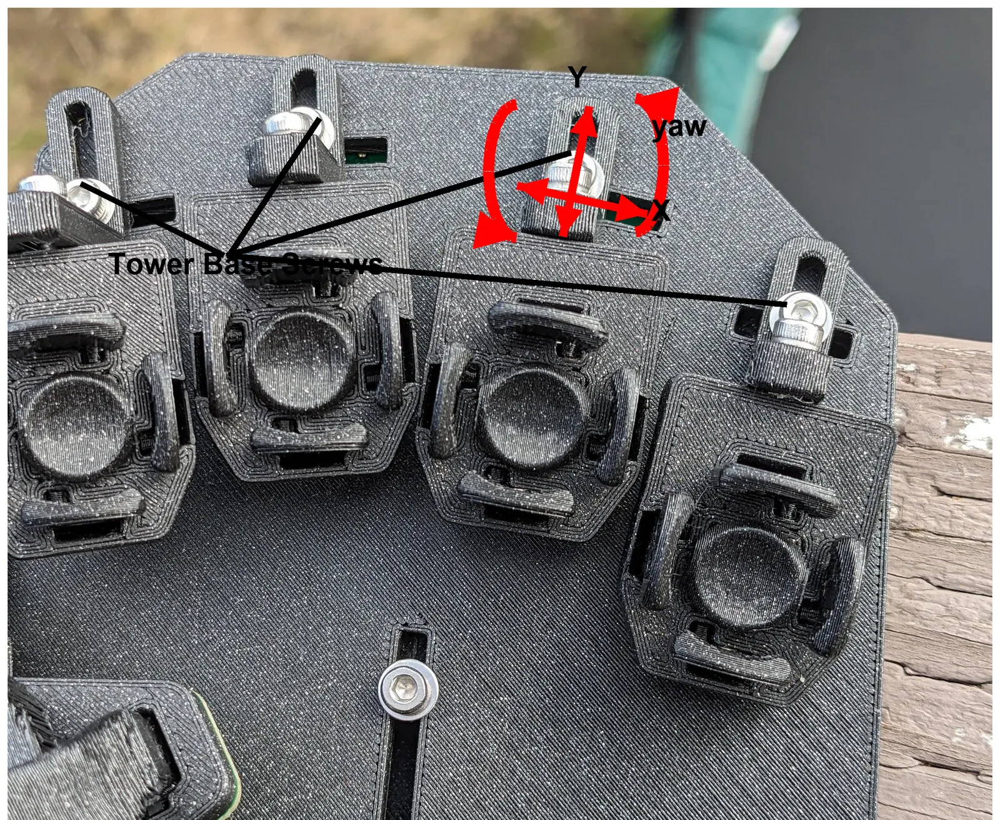

### Height and roll

1. Loosen the cluster height screws slightly. The washer may bind a little. Don't unscrew too far. Wiggle it gently, or lift the edge of the washer to break it free of the plastic.
2. **Roll:** set it so each finger presses the East and West keys equally easily. If you have to favor one side, make the inboard key slightly higher, so it's easier to press: West on the right hand, East on the left hand.
3. **Height:** set it so each finger rests with the same light pressure on its center key, without touching any other key.

{/* VERIFY: the live guide warns that clusters set all the way down can hit the base plate and block the "center key slider mechanism" (it needs 1.5 mm of clearance). Does this also apply to the tipping center keys? Left off the page until confirmed. */}

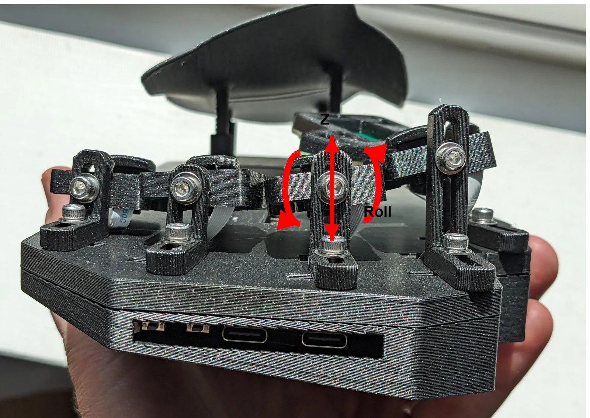

### Palm rest shaping (PLA only)

Watch the [palm rest shaping video](https://www.youtube.com/watch?v=feAgCKpLzhQ).

- Only shape the palm rest while it's attached to the carrier. On a tripod rest, this keeps the legs in the right places.
- Dip the area you want to shape in water at about 90 °C. Swish it gently for 5 to 10 seconds until it's pliable.
- Quickly shake off the hot water and form it to your hand. It cools and hardens quickly.
- Work a little at a time. Don't rush, and don't force a bend, or the layers may split.
- Keep a bowl of cool water nearby. If the plastic gets too soft, dip it to set the shape quickly.

{/* VERIFY: is hot-water shaping supported on PLA hemispherical rests? Should they stay on the carrier while shaping, so the ball and the screw recess keep their shape? */}

## Step 19: Enjoy!

- Your Svalboard starts with the default QWERTY layout.
- To change keys, layers, macros, combos or tap dances, use [Keybard](/keybard/): https://keybard.svalboard.com
- For other letter layouts and number layers, open Keybard's **Layouts** panel and drag a layer onto yours. It has Dvorak, Colemak, the Hands Down variants (HD Promethium, HD Neu), Graphite, and NavNAS number layers.
- Read the [Svalboard Manual](https://svalboard.com/manual) to get the most from your Svalboard.
- Questions? Ask on the [Svalboard Discord](https://www.svalboard.com/discord), or email support@svalboard.com.

### Thumb cluster layer lights

Thumb clusters in kits shipped after May 2024 have an RGB layer light. It shows the active layer. The default colors are:

- Green: layer 0 (base)
- Orange: layer 1 (NavNAS)
- Azure: layer 2 (Function)
- Magenta: layer 15 (mouse layer)

You can change each layer's color in Keybard. On Svalboard's Vial firmware, colors are set in the firmware source.

If you print the thumb cluster in a dark color, turn the brightness up, or print the diffuser in white. The diffuser is a separate part in the STEP file.

### Brightness

- Set the brightness in Keybard: click the color dot beside the layer name, then the gear button (**Custom layer color**). Select **LED color** and drag **Brightness**. Choose **Apply**. It applies to every layer.
- Or add **Bright +** and **Bright -** to keys (Keybard's **Special Keys** panel, **Backlight and RGB Keys**), then press them on the board.
- **RGB Toggle** turns the layer lights on and off.

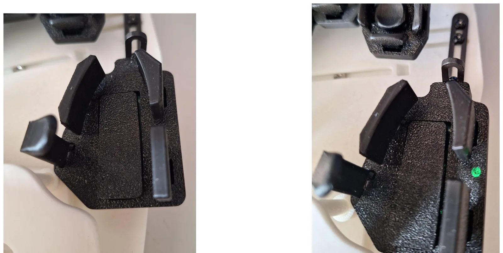
