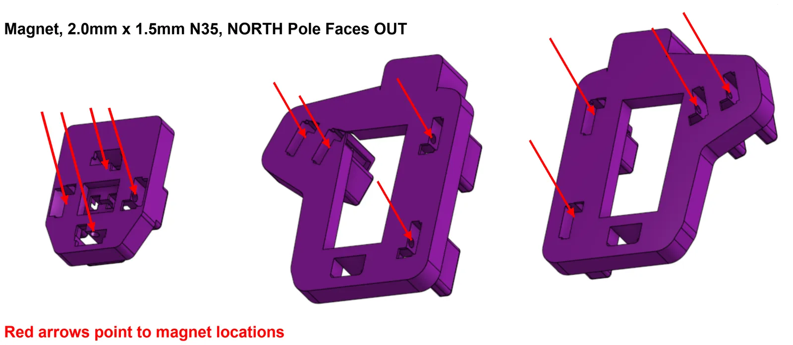

Each finger cluster has 5 keys, so a finished cluster with its keys needs 10 magnets.

All magnets are 2.0 mm x 1.5 mm N35.

- **Clusters:** the **north** pole faces out.
- **Keys:** the **south** pole faces out, so it's the visible side.

## Install key magnets: dip method

1. Use the Key stage (south pole up).
2. Put magnets on the stage.
3. Put a small blob of CA glue on a surface. A strip of painter's tape works well.
4. Pick up a magnet with a thin flat-blade screwdriver.
5. Dip the magnet in the glue.
6. Press it into the hole in the key.
7. Squeeze the magnet flush with parallel pliers.
8. Let the glue cure before you use the key.

## Install key magnets: pre-applied glue method

1. Use the Key stage (south pole up).
2. Put magnets on the stage.
3. Put glue in the magnet holes of the keys.
4. Pick up a magnet with a thin flat-blade screwdriver.
5. Press it into the hole in the key.
6. Squeeze the magnet flush with parallel pliers.
7. Let the glue cure.

## Cluster magnets

Install the cluster magnets the same way, from the Cluster stage (north pole up). The red arrows show where the magnets go.

The thumb cluster takes magnets the same way. The left thumb cluster is shown. The right one is the same.

## Key magnets

## Tipping center key

The tipping center key uses normal key polarity: the **south** pole faces out (up). Make sure the hole in the key is clear of stringing and stray filament.

