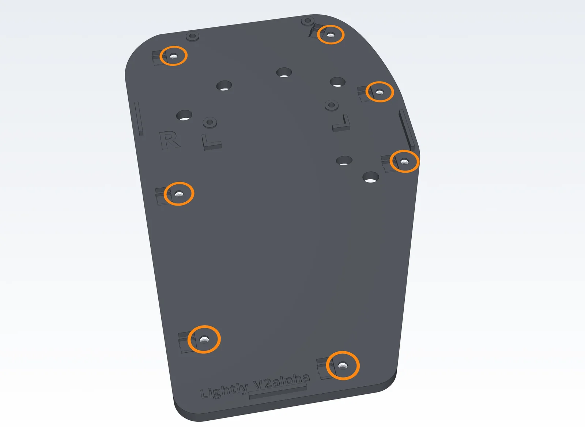
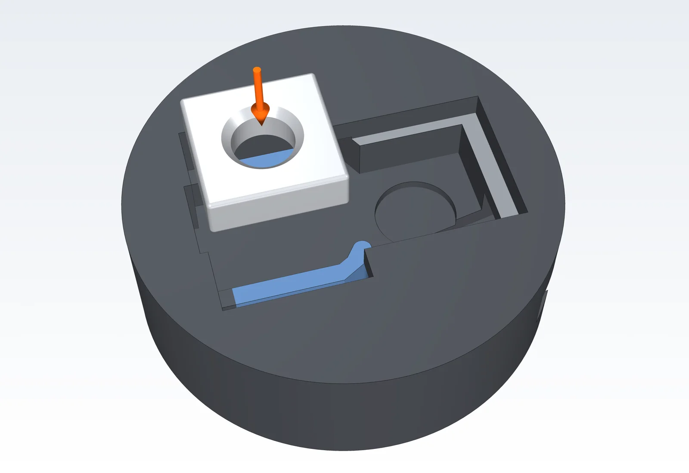
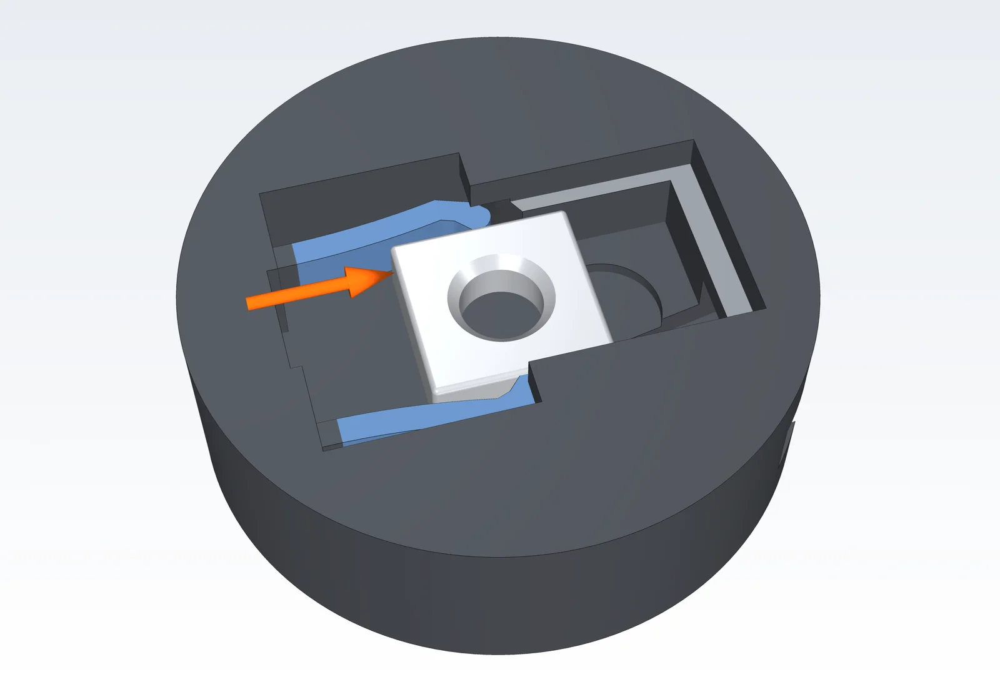
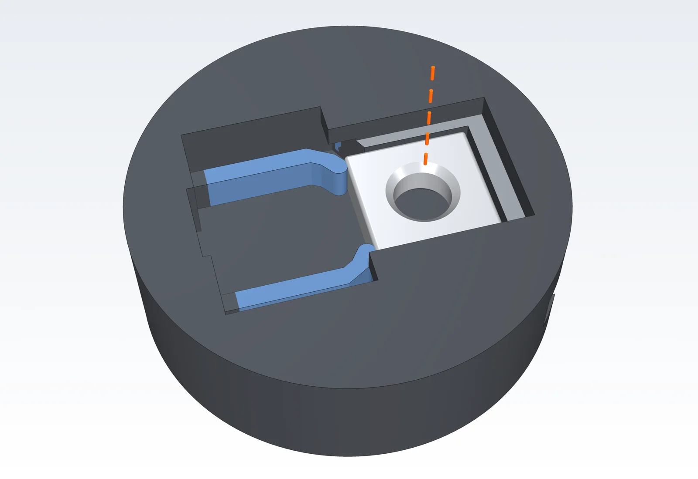
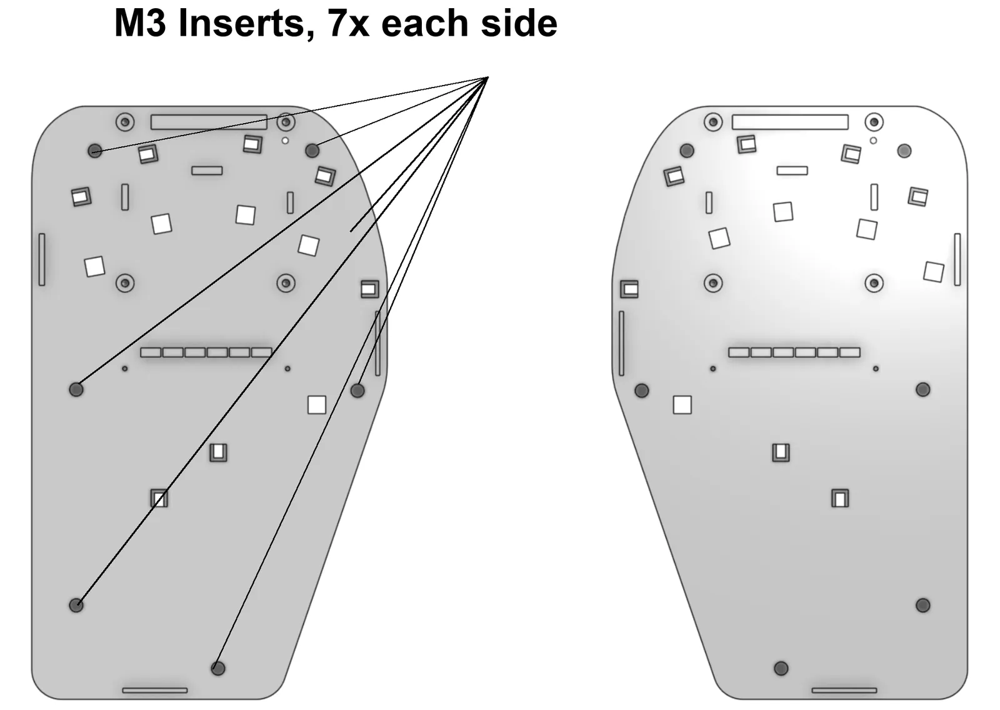
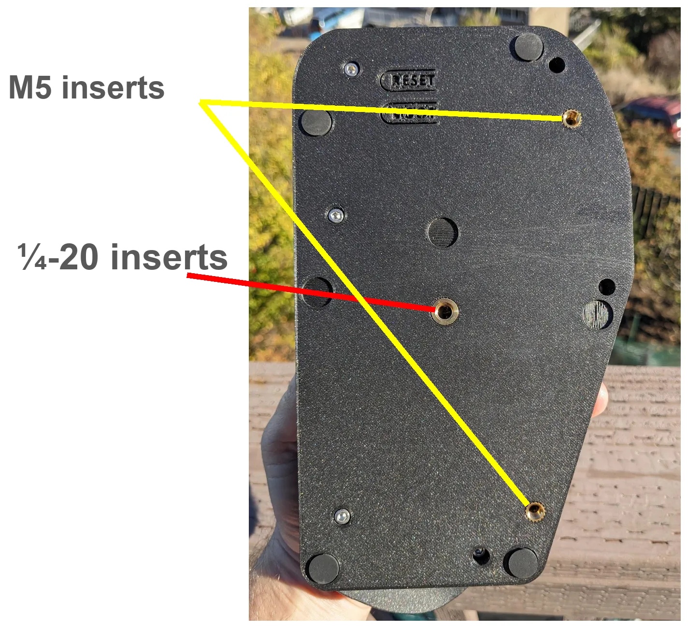

The case screws hold each base plate to its back case. Depending on your base plates, those screws thread into square nuts or into heat set inserts.

## Which base plates you have

Our latest base plates use square nuts at the case screw holes. Earlier base plates, including v1.2.8, use heat set inserts, and builds of every version are out there. To check yours, turn a base plate over and look at the seven case screw holes on the back.

- If each hole has a small rectangular opening beside it, your base plates take square nuts. Follow [Square nuts at the case screw holes](#square-nuts-at-the-case-screw-holes).
- If the holes are plain and round, your base plates take heat set inserts. Follow [Heat set inserts in the base plates](#heat-set-inserts-in-the-base-plates).

The back cases take heat set inserts either way.

## Square nuts at the case screw holes

Square nuts need no soldering iron. Each one clicks into a pocket on the back of the base plate and stays there, ready for its case screw. You need 7 M3 square nuts per base plate, DIN 562 (the thin kind: 5.5 mm across and 1.8 mm thick).

The left base plate is a mirror image. In the close-ups below, the thin layer of plastic over the pocket is cut away so you can see the nut.

1. Lay the base plate on the table with the back facing up.
2. Drop a nut flat into the rectangular opening beside a case screw hole.

   

3. Push the nut sideways toward the screw hole, with a fingertip or a small screwdriver. The two spring arms bend outward to let it pass.

   

4. Keep pushing until the nut clicks into the pocket over the hole. The arms spring back behind it and hold it in place.

   

5. Repeat for the other six holes, then do the other base plate.

Look through each screw hole. You should see the nut's thread centered in it.

## Heat set inserts

### General process

- Set the soldering iron to about 280 °C for PLA. Lower and slower also works.
- A heat set insert tip sized for each insert is easiest. [Kits with every size are on Amazon](https://www.amazon.com/Virtjoule-Heat-Insert-Tips-Sizes/dp/B08B17VQLD). A single 3 mm tip also works for all of them. It's slower to heat the big inserts, but you don't need to swap tips.
- A plain tapered soldering iron tip works too, but the insert is less stable and more likely to tip and foul the part.

1. Let the iron preheat for a few minutes.
2. Pick up an insert with the tip. On the base plates and cases, you can instead set the inserts in their holes and press down vertically.
3. Press the insert gently into the hole. Let the heat do the work. Forcing it can deform and ruin the part.
4. **Don't insert it all the way.** Stop about 0.5 mm short.
5. Finish by pressing the part against a flat surface, or with a flat tool, so the insert sits flush and flat.

### Heat set inserts in the base plates

If your base plates have plain round case screw holes, install 7 M3 inserts in each base plate.

### Back cases

Install a 1/4-20 insert in the middle of each back case, and the M5 inserts on the side. The M5 inserts are for screw-in legs.

## Square nuts in the base plate slots

The square nuts in the slots let each cluster tower bolt to the base plate anywhere along its slot.

Slot nuts go in from the front of the base plate, the side the towers mount on.

- **Latest base plates:** each slot opening has two spring arms, like the case screw pockets. Drop a nut into the opening and push it along the slot past the arms.
- **Earlier base plates:** drop a nut into each slot opening and tip it into position on one side of the slot.

<!-- VERIFY: the live guide's slide for this ("Insert nuts in baseplate") says "Need pic". A photo of the nuts seated in the slots would help. -->
