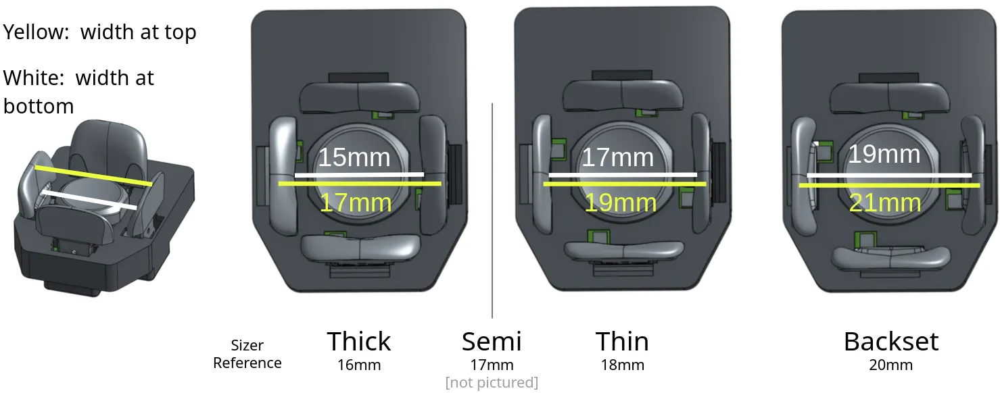
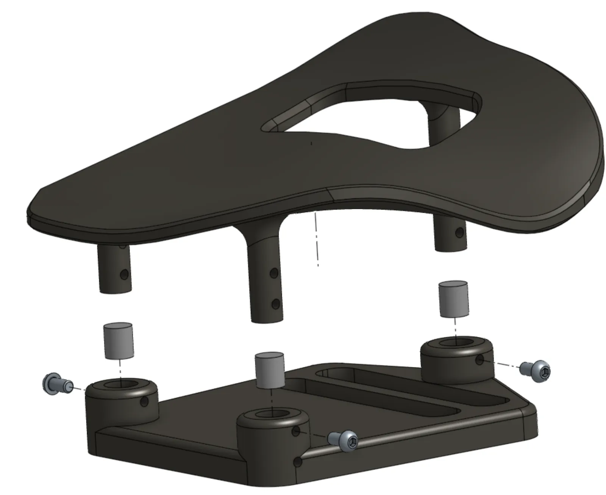

Fit matters more than any setting. Use the included T10 driver. The [fit video playlist](https://www.youtube.com/watch?v=ArXnZVQM3LM&list=PL_Jqu5bq_U_CQBhYryllArikWe-ns3g8q) shows each adjustment.

What moves:

- **Clusters** move up and down on their towers, and roll left and right.
- **Towers** move forward and back, yaw, and slide side to side in the baseplate track.
- **Palm rests** move forward and back, side to side, and yaw.

Some users bend or reverse the steel towers so each cluster sits directly over its tower base.

## Key width

Keys should sit as close around your fingers as possible without accidental presses. Print the [sizer sheet](https://www.svalboard.com/sizer) and measure each fingertip, on both hands.

Key names give three numbers: **height, thickness, offset**.

- Height: nominal key height in mm.
- Thickness: where the key face sits relative to the front of the key base. +1 is "Thick", +0.5 "Semi", 0 "Thin", −1 "Backset", −2 "double Backset". Thicker keys suit narrower fingertips.
- Offset: magnet offset. A larger offset means a lighter press.

| Example | Meaning |
| --- | --- |
| 6 1 0.7 | 6 mm tall, Thick, 0.7 mm offset (default, about 20 g) |
| 11 0 0.8 | 11 mm tall, flush, 0.8 mm offset (about 17 g) |
| 8 −2 1.0 | 8 mm tall, set back 2 mm, 1.0 mm offset (about 12 g) |

Standard clusters have 18 mm between key bases. Slim clusters have 16 mm and need a different circuit board. Your fit is the spacing minus both keys' thickness:

| Keys | Cluster | Fit |
| --- | --- | --- |
| Two +1 | 18 mm | 16 mm |
| Two +1 | 16 mm | 14 mm |
| Two −1 | 18 mm | 20 mm |
| Two −1 | 16 mm | 18 mm |

For reference, one user's measurements and the fits he uses:

| | L Pinky | L Ring | L Middle | L Index | R Index | R Middle | R Ring | R Pinky |
| --- | --- | --- | --- | --- | --- | --- | --- | --- |
| Measured | 14 | 17 | 16 | 15 | 16 | 16 | 17 | 14 |
| Used | 16 | 18 | 17 | 17 | 17 | 17 | 18 | 16 |

Include your measurements with your order.

## Trackball size

The default trackball is 44 mm. A 52 mm ball is available for large hands, about 200 mm or more from wrist to middle fingertip. The 44 mm ball gives a more flexible fit even for large hands.

| Size | Length (wrist to middle fingertip) | Width at knuckles |
| --- | --- | --- |
| X-Small | under 170 mm | |
| Small | 170–180 mm | under 75 mm |
| Medium | 180–190 mm | 75–85 mm |
| Large | 190–195 mm | over 85 mm |
| X-Large | over 195 mm | |

## Palm rests

Set the palm rests first. You need a steady hand position before you can fit the clusters.

- Loosen both carrier screws until the carrier moves easily. Tighten until it holds, test, then tighten a little more. Don't overtighten; it can damage the carrier and base plate.
- With a relaxed hand, your fingers rest on the Center keys. Your base knuckles usually sit just in front of the palm rest's front edge.
- **Hemispherical palm rests** (default on orders after 2026-09-01): loosen the large center screw slightly with the 3 mm hex key to adjust pitch and roll, then tighten it firmly. They ship on 9 mm carriers; other heights are in the parts repository.
- **Tripod palm rests**: newer ones have 5 mm shims installed. Remove them to lower the rest 5 mm, or use any shim up to about 6 mm.

  

- **PLA palm rests** can be reshaped in hot water. Keep the rest attached to its carrier while you do it. [Thermoforming demo](https://www.youtube.com/watch?v=feAgCKpLzhQ). Palm rests are a consumable part; contact support@svalboard.com for replacements.

## Finger clusters

- **Length, breadth and yaw**: loosen the base screw just enough to move the tower with gentle pressure. Fingers should rest on the Center keys; many people like a slight bias toward South. If a cluster won't reach, move the palm rest back.
- **Height and roll**: loosen the cluster height screw slightly and slide the cluster. Each finger should rest with the same light pressure, without reaching or pulling back. Roll the cluster so you reach East and West easily. If you must favor one, favor the inward key (East on the left hand, West on the right).
- **Keep splay small**: put clusters as close together as you can without neighboring East and West keys touching.
- At very low heights, check that the cluster doesn't hit the baseplate, especially on the pinky.
- Tighten gently. Overtightening can damage the cluster or base plate.

## Thumb clusters

Thumb clusters adjust the same ways as finger clusters. Thumb fit is personal. Aim for Knuckle keys that are easy to press on purpose and hard to bump by accident. If your thumb rest triggers the Down key, lower the cluster.
