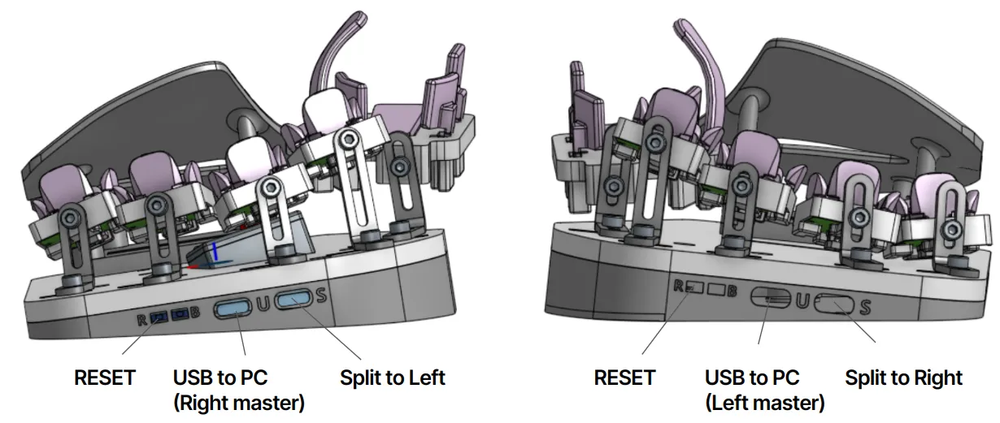
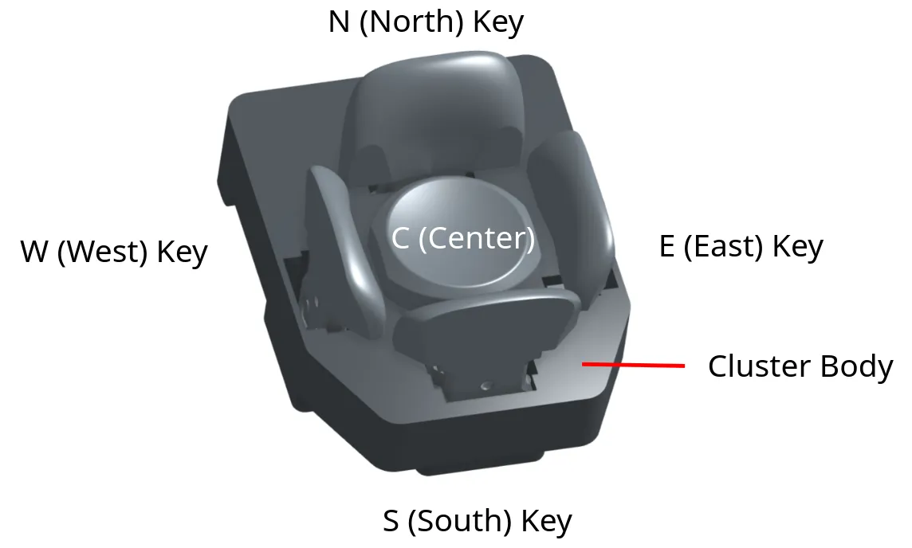

## The halves

Each half has its own RP2040 microcontroller and its own firmware. You flash each half with the file for its side (left or right). Copying a firmware file does not change which side a half is.

- **U port**: USB to your computer.
- **S port** (or **↔**): the split cable to the other half. You can connect and disconnect the split cable while the board is plugged in.
- **RESET button**: on the bottom of each half. A double press starts bootloader mode (see [Flashing firmware](/firmware/flashing/)).

## Keys

Each finger has a **5-key cluster**: North, South, East, West, and a Center key pressed down. This is the standard cluster.

<!-- VERIFY: this diagram labels the Up key "Up (Mode Key)". Thumb Up layer switching is gone and the Up keys ship blank. Keep this image, or replace it with one labeled just "Up"? -->

Each thumb has six keys: **Pad, Knuckle, Nail, Up, Down and Double Down**. Double Down is a switch under the Down key: press Down all the way through.

That gives **52 keys** in total, each a few millimeters from your fingers.

For more reach, choose the **6-key finger cluster**, which adds a second South key under each finger that has one. Put it on any or all fingers for 56 to 60 keys. Every Svalboard firmware supports it. In Keybard, choose the clusters your board has in **Settings → Fragments** (see [Fragments](/keybard/settings/#fragments-your-finger-clusters)).

## Mounting and tenting

Each half has two M5 inserts at the inner edge and a ¼"-20 insert at the center.

- M5: screw in machine screws of any length as tenting legs. Pad the screw heads so they don't scratch your desk.
- ¼"-20: the standard camera thread. Users attach super clamps, arms, quick-release plates and similar mounts.

## Care and cleaning

Factory builds are printed in tough ABS and handle everyday heat well; like any electronics, don't leave them in a hot car. Self-printed PLA parts are another matter: they can soften in a hot car, near a heater or in strong sun. ABS dissolves in acetone, so keep acetone away from the board.

- **Keys**: all keys except the finger Center keys lift out. Wash them in cold or room-temperature water with mild soap. Don't use an ultrasonic cleaner; it heats the water and can warp the keys. Handle the flag on each key carefully.
- **Center keys**: tipping Center keys curl under the cluster to a magnet at the north end. Rotate the key upward to pull its arm off the magnet and out through the cluster. Older "gap slider" Center keys pop off the back of the cluster; see the [build guide](https://svalboard.com/build). Don't lose the sliders.
- **Dust**: blow it out with a powered air duster.
- **Spills**: unplug the board first. Wipe the plastic with a barely damp cloth, keeping water away from the electronics, and let everything dry completely before you plug it back in. Then check that every key still works in [Matrix Tester](/keybard/settings/#check-every-key-with-matrix-tester).

## Opening the case

1. Turn the half upside down. Don't rest it on the thumb keys.
2. Remove the six or seven M3 screws in the bottom plate with the included 2.5 mm hex key, or the T10 driver for Torx screws.
3. Lift off the bottom. You can leave the screws in their holes.

## Self-printing and repairs

- [Build guide](/build/): assembly, print settings, repairs and flashing a new build.
- [Parts repository](https://github.com/svalboard/svalboard-self-print): every plastic part. Customers can request access: send your GitHub username to morgan@svalboard.com.
- Ask the community on the [Discord](https://svalboard.com/discord).
