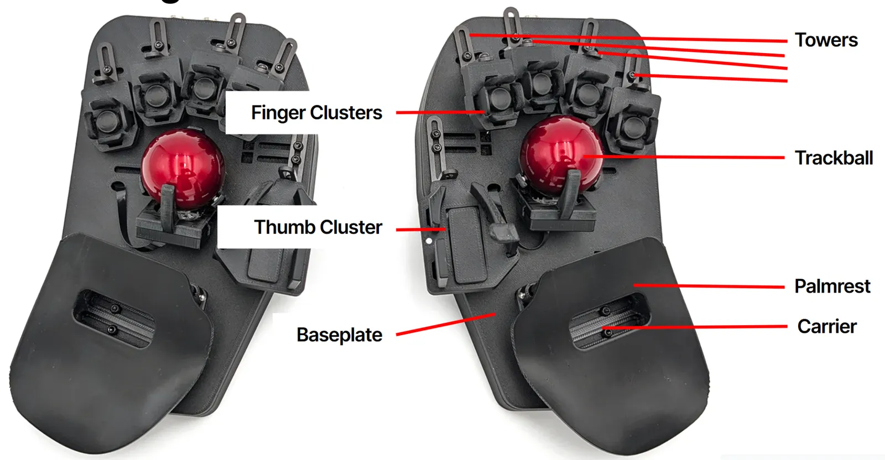
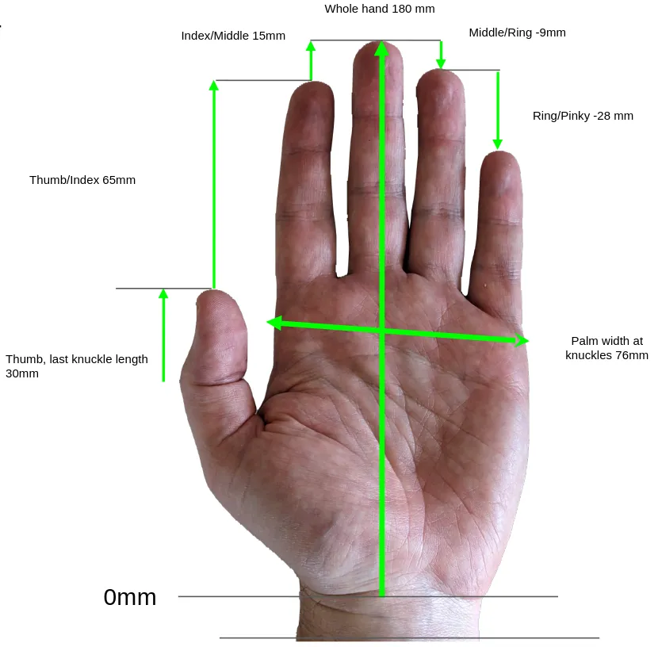
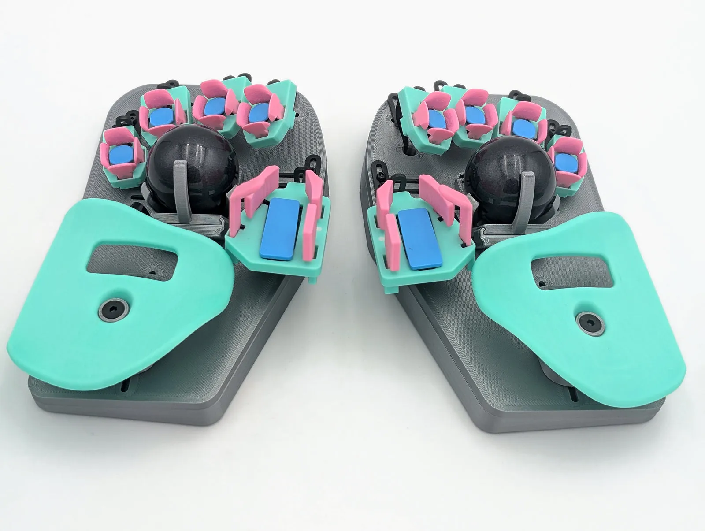
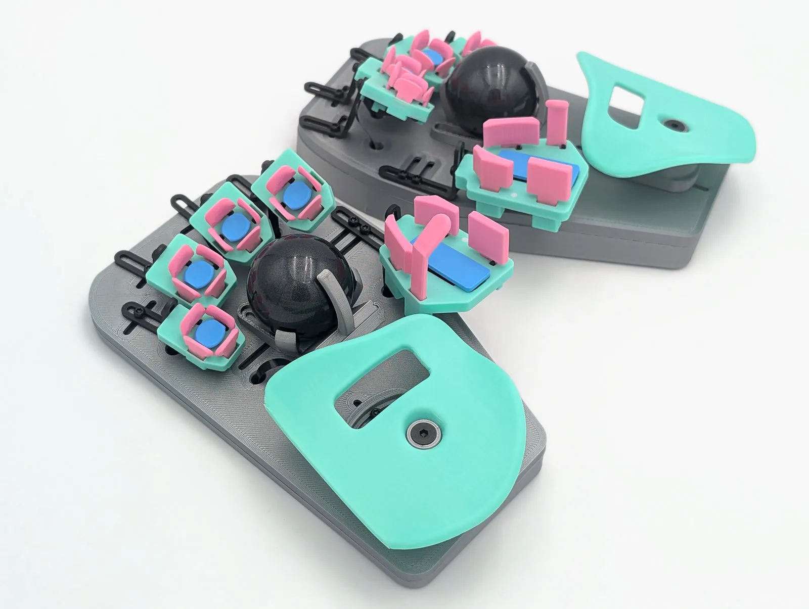
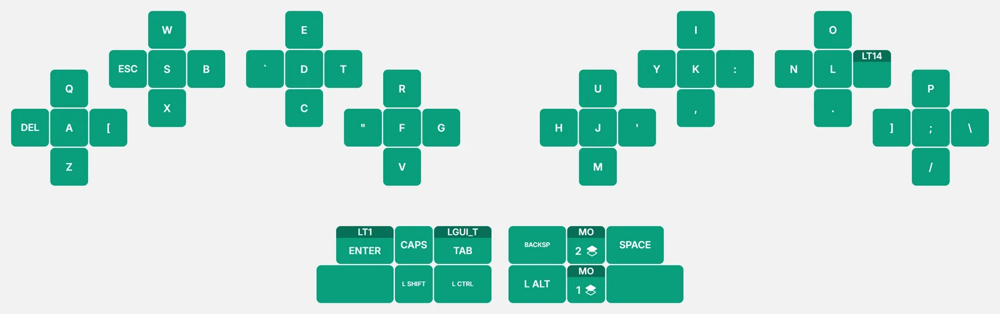
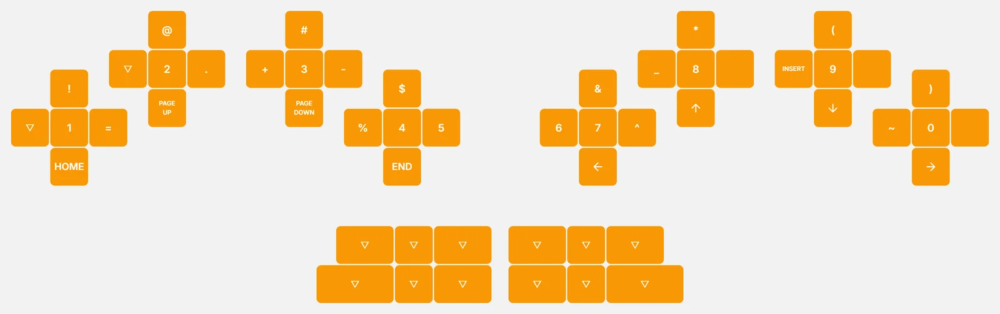
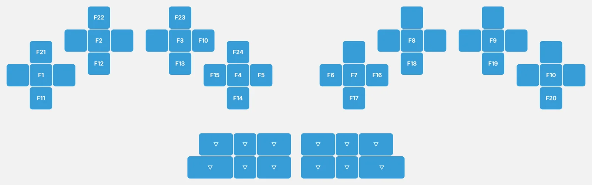
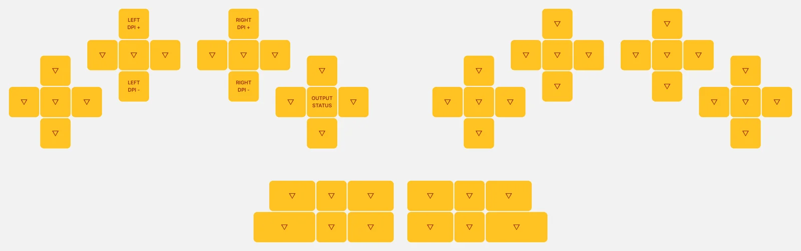
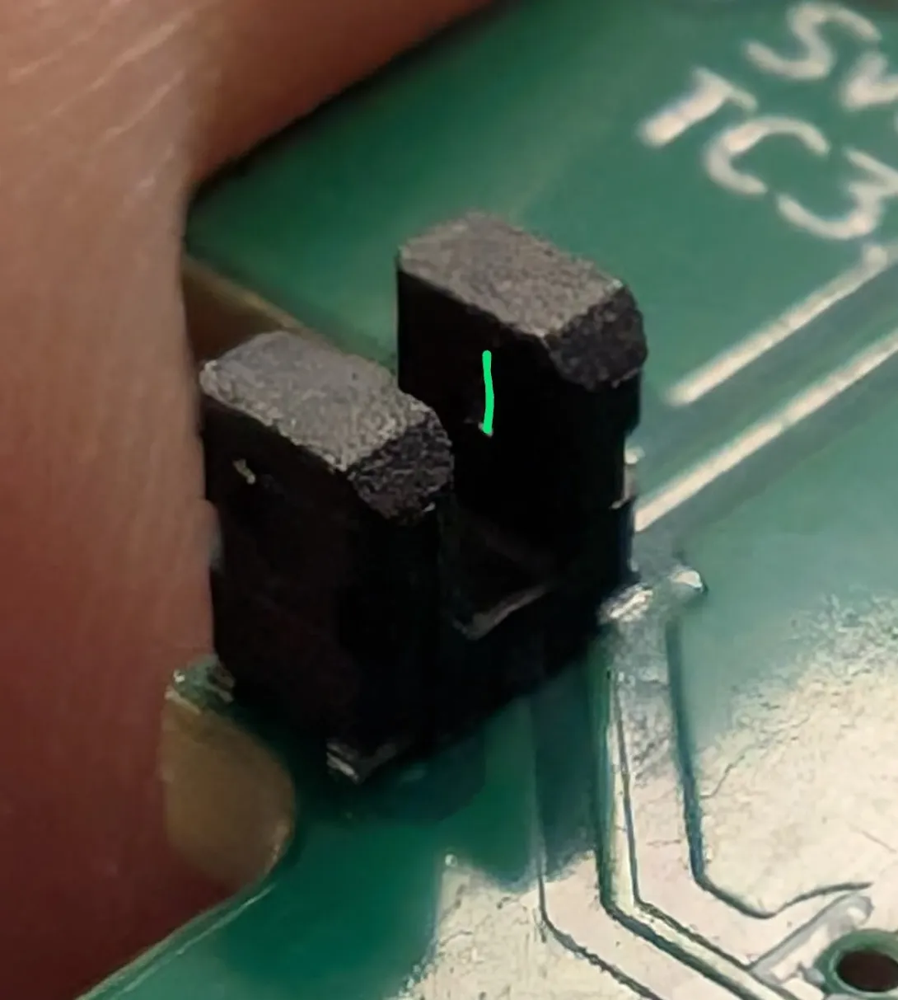

import CadFigure from '../../../components/CadFigure.astro';

## The halves

<CadFigure name="cad-ports-reset" alt="The finger end of a right half's case, from below. The U (USB) port and the S (split) port are side by side in the end wall, and the RESET button hole is in the bottom." caption="Right half shown; the left half is its mirror image." />

Each half has its own RP2040 microcontroller and its own firmware. You flash each half with the file for its side (left or right). Copying a firmware file does not change which side a half is.

- **U port**: the USB port, to your computer.
- **S port** (or **↔**): the split port, for the split cable to the other half. You can connect and disconnect the split cable while the board is plugged in.
- **RESET button**: on the bottom of each half. A double press starts bootloader mode (see [Flashing firmware](/firmware/#flashing-firmware)).

## Keys

<CadFigure name="cad-finger-cluster-keys" alt="A finger cluster with its keys labeled: North at the back, East, South, West, and the Center key in the middle, plus the cluster body." />

Each finger has a **5-key cluster**: North, South, East, West, and a Center key pressed down. This is the standard cluster.

<CadFigure name="cad-thumb-cluster-keys" alt="A right thumb cluster seen from its outer side, keys labeled: the Nail and Knuckle keys in front, their sloped tops running together as one line, the layer LED below them, the Pad key behind with its top rising toward the Up key, the Up key, the Down key in the middle, and the cluster body." />

Each thumb has six keys: **Pad, Knuckle, Nail, Up, Down and Double Down**. Double Down is a switch under the Down key: press Down all the way through.

That gives **52 keys** in total, each a few millimeters from your fingers.

For more reach, choose the **6-key finger cluster**, which adds a second South key under each finger that has one. Put it on any or all fingers for 56 to 60 keys. Every Svalboard firmware supports it. In Keybard, choose the clusters your board has in **Settings → Fragments** (see [Fragments](/keybard/settings/#fragments-your-finger-clusters)).

<CadFigure name="cad-6key-cluster" alt="A 6-key finger cluster body with its key slots labeled: North, East, West, Center, South, and the Second South (2S) slot, ringed, behind South." caption="The 6-key cluster adds a Second South key behind South." />

## Mounting and tenting

Each half has two M5 inserts at the inner edge and a ¼"-20 insert at the center.

<CadFigure name="cad-inserts-back-case" alt="The bottom of the right back case. Two M5 inserts (orange) sit near the inner edge and a 1/4-20 insert (blue) in the middle." caption="Back case, bottom: two M5 inserts for screw-in legs and one 1/4-20 insert in the middle." />

- M5: screw in machine screws of any length as tenting legs. Pad the screw heads so they don't scratch your desk.
- ¼"-20: the standard camera thread. Users attach super clamps, arms, quick-release plates and similar mounts.

## Care and cleaning

Factory builds are printed in tough ABS and handle everyday heat well; like any electronics, don't leave them in a hot car. Self-printed PLA parts are another matter: they can soften in a hot car, near a heater or in strong sun. ABS dissolves in acetone, so keep acetone away from the board.

- **Keys**: all keys except the finger Center keys lift out. Wash them in cold or room-temperature water with mild soap. Don't use an ultrasonic cleaner; it heats the water and can warp the keys. Handle the flag on each key carefully.
- **Center keys**: tipping Center keys curl under the cluster to a magnet at the north end. Rotate the key upward to pull its arm off the magnet and out through the cluster. Older "gap slider" Center keys pop off the back of the cluster; see the [build guide](https://svalboard.com/build). Don't lose the sliders.

  <CadFigure name="cad-tipping-remove" alt="A finger cluster with its tipping Center key (orange) turned partway up and out, with a curved arrow showing the direction to rotate it." />

- **Dust**: blow it out with a powered air duster.
- **Spills**: unplug the board first. Wipe the plastic with a barely damp cloth, keeping water away from the electronics, and let everything dry completely before you plug it back in. Then check that every key still works in [Matrix Tester](/keybard/settings/#check-every-key-with-matrix-tester).

## Opening the case

1. Turn the half upside down. Don't rest it on the thumb keys.
2. Remove the six or seven M3 screws in the bottom plate with the included 2.5 mm hex key, or the T10 driver for Torx screws.
3. Lift off the bottom. You can leave the screws in their holes.

<CadFigure name="cad-back-cover-screws" alt="A half turned upside down and pulled apart: the back cover lifted off the base plate, with seven M3 x 6 mm screws (orange) lined up over its screw holes." />

## Self-printing and repairs

- [Build guide](/build/): assembly, print settings, repairs and flashing a new build.
- [Parts repository](https://github.com/svalboard/svalboard-self-print): every plastic part. Customers can request access: send your GitHub username to morgan@svalboard.com.
- Ask the community on the [Discord](https://svalboard.com/discord).

## Fit

Fit matters more than any setting. Use the included T10 driver. The [fit video playlist](https://www.youtube.com/watch?v=ArXnZVQM3LM&list=PL_Jqu5bq_U_CQBhYryllArikWe-ns3g8q) shows each adjustment.

What moves:

- **Clusters** move up and down on their towers, and roll left and right.
- **Towers** move forward and back, yaw, and slide side to side in the baseplate track.
- **Palm rests** move forward and back, side to side, and yaw.

Some users bend or reverse the steel towers so each cluster sits directly over its tower base.

### Key width

Keys should sit as close around your fingers as possible without accidental presses. Print the [sizer sheet](https://www.svalboard.com/sizer) and measure each fingertip, on both hands.

<CadFigure name="cad-key-sizing" alt="Four finger clusters cut through the middle, one for each side key size, with a dimension line between the East and West keys: Thick about 16 mm, Semi about 17 mm, Thin about 18 mm, Backset about 20 mm." caption="Approximate space between opposite side keys for each key size. The exact gap depends on where you measure it." />

Key names give three numbers: **height, thickness, offset**.

- Height: nominal key height in mm.
- Thickness: where the key face sits relative to the front of the key base. +1 is "Thick", +0.5 "Semi", 0 "Thin", −1 "Backset", −2 "double Backset". Thicker keys suit narrower fingertips.
- Offset: magnet offset. A larger offset means a lighter press.

| Example | Meaning |
| --- | --- |
| 6 1 0.7 | 6 mm tall, Thick, 0.7 mm offset (default, about 20 g) |
| 11 0 0.8 | 11 mm tall, flush, 0.8 mm offset (about 17 g) |
| 8 −2 1.0 | 8 mm tall, set back 2 mm, 1.0 mm offset (about 12 g) |

Standard clusters have about 18 mm between key bases. Slim clusters have about 16 mm and need a different circuit board. Your fit is roughly the spacing minus both keys' thickness:

| Keys | Cluster | Approximate fit |
| --- | --- | --- |
| Two +1 | 18 mm | 16 mm |
| Two +1 | 16 mm | 14 mm |
| Two −1 | 18 mm | 20 mm |
| Two −1 | 16 mm | 18 mm |

For reference, one user's measurements and the fits he uses:

| | L Pinky | L Ring | L Middle | L Index | R Index | R Middle | R Ring | R Pinky |
| --- | --- | --- | --- | --- | --- | --- | --- | --- |
| Measured | 14 | 17 | 16 | 15 | 16 | 16 | 17 | 14 |
| Used | 16 | 18 | 17 | 17 | 17 | 17 | 18 | 16 |

Include your measurements with your order.

### Trackball size

The default trackball is 44 mm. A 52 mm ball is available for large hands, about 200 mm or more from wrist to middle fingertip. The 44 mm ball gives a more flexible fit even for large hands.

| Size | Length (wrist to middle fingertip) | Width at knuckles |
| --- | --- | --- |
| X-Small | under 170 mm | |
| Small | 170–180 mm | under 75 mm |
| Medium | 180–190 mm | 75–85 mm |
| Large | 190–195 mm | over 85 mm |
| X-Large | over 195 mm | |

### Palm rests

Set the palm rests first. You need a steady hand position before you can fit the clusters.

- Loosen both carrier screws until the carrier moves easily. Tighten until it holds, test, then tighten a little more. Don't overtighten; it can damage the carrier and base plate.
- With a relaxed hand, your fingers rest on the Center keys. Your base knuckles usually sit just in front of the palm rest's front edge.
- **Hemispherical palm rests** (default on orders after 2026-09-01): loosen the large center screw slightly with the 3 mm hex key to adjust pitch and roll, then tighten it firmly. They ship on 9 mm carriers; other heights are in the parts repository.

  

  
- **Tripod palm rests**: newer ones have 5 mm shims installed. Remove them to lower the rest 5 mm, or use any shim up to about 6 mm.

  <CadFigure name="cad-tripod-shims" alt="Exploded view of a tripod palm rest: the rest at the top, a 5 mm shim (orange) under each of its three legs, the sled with its three leg sockets, and an M2 x 4 mm screw (blue) beside each socket." caption="With the 5 mm shims in, the legs sit 5 mm higher and the M2 screws go in the upper holes." />

- **PLA palm rests** can be reshaped in hot water. Keep the rest attached to its carrier while you do it. [Thermoforming demo](https://www.youtube.com/watch?v=feAgCKpLzhQ). Palm rests are a consumable part; contact support@svalboard.com for replacements.

### Finger clusters

- **X/Y and yaw**: loosen the base screw just enough to move the tower with gentle pressure: north–south (Y), east–west (X), and turned (yaw). Fingers should rest on the Center keys; many people like a slight bias toward South. If a cluster won't reach, move the palm rest back.

  <CadFigure name="cad-fit-cluster-xy" alt="An index tower (orange) and finger cluster on a corner of the base plate. A line points to the tower base screw; arrows show the cluster moving along the tower foot (Y), along the plate slot (X), and turning (Yaw)." />

- **Z and roll**: loosen the cluster height screw slightly and slide the cluster up or down (Z), or turn it on its tower (roll). Each finger should rest with the same light pressure, without reaching or pulling back. Roll the cluster so you reach East and West easily. If you must favor one, favor the inward key (East on the left hand, West on the right).

  <CadFigure name="cad-fit-height-roll" alt="A finger cluster on its tower, seen from behind the tower. A line points to the cluster height screw; arrows show the cluster sliding up and down the tower (Z) and turning on the screw (Roll)." />

- **Keep splay small**: put clusters as close together as you can without neighboring East and West keys touching.
- At very low heights, check that the cluster doesn't hit the baseplate, especially on the pinky.
- Tighten gently. Overtightening can damage the cluster or base plate.

### Thumb clusters

Thumb clusters adjust the same ways as finger clusters. Thumb fit is personal. Aim for Knuckle keys that are easy to press on purpose and hard to bump by accident. If your thumb rest triggers the Down key, lower the cluster.

## Typing on a Svalboard

### Layers

A layer is another set of meanings for the same keys, like Shift turns lowercase into capitals. You hold a key to use a layer for a moment, or tap a key to switch to it.

### The default layout

Your Svalboard ships with **Sval-QWERTY**, a layout modeled on Datahand QWERTY. These pictures are straight from Keybard.

**Base layer:** letters, with Shift, Enter, Tab, Ctrl and Caps Lock under the left thumb, and Space, Backspace and Alt under the right.

**NavNAS layer:** hold Right Thumb Down or Left Thumb Pad for numbers, symbols, arrows and page navigation.

**Function layer:** hold Right Thumb Double Down (press Down all the way through) for F1–F24.

**Board settings layer:** hold Right Ring East for pointer speed and Output Status.

**Mouse layer:** turns on by itself when you move a pointing device. See [Pointing modules](/hardware/#the-mouse-layer-automouse).

The thumb **Up** keys ship blank, ready for whatever you want there.

### Layouts

A layout is how the letters and other keys are arranged on each layer. Start with the layout you already know: QWERTY, Colemak, Dvorak or another. Svalboard uses the same finger for the same letter with few exceptions, so your existing habits carry over. Finger travel drops a lot with any layout.

Keybard's **Layouts** panel has ready-made letter layers (Dvorak, Colemak, the Hands Down variants HD Promethium and HD Neu, and Graphite) and number layers, including the default NavNAS. See [Start from a layout Svalboard provides](/keybard/layers/#start-from-a-layout-svalboard-provides).

You will use your thumbs for modifiers, Space, Enter, Backspace, Shift and Tab, instead of your pinkies. You will also switch between the letter and NavNAS layers often. It gets fast with practice.

### Learning and practice

You'll adapt faster if you already use thumb keys, a split keyboard or layers.

- Many people type 30–40 wpm within a few days.
- Coming from a flat QWERTY keyboard, expect full-time use at 40–50 wpm after 4–6 weeks of practice.
- Practice 15–20 minutes at a time, two or three times a day. Increase it as you get comfortable. An hour a day early on usually slows you down; sleep is part of how muscle memory forms.
- Use a typing site with statistics, such as [Monkeytype](https://monkeytype.com). Tag your sessions "svalboard" to help us study learning curves.
- You can still use other keyboards. Many users switch every day.

Learning aids:

- The printable keymap on the [packing slip](http://www.svalboard.com/packing-slip).
- Keybard's **Print Layers** (see [Print your layers](/keybard/settings/#print-your-layers)) and the Keybard Host overlay (see [Desktop overlay](/keybard/overlay/)).

## Pointing modules

Each half can have one pointing module:

- **Trackball**
- **TrackPoint**
- **Touchpad**

Each half needs the file for its module (see [Firmware files](/firmware/#firmware-files)). Flashing the wrong file does no harm; the pointer just won't work until you flash the right one.

One half connects to your computer by USB, and the other connects to it through the split cable. Pointing is smoothest on the USB half, so plug in the half with your main pointing device. A TrackPoint always goes on the USB half.

### The mouse layer (automouse)

Moving a pointer turns on the mouse layer, and the thumb layer lights glow magenta while it's on. The default mouse layer puts the mouse buttons and Sniper under your left hand: hold Sniper for slower, finer pointer movement.

Every key marked ▽ is transparent: it isn't on the mouse layer. Pressing one turns the mouse layer off and types that key's normal character, so you can go straight back to typing. The mouse layer also turns off on its own once the pointer has been still for the timeout with no mouse-layer key held. Each click restarts the timer, so double clicks and Ctrl-clicks work.

The timeout defaults to 500 ms. Change it, turn automouse off, or change sensitivity in Keybard (see [Pointing devices](/keybard/pointing/)). On Vial, see [Pointing settings in Vial](/vial/#pointing-settings-in-vial).

### Scrolling

Each pointer can move the cursor or scroll. A popular setup scrolls with the left hand and points with the right. By default the left pointer scrolls. You can set this per side, and switch for a moment with a hold or toggle key.

### TrackPoint drift

A TrackPoint can drift slightly, most often with large temperature changes. Press **Fix Drift** with your finger off the TrackPoint. In Keybard, Fix Drift is in the **Mouse Keys** panel; add it to a key you can reach.

## Troubleshooting

### The board is plugged in but doesn't type

- Seat every cable fully. Try known-good cables.
- If a drive named RPI-RP2 is showing, that half is in bootloader mode. Press RESET once. Try both halves.
- Check that every key is installed and seated.
- Check that both halves run the same release, left file on left and right on right.

### A key is always on

- Check the key is fully inserted and moves freely.
- Check its flag (the part inside the cluster) is intact and opaque, with no pinholes. For keys printed in a color other than black, coat the flag with silver metallic Sharpie.

### A key never registers

Dust in the sensor slot is the usual cause. Clear the slot and the slits on both sides with a toothpick and compressed air. They are tiny; be gentle.

### Left Nail or Right Pad key registers inconsistently

Pressing far off center can tilt the key in its well. Fit your thumb so it hits near the key's center; shimming is better than moving the thumb deeper into the cluster. If it continues, contact support@svalboard.com.

### A key sticks

- Remove the keys from that cluster and blow out the well.
- Look for burrs or debris on the key and well edges.
- If the return feels slow, lightly sand the bottom rear edge of the key base.

### A key double-triggers

The key is probably too far from your finger, so you press only to the trigger point. Move the cluster slightly toward that key. For a North key, move the cluster a little south.

### TrackPoint drifts

Press Fix Drift (see [TrackPoint drift](/hardware/#trackpoint-drift)). Update to the latest firmware. If it drifts the opposite way after each move, a firmware update fixes it.

### TrackPoint jumps at random

The microcontroller on the TrackPoint half must be labeled V3 or later, or have large through-hole resistors soldered from pins 23 and 24. If it does and the TrackPoint still jumps, it may be damaged. Contact support@svalboard.com.

### Trackball doesn't respond

Check that you flashed the trackball file for that half (see [Firmware files](/firmware/#firmware-files)). Units shipped after May 2024 use the PMW3389 file. A wrong file does no harm.

### Trackball tracks poorly

The ball may sit too far from the sensor. Contact support@svalboard.com and we'll help you fix it. If you printed the holder yourself in PLA, you can reshape it: dip its plastic parts (not the electronics) in hot water for 30 seconds and bend it to bring the ball closer.

### Still stuck

Ask on the [Discord](https://svalboard.com/discord) or see [support](https://svalboard.com/pages/support). For firmware and Keybard problems, see [Recovery](/firmware/#recovery).
