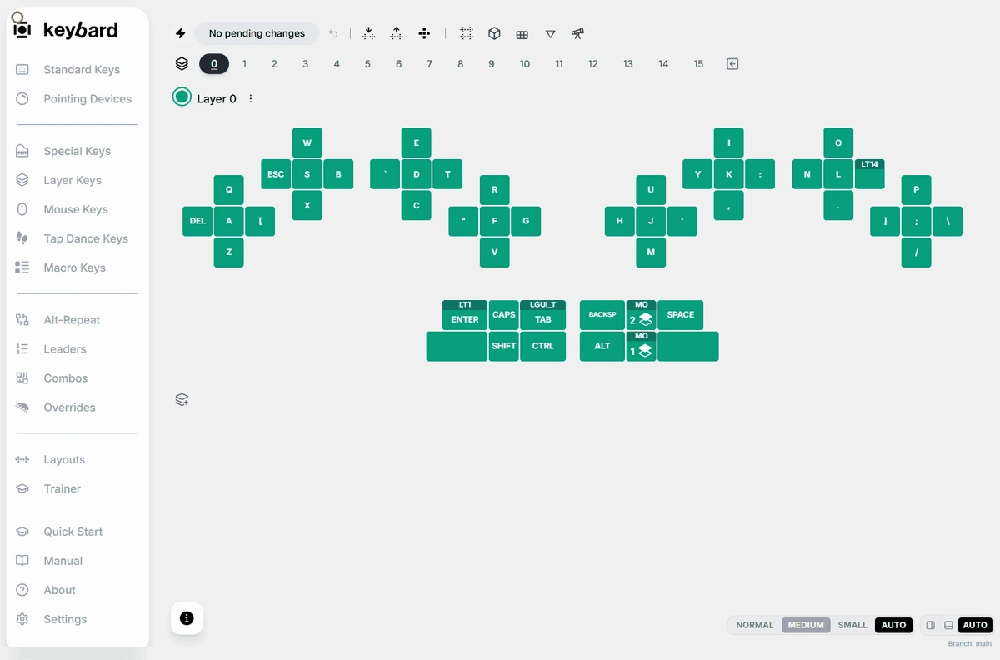
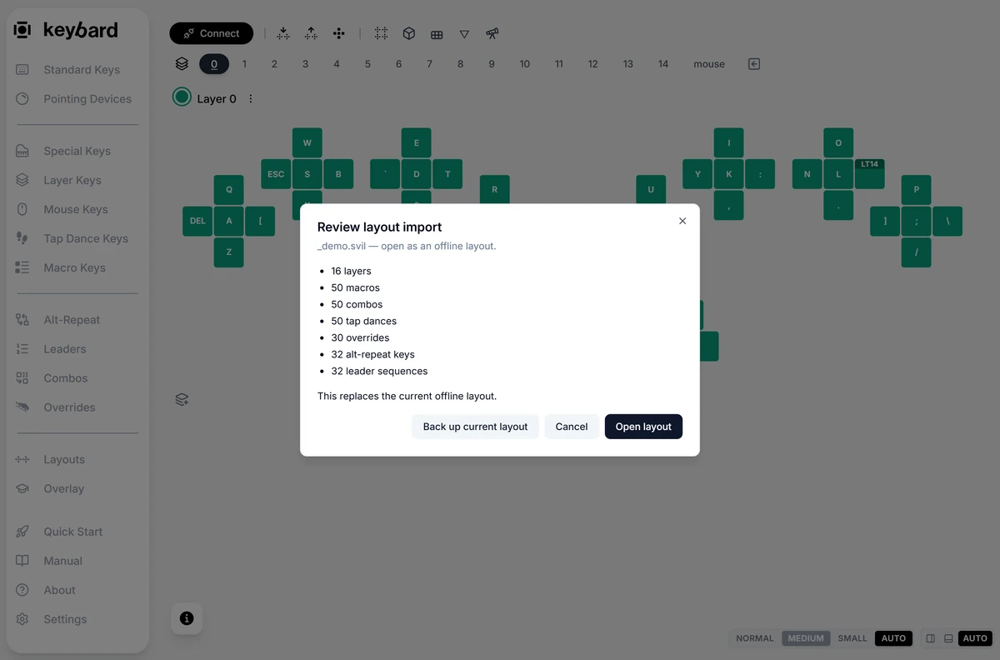
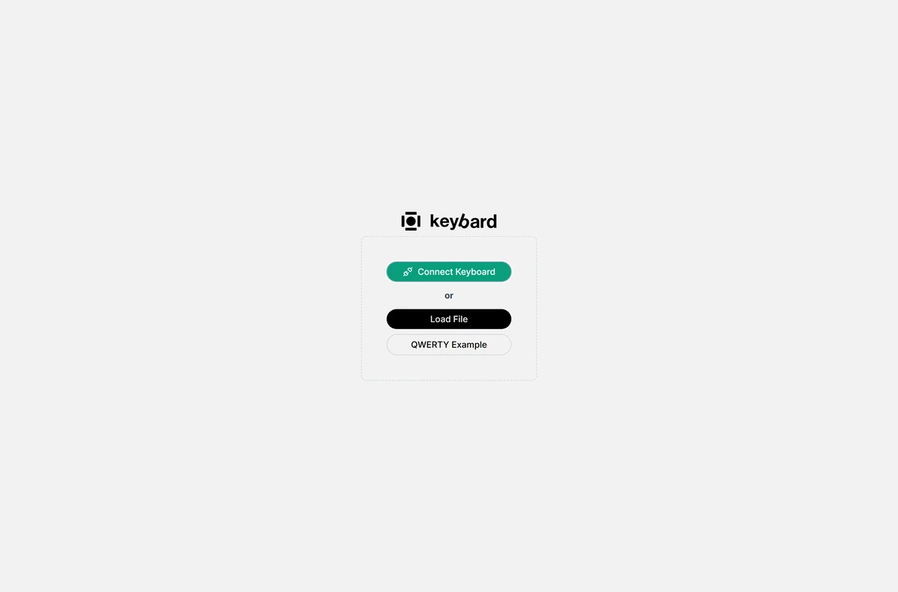

Keybard keeps two kinds of backup:

- **Automatic backups**: snapshots Keybard saves on its own while a board is connected.
- **Exported files**: `.svil` files you save yourself and keep where you like.

Use both. Automatic backups catch the change you forgot to save. An exported file survives a new computer or a cleared browser.

## Before you flash firmware

Flashing firmware resets the board's settings, including your layout.

1. Connect in Keybard and choose **Export Layout**. Save a `.svil` with **Include Macros** on, somewhere outside the browser.
2. Flash both halves. See [Flashing firmware](/firmware/flashing/).
3. Reconnect, choose **Import Layout**, and select your saved file.
4. Review the import. In Manual Updates, choose **Stage import**, then **Apply N Changes**. In Live Updating, choose **Apply import**.
5. Check your layers, behaviors, pointing settings, colors and names. Set your [default layer](/keybard/layers/#choose-the-layer-the-board-starts-on) again. Then export a fresh backup.

You can also restore from **Settings → Backups**. Pick a snapshot from before the update: one saved after the reset holds the defaults.

## Automatic backups

Open **Settings → Backups**. Nothing needs to be turned on. While a board is connected, Keybard saves a snapshot:

- when the board connects and finishes loading, before you change anything
- about 10 seconds after your edits stop
- when you switch tabs or close Keybard within those 10 seconds

A snapshot holds the same information as an exported `.svil`. If nothing changed since the last one, no new snapshot is added.

Backups are grouped by board, with the connected board first. Keybard tells boards apart by their serial number, so two Svalboards keep separate histories even with the same name. Each entry shows:

| Shown | Meaning |
| --- | --- |
| Date and time | When the snapshot was saved. |
| **Connected** or **Edited** | Saved when the board connected, or after you edited it. |
| Change summary | What changed since the previous backup of this board, such as *2 keys, 1 macro*. The first backup says *As loaded*. |
| **Unsent (N)** | The snapshot includes N edits still pending in Manual Updates. Restoring it brings them back, though the board never got them. |

The newest eight backups of each board are shown. **Show all** lists the rest. Keybard keeps every backup from the last 24 hours, the latest of each day for 30 days, and after that the latest of each month. The most recent **Connected** backup is always kept.

### Restore, download or delete a backup

- **Restore** opens **Review layout import**, the same review used for files. In Manual Updates, **Stage import** adds the differences to your pending edits; nothing reaches the board until you choose **Apply N Changes**. In Live Updating, **Apply import** writes them straight away. Apply or discard pending edits before you restore.
- The download button saves the backup as a `.svil` file.
- The delete button removes the backup after you confirm.

### Keep a copy in a folder

Automatic backups live inside the browser. To also keep them as files, choose **Choose backup folder** in **Settings → Backups**, pick a folder, and allow Keybard to edit files there. This needs a browser that lets websites save to a folder, such as Chrome or Edge.

- Each board gets its own subfolder, named after the board and its serial number.
- `latest.svil` always holds the newest backup. There is also one file per day with changes, named by date, such as `2026-10-03.svil`.
- Dated files are kept for 30 days, then one per month. Keybard only deletes files it wrote.
- Renaming a board starts a new subfolder. The old one stays as it was.

Browsers ask again before a site may keep writing to a folder. When that happens, **Settings → Backups** shows **Paused** and a **Resume backups** button. Choose it. If the browser offers **Allow on every visit**, choose that so it doesn't ask again. Backups made while paused are written when you resume.

If the folder was moved or deleted, Keybard shows **Folder not found**; choose a folder again. **Change folder** switches folders. **Stop using folder** stops writing files; files already written stay.

:::caution
Automatic backups belong to this browser profile on this computer. Another browser, profile or computer has its own list. Clearing this site's data deletes them, though copies in a backup folder remain. Only a connected board is backed up, not an example or a loaded file.
:::

## Export and import files

Use `.svil` files for your backups. **Export Layout** and **Import Layout** are in the toolbar above the keyboard.

| Action | What it does |
| --- | --- |
| **Export Layout** | Downloads the editor's current configuration, including pending edits. |
| **Load File** (welcome screen) | Opens a file as an offline draft. Writes nothing to a board. |
| **Import Layout** | Reviews a file's changes for the current board or draft. |
| **Restore** (Settings → Backups) | Opens the same review for an automatic backup. |
| **Import** (Layouts) | Adds layouts to the browser's library. |
| **Save Layer...** | Saves one layer to the library. Not a backup. |

### Import a backup onto your board

1. Connect the board and export its current configuration first.
2. Apply or discard pending edits.
3. Choose **Import Layout**, select the file, and read **Review layout import**.
4. Check the destination, counts, warnings and errors. **Back up current layout** is available in the review.
5. In Manual Updates, choose **Stage import**, check the pending edits, then apply them. In Live Updating, **Apply import** writes the changes. Offline, **Open layout** replaces the current draft.
6. Test the important keys before relying on them.

A `.svil` restores the keymap, macros, tap dances, combos, overrides, alt-repeat keys and leader sequences; QMK and pointing settings Keybard supports; layer colors; layer, macro and tap-dance names; and hardware positions.

It is not a full device image. The review lists settings it can't restore. Entries beyond those in the file stay on the board. The board's USB name and its saved default layer are separate settings: check them after restoring.

Keybard can refuse a file whose matrix size doesn't match, that has too many layers or entries, or that holds keycodes or macro content the board can't take. Read the message rather than forcing the file through.

The export dialog also offers a legacy `.vil` format. It leaves out Svalboard settings, names, colors and hardware selections. Use `.svil`.

## Return to saved work

To continue offline work, choose **Load File** on the welcome screen and open your exported file. If you forgot to export from a connected board, look in **Settings → Backups**.

Name your backups so you can tell them apart: one before a big change, one after you've checked it. Keep both until you're happy with the new layout.
