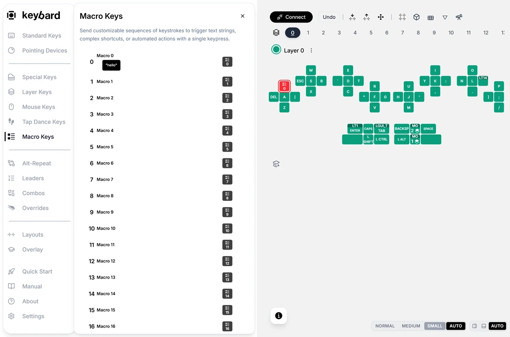
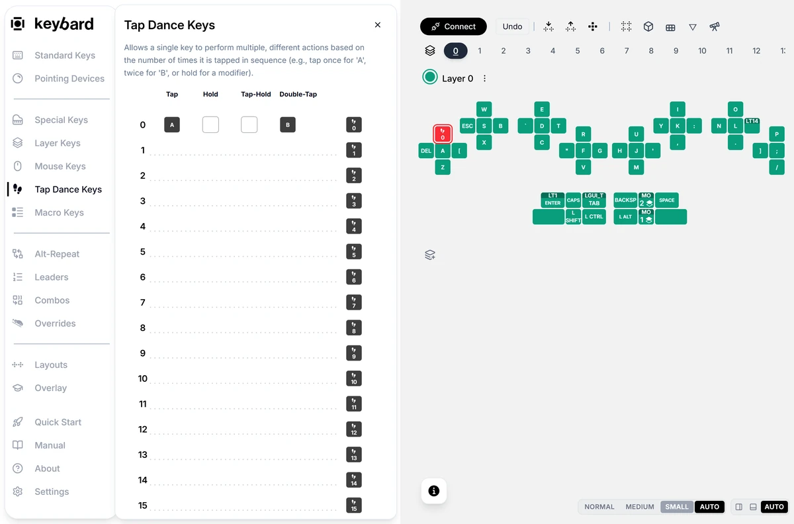
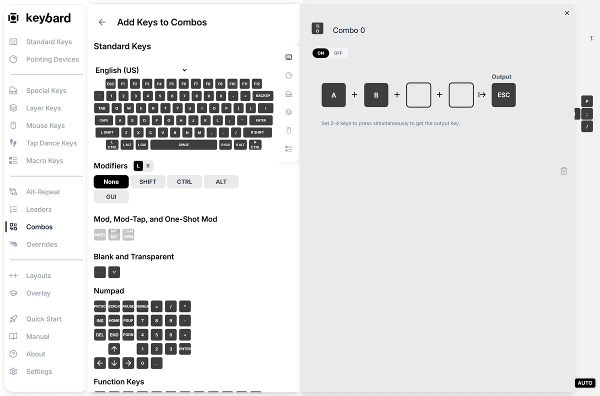
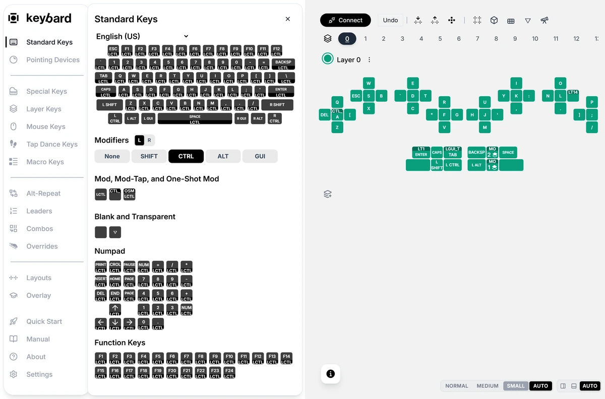
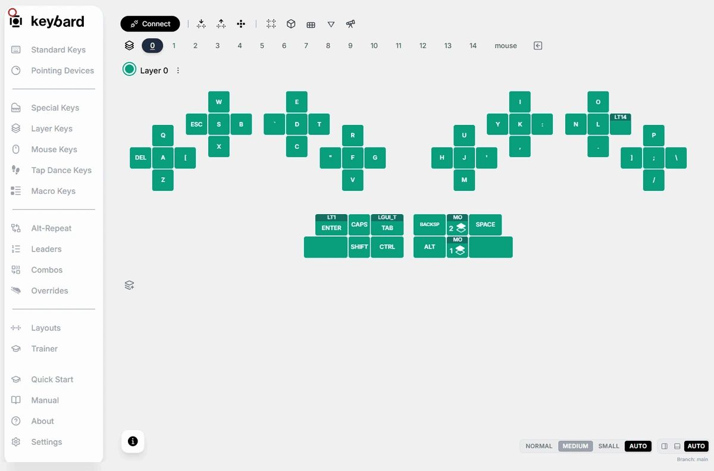
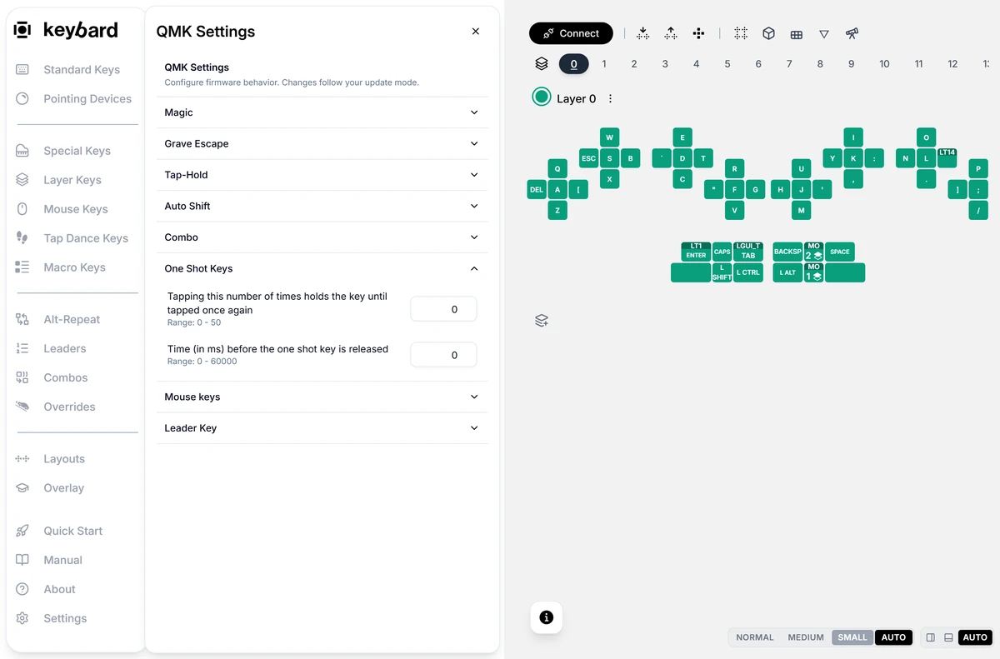
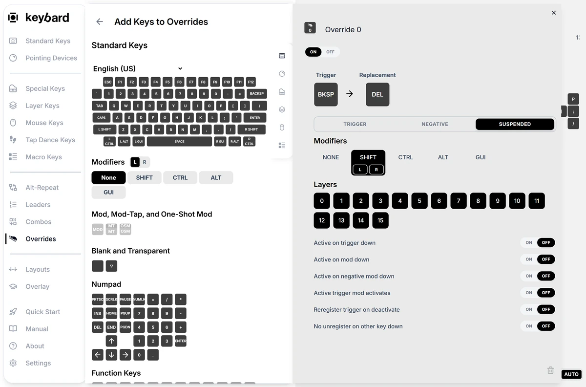
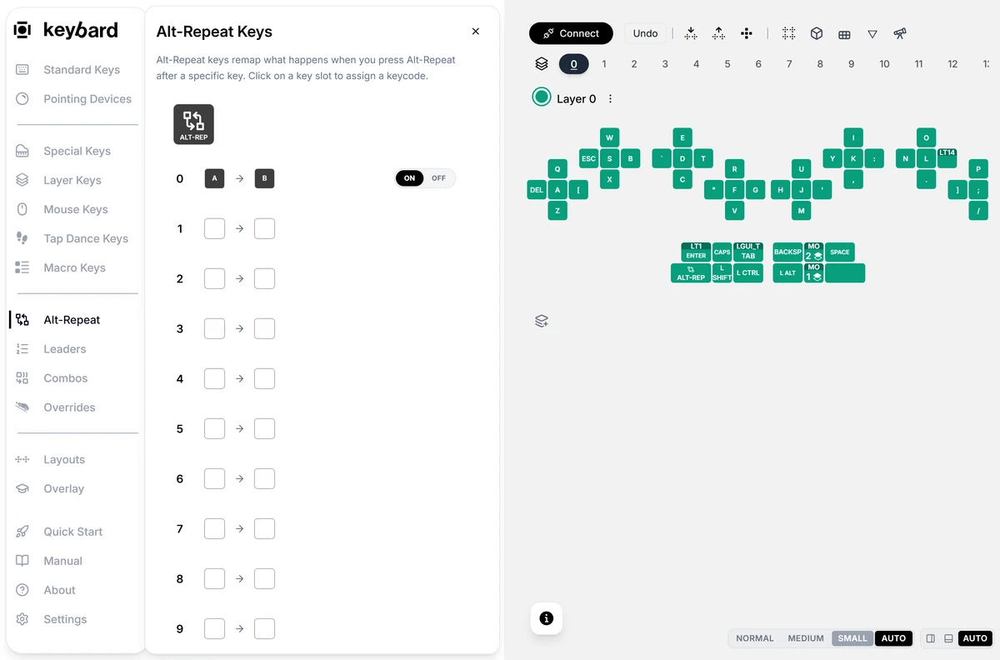

A normal key sends one key. A behavior can send a sequence, tell a tap from a hold, or respond to several keys together.

Svalboard QMK has 256 entries each for macros, tap dances, combos, overrides, alt-repeat mappings and leader sequences. Start with one small example, test it in an empty document, then build on it.

**Special Keys** holds media, system and lighting keys. **Layer Keys** and **Mouse Keys** have their own panels. They all work like **Standard Keys**: drag a key onto a position, or select a position and click a key.

:::note[Defining and using are different steps]
A macro or tap dance needs a definition and a key that uses it. Combos and overrides respond to the keys you set as their triggers. Leader sequences need a **Leader** key as well.

In Manual Updates, choose **Apply N Changes** before testing. Then close the editor, deselect, and test in a scratch document. Typing while a position is selected can change your layout.
:::

## Macros

**Macro Keys** → edit an entry.

A macro runs its actions in order. Start with something harmless, such as the text "hello".

1. Open **Macro Keys** and edit an unused entry. In the bottom-panel layout, the plus button opens an empty entry.
2. Add **Text** and type `hello`. Click the macro's title to give it a name.
3. Close the editor. Select a spare position, then click the macro's tile, or drag the tile onto the position.
4. Apply the changes. Deselect and focus an empty document. Press the key: it should type your text.
5. Add more actions only once this works. Then export a fresh backup.

| Action | What it does |
| --- | --- |
| **Key Tap** | Presses and releases a key. |
| **Key Down** | Holds a key down. |
| **Key Up** | Releases a held key. |
| **Delay** | Waits the number of milliseconds you set. |

For a shortcut, use a modifier **Key Down**, a **Key Tap**, then the matching **Key Up**. Always release what you hold. All macros share one block of storage.

Text macros send keystrokes, not clipboard text. Your computer's keyboard layout decides which characters come out, so test punctuation. Don't store passwords in macros: a macro and an exported file are not a secure place for secrets.

## Tap dances

**Tap Dance Keys** → edit an entry.

A tap dance gives one key several outputs. To learn it, set **Tap** to A and **Double-Tap** to B, and leave the rest empty.

1. Open an unused entry in **Tap Dance Keys**.
2. Select the **Tap** slot and assign A. Select **Double-Tap** and assign B. **Hold** is a long press. **Tap-Hold** is a tap followed by a held press.
3. Leave **Enabled** on. Don't change the timing yet.
4. Close the editor and assign the tap dance's tile to a spare position. Apply the changes.
5. Deselect. Test a single tap, then a quick double tap. If your double taps come out as two single taps, adjust the timing.

:::caution
Release a tap-dance key before changing what it does. Editing a tap dance while it is held can leave its old output held.
:::

## Combos

**Combos** → edit an entry.

A combo watches for up to four keys pressed together and sends its **Output**. For example, A and B together can send Escape. Combos match the keys' bindings, not physical positions, so think about where those keys sit on each layer.

1. Choose an unused combo. Fill the first two inputs with A and B. Set **Output** to Escape.
2. Leave the other inputs empty and enable the entry.
3. Apply the changes. Deselect, then press each key alone before pressing them together.
4. If the combo is hard to hit, raise **Combo Timeout** in the Combos panel while connected. Raise it a little at a time: a long window can catch normal typing.

There's no combo key to place. Pick key pairs you rarely type together.

## Mod-taps and one-shots

**Standard Keys** → **Modifiers** → **Mod, Mod-Tap, and One-Shot Mod**.

- A shortcut such as Ctrl+C sends both together.
- A **mod-tap** sends A when tapped and holds Control when held.
- A **one-shot** modifier lets you tap Shift, let go, then type the shifted key.

To make a key A on tap and Control on hold:

1. Assign A to the position. Select the position again if assigning cleared the selection.
2. In **Standard Keys**, choose **CTRL** under **Modifiers**. The built keys use the selected position's key.
3. Choose the **MT** (mod-tap) tile, not the plain modifier or the one-shot tile.
4. Apply, deselect, and test a tap. Then hold the key and press another key.

For a one-shot Shift, choose **SHIFT** and the **OSM** tile. Tap the key, let go, then type a letter.

Modifiers come in left and right versions. Some views also offer **MEH** (Control, Shift and Alt) and **HYPER** (those plus GUI). GUI is the Windows or Command key.

### One-shot settings

Open **Settings → General → QMK Settings...** → **One Shot Keys** while connected. On vLaunch2 and later, an unused one-shot releases after **5000** ms, and tapping it **5** times locks it on. Tap a locked one-shot again to release it.

1. Set **Tapping this number of times holds the key until tapped once again** to the number you want, or **0** to turn off locking.
2. Set **Time (in ms) before the one shot key is released**, or **0** to turn off the timeout. Set both to 0 for one-shots that never time out or lock.
3. Press Enter or leave each field. In Manual Updates, apply the changes. Test waiting past the timeout and tapping repeatedly.

These settings apply to one-shot modifiers and one-shot layers. Importing a backup can change them, so check them after a restore. Mod-taps also depend on the tap-hold settings in [Settings and checks](/keybard/settings/#typing-feel).

## Overrides

**Overrides** → edit an entry.

An override replaces a key when certain modifiers are held. For example, Shift+Backspace can send Delete. It changes how an existing key behaves, so there's no override key to place.

1. Set **Trigger** to Backspace and **Replacement** to Delete.
2. In the **Trigger** modifier tab, select Shift. Check left and right if you use both Shift keys.
3. In **Suspended**, select Shift too, so the replacement is plain Delete, not Shift+Delete. **Negative** lists modifiers that stop the override; leave it empty here.
4. Choose the **Layers** it applies to and enable it. Leave the other options alone for now.
5. Apply, deselect, and test: Backspace still deletes left, and Shift+Backspace deletes right.

## Leader sequences

**Leaders** → the **Leader** key and sequence entries.

A leader sequence is a **Leader** key followed by keys typed one after another. For example, Leader, A, B can run a macro that types "hello".

1. Create and test the "hello" macro first.
2. Open **Leaders**. Assign its **Leader** tile to a spare position.
3. Edit an unused sequence. Set its first two keys to A and B, and its **Output** to your macro. Enable it. Sequences can be up to five keys.
4. While connected, check **Leader Timeout**. With **Per-key timing** on, the timer restarts after each key. Otherwise the whole sequence shares one time limit.
5. Apply, deselect, and type Leader, A, B.

## Alternate repeat

**Alt-Repeat** → edit a mapping.

Alternate repeat sends a different key depending on the key you typed last. To try it, map A to B and place the alternate-repeat key on a spare position. Type A, then press the alternate-repeat key: it types B.

1. Choose an unused entry. Set **Trigger** to A and **Alternate** to B, and enable it.
2. Assign the alternate-repeat key from the panel to a position. Apply and deselect.
3. Test this before trying **Bidirectional**, **Ignore mod handedness** or **Default to alternate**.

:::caution
Alternate repeat has known firmware defects with modifier matching and **Default to alternate**. Test custom mappings before relying on them, especially with modifiers.
:::
