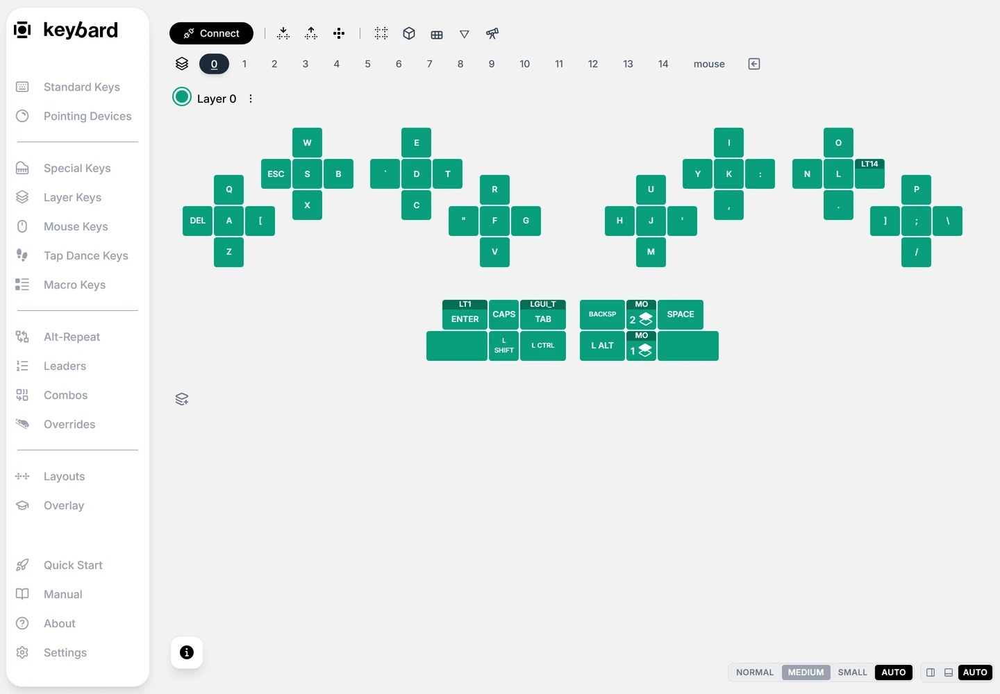
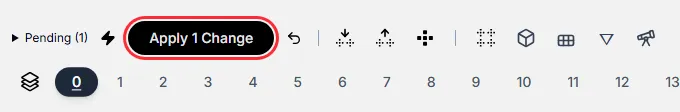
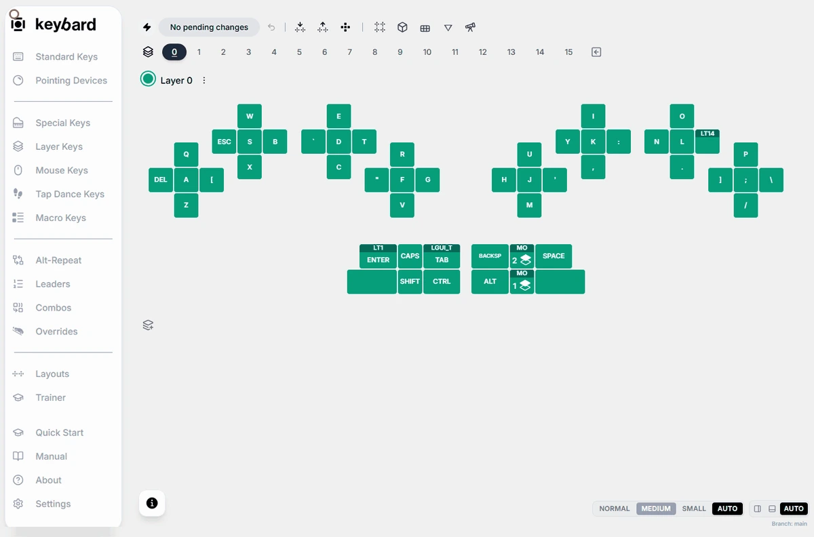
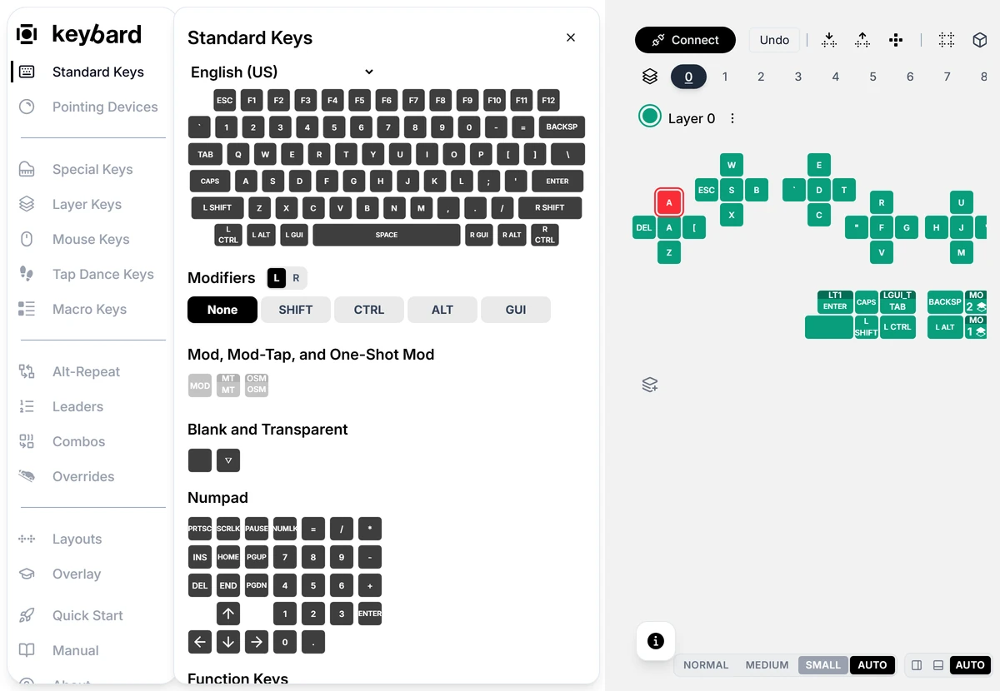
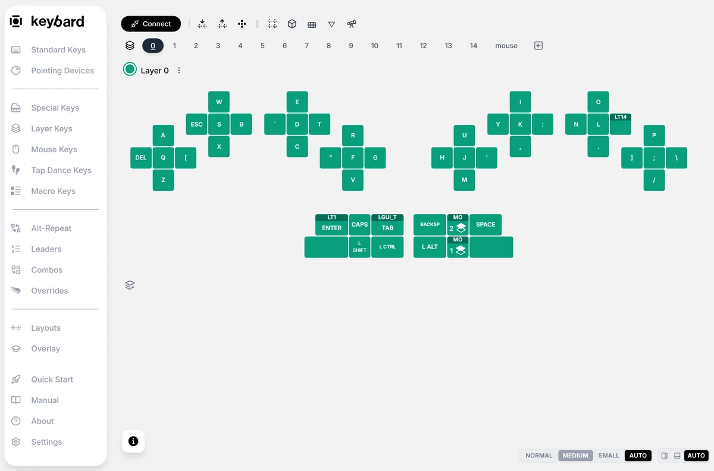

Start with one easy-to-recognize key on a layer you know. Leave the keys you use to switch layers alone until you are comfortable restoring a backup.

## Choose when changes reach the board

**Live Updating** is on by default. While connected, each edit is saved to the board as you make it.

For a controlled first experiment, click the lightning control labeled **Switch to Manual Updates**. Edits then wait in a queue until you apply them.

| Control | What it does |
| --- | --- |
| **Live Updating** | Edits are saved as you make them. Watch for saving or error messages. |
| **Pending (N)** | In Manual Updates, the number of edits waiting. Click it to see the list. |
| **Apply N Changes** | Writes the pending edits to the board. |
| **Discard pending edits** | Throws away edits not yet applied. It doesn't undo changes already applied. |
| **Switch to Live Updating** | Applies the pending edits, then turns Live Updating back on. |

## Assign a key

1. Select the layer tab you want to edit.
2. Open **Standard Keys**.
3. Drag a key from the palette onto the position you want to change. Or select the position first, then click a palette key.
4. Check the new legend. In Manual Updates, **Pending (N)** counts the edits waiting.
5. Choose **Apply N Changes** and wait for saving to finish. A changed legend alone doesn't mean the board has it.
6. Click away to deselect the key. Open a text editor, switch to the layer you edited, and press the key.
7. Export the working result as a new `.svil` file.

## Swap two keys

Dragging a key from the layout onto another position swaps the two bindings, even across layers. Dragging from a palette assigns a copy instead.

If an **Undo** button appears, its tooltip names the change it reverses. It is not a full edit history.

## Typing can assign a key

**Typing Binds a Key** is on by default. While a position is selected, pressing a key on your physical keyboard assigns that key to it, modifiers included.

Deselect before you test normal typing. To turn this off, open **Settings → General** and switch off **Typing Binds a Key**.
