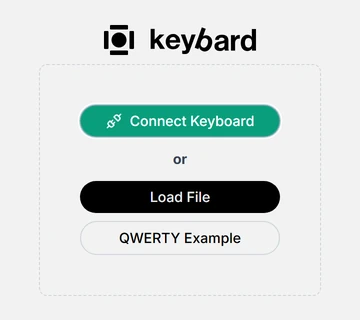
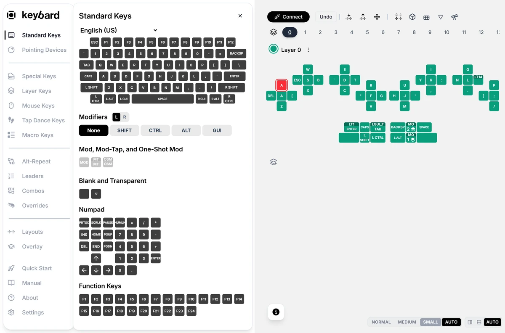
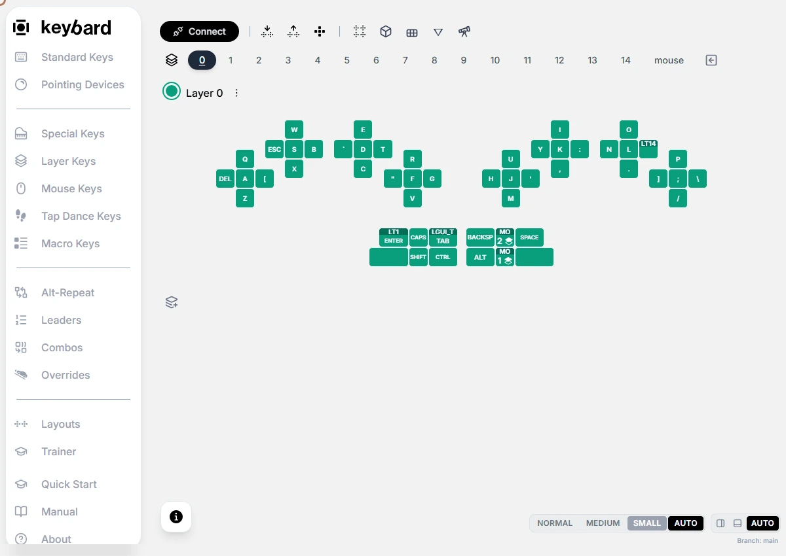

Keybard is the web app that configures a Svalboard running Svalboard QMK firmware. It runs in your browser at [keybard.svalboard.com](https://keybard.svalboard.com). There is nothing to install.

With Keybard you change what each key does, organize layers, build macros, tap dances, combos and other behaviors, tune your pointing devices, and back up your setup. You can explore it without a keyboard first.

<!-- VERIFY: most screenshots here were recaptured from the current Keybard (offline QWERTY Example). Eight need a connected board and still show the older navigation rail ("Trainer"): toolbar-pending-apply, manual-updates-apply-one-change, automatic-backup-after-edit, restore-automatic-backup, pointing-dpi, settings-reset-recovery, make-default-layer, and the Host overlay animation. Recapture them on a test board. -->

## What you need

- **A desktop browser that supports WebHID**: Chrome or Edge. Firefox and Safari don't support WebHID, so **Connect Keyboard** is unavailable there.
- **A USB data cable** between your computer and the half you plug in.
- **Svalboard QMK firmware** on the board. A board still on Svalboard's Vial firmware needs new firmware first; see [Moving from Vial](/firmware/#moving-from-vial).

## The welcome screen

| Choose | What happens | Use it for |
| --- | --- | --- |
| **Connect Keyboard** | The browser asks which keyboard to open. Keybard then reads its configuration. | Editing your Svalboard. |
| **Load File** | A saved layout opens as an offline draft. | Inspecting a backup or continuing exported work. |
| **QWERTY Example** | A bundled example opens without a keyboard. | Learning the controls safely. |

The recording above opens **QWERTY Example**, opens **Standard Keys**, and drags A onto Q. No keyboard is changed.

If the left navigation shows only icons, click the logo at its top to show the labels. Hovering an icon also names it.

## Connect your Svalboard

1. Plug your Svalboard in by USB and open [keybard.svalboard.com](https://keybard.svalboard.com).
2. Choose **Connect Keyboard**.
3. Select your keyboard in the browser's chooser and allow access. If several keyboards are attached, check that you picked the right one.
4. Wait for the layout to load.
5. Export a backup before you change anything (next section).

After a refresh, Keybard returns to the welcome screen. Keyboards you allowed before appear under **or reconnect without the chooser**.

## Back up before your first edit

1. Choose **Export Layout** in the toolbar above the keyboard.
2. Keep **.svil (Recommended)** and **Include Macros** selected, then choose **Export**.
3. Give the file a clear name, such as `before-first-edit.svil`, and keep it outside the browser.

Export saves what the editor shows, including changes not yet applied to the board. Exporting after experimenting doesn't give you back the untouched layout. Export first.

Keybard also keeps [automatic backups](/keybard/backups/) while a board is connected.

## Three places your work can live

| Where | What it is |
| --- | --- |
| **On your Svalboard** | The saved configuration the keyboard runs. Connecting reads it. Applying edits changes it. |
| **In this browser session** | The current draft. It can include changes not yet applied, so the layout on screen is not always what the board runs. |
| **On your computer** | An exported file. A copy you keep. |

An example or a loaded file is an offline draft. Keybard writes nothing to a keyboard from it. Export the draft before closing or refreshing the page. Connecting a keyboard later reads that keyboard; it doesn't install your draft.

## Know what you are editing

| State | Meaning |
| --- | --- |
| Editing a keyboard | Changes can be written to the connected board. |
| Offline draft | Changes affect the loaded file or example in this session. Export to keep them. |
| Pending changes | Changes are waiting to be written. The board may differ from the screen. |
| Not saved | A write failed. Some earlier writes may have succeeded. See [Troubleshooting](/keybard/troubleshooting/#a-save-failed). |

## Which firmware is on the board

Open **About** in the left navigation. Under **Keyboard firmware** it shows the connected board's **Release**, its **Build**, and the protocol and keycode versions. When newer firmware is available, About says so and links to it.

The firmware doesn't report its release by name. Keybard works it out from the features the board reports, so it may show a release followed by "or later".

If a half's firmware doesn't match the pointing device attached to it, Keybard warns you when you connect. See [Pointing devices](/keybard/pointing/#wrong-pointing-device-firmware).

## In this section

- [Make your first change](/keybard/first-change/)
- [Layers and layouts](/keybard/layers/)
- [Layer lights and brightness](/keybard/layer-lights/)
- [Backups and files](/keybard/backups/)
- [Behaviors](/keybard/behaviors/)
- [Pointing devices](/keybard/pointing/)
- [Settings and checks](/keybard/settings/)
- [Desktop overlay](/keybard/overlay/)
- [Troubleshooting](/keybard/troubleshooting/)
