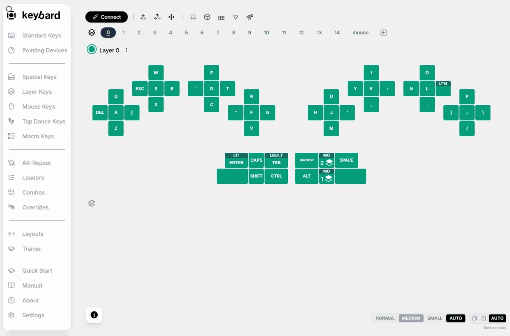
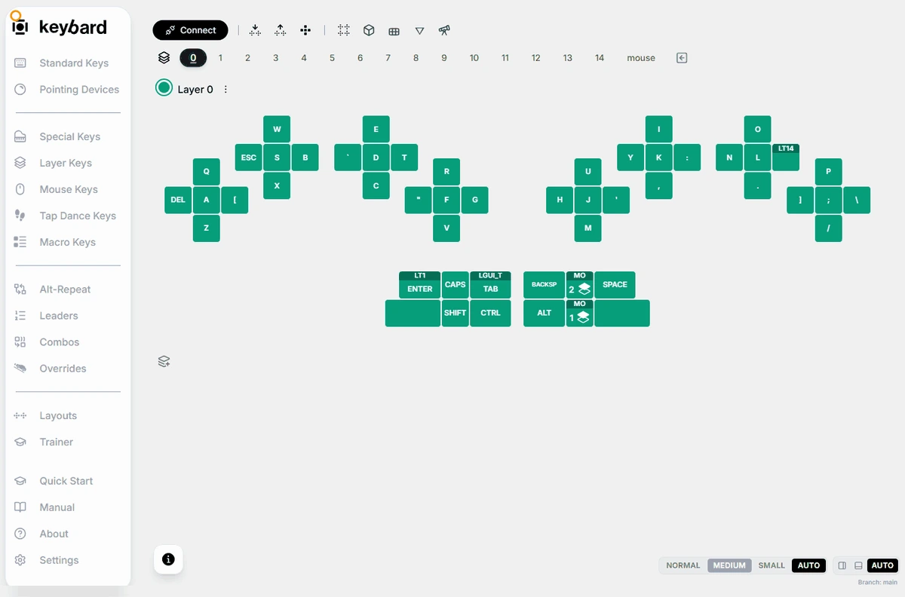
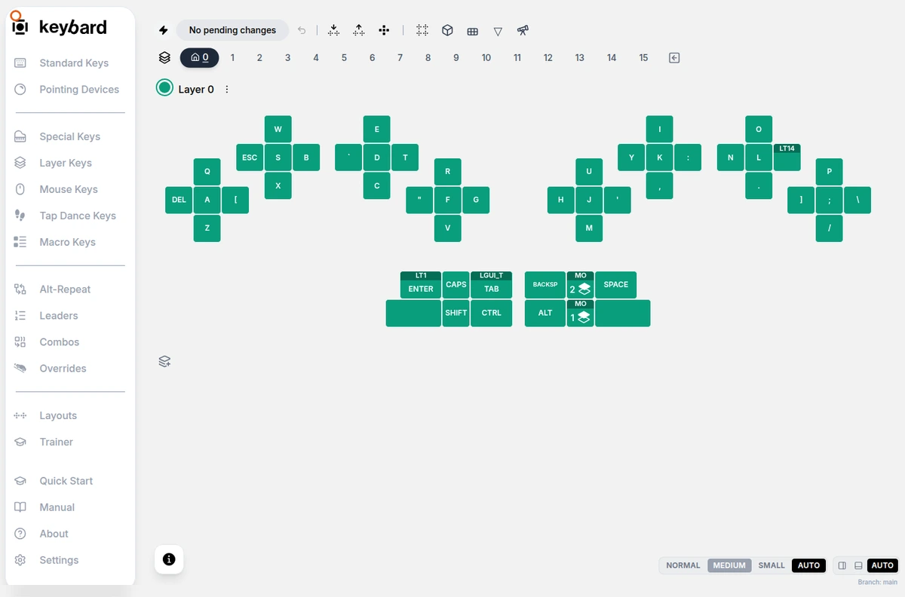
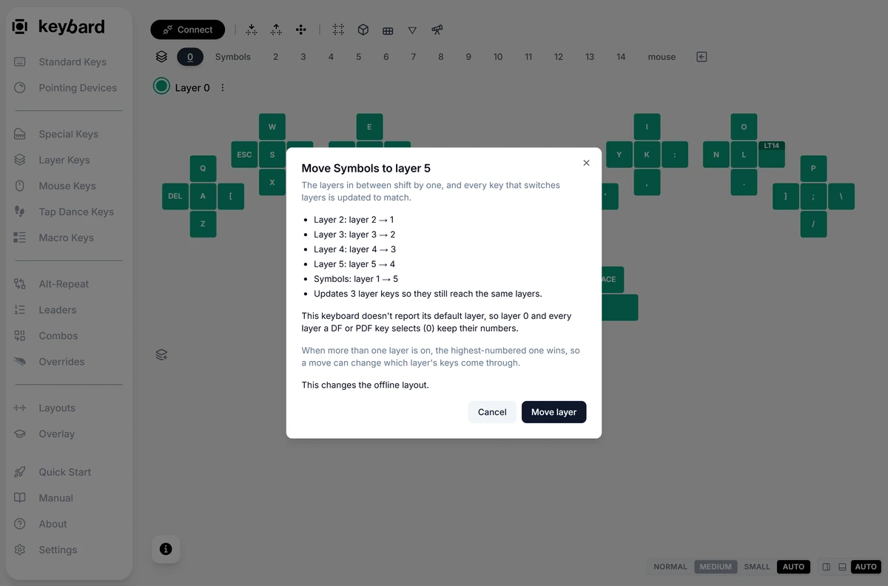
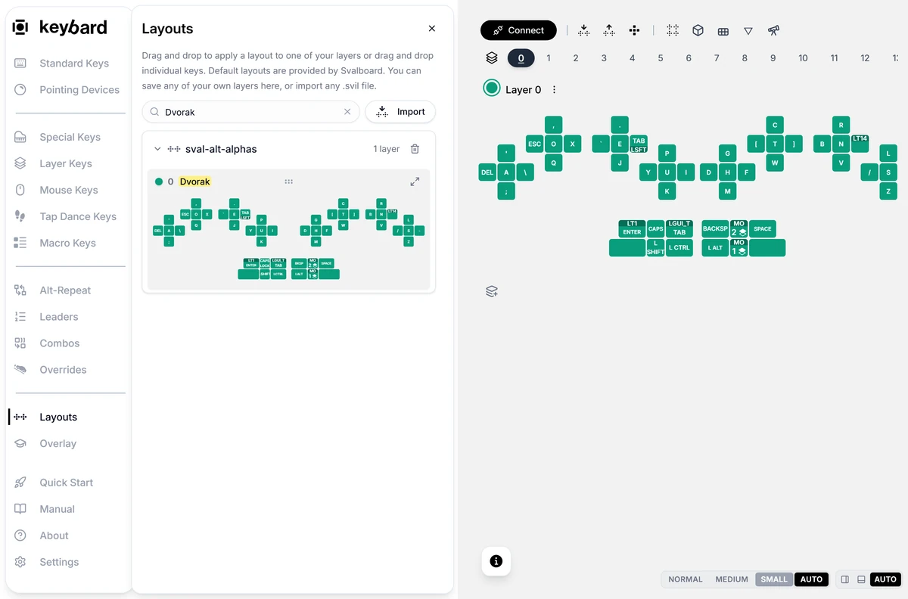
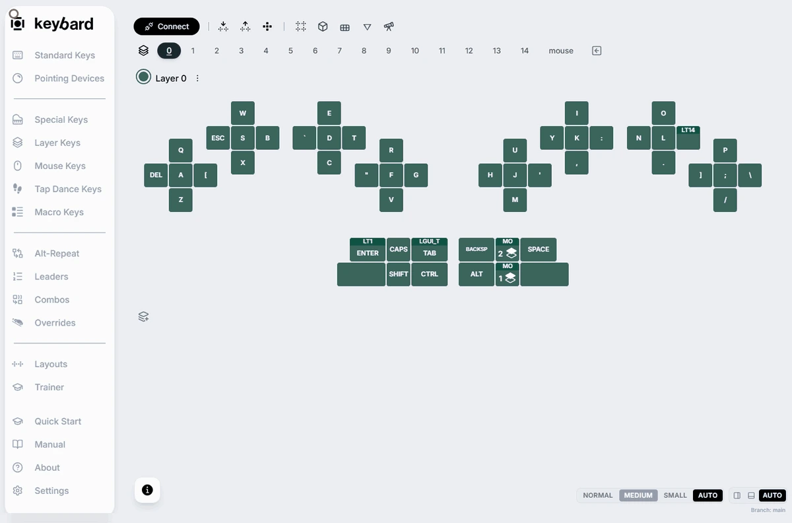
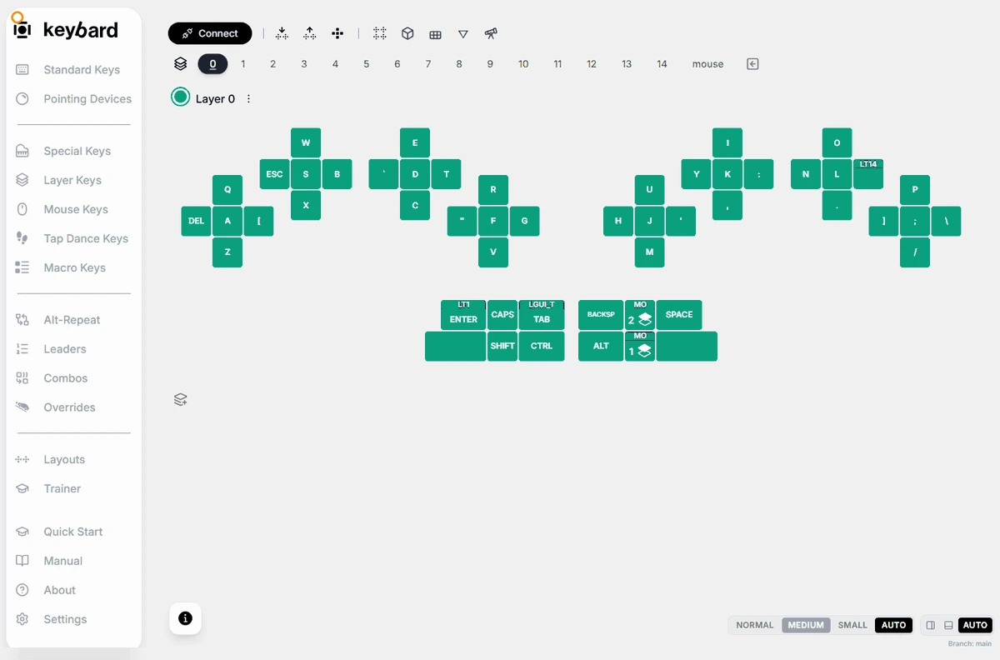

A layer is another set of bindings for the same physical keys. Clicking a layer tab changes what you see in Keybard. A layer key on the keyboard changes what the keyboard types.

| Term | Meaning |
| --- | --- |
| Default layer | The starting layer, used when no higher active layer provides a binding. |
| Transparent key | Uses the binding from the next active layer below. |
| Blank key | Does nothing at that position. It doesn't fall through. |
| Momentary layer key | Turns on another layer while held. |
| Layer-tap key | Types a key when tapped, and turns on a layer when held. |

When several layers are active, the highest-numbered one wins.

## Build a navigation layer

Layer keys are in **Layer Keys**. Start with a momentary key that opens a small navigation layer.

1. Choose an unused layer, such as layer 3. Assign a few arrow keys from **Standard Keys**. Leave the other positions transparent so they use the layers below.
2. Go back to the base layer and select a spare position.
3. Open **Layer Keys**, choose **MO** (Momentary), and click the tile for layer 3.
4. Apply the changes and deselect. In a text editor, hold the new key and try the arrows. Release it and check that normal typing returns.

To make the same key type something when tapped, assign the tap key first. Select the position again, then choose **LT** (Layer Tap) and the layer. Keybard takes the tap key from the selected position.

| Layer Keys button | Use it to |
| --- | --- |
| **MO** (Momentary) | Turn a layer on only while held. |
| **LT** (Layer Tap) | Send a key on tap, and turn a layer on while held. |
| **TG** (Toggle Layer) | Turn a layer on or off with a tap. Keep a way to toggle it off. |
| **TT** (Tap Toggle) | Hold for a momentary layer, or tap the set number of times to toggle it. |
| **OSL** (One Shot Layer) | Turn a layer on for the next key only. |
| **TO** (To Layer) | Switch to a layer, turning off the others except the default. Plan a way back. |
| **DF** (Default Layer) | Change the default layer until the board restarts. |
| **PDF** (Persistent Default Layer) | Keybard currently assigns this as DF. Use **Make Default Layer** to save a default. |

## Transparent and blank

With layer 3 active, a transparent key at the A position types A from the base layer. A blank key at that position types nothing.

## Name, color and compare layers

- Click a layer's name to rename it. Names can be up to 16 bytes. Accented letters and emoji use more than one byte each.
- Click the color dot beside the name to pick its color. See [Layer lights and brightness](/keybard/layer-lights/).
- The layer's actions menu has **Copy Layer**, **Paste Layer**, **Make All Blank**, **Make All Transparent**, and **Switch Blank to Transparent** and **Switch Transparent to Blank**. These change many keys at once, so check the layer first.

**Show Multiple Layers** shows layers together. **3D View** stacks them. **Hide All Transparent Keys** hides inherited keys from view; it doesn't change them. **Show All Layers** brings back layers hidden by that filter. Viewing a layer doesn't turn it on in the keyboard.

## Choose the layer the board starts on

A house icon marks the default layer.

1. Connect the board.
2. Right-click the layer tab you want and choose **Make Default Layer**.
3. In Manual Updates, apply the change. In Live Updating, it saves right away.

Keybard reads the value back to check it. The board keeps this default after you unplug and restart it.

This needs vLaunch2 firmware or later. On older firmware the menu shows **Make Default Layer (needs newer firmware)**. A **DF** key changes the default only until the board loses power.

## Reorder layers

1. Export a backup. Apply or discard pending edits.
2. Drag a layer tab to the gap where it should go.
3. Read the **Move … to layer …** review. Layers in between shift by one. Layer keys such as MO, LT and TG follow their layers. Names and colors move with them.
4. Choose **Move layer**. In Manual Updates, it waits for **Apply N Changes**. In Live Updating, it is written right away. Offline, only the draft changes.
5. Test your layer keys. Use **Undo** if needed, then export the result.

The mouse layer must stay last. Read any warning about tri-layer targets. On vLaunch2 or later, the default layer stays the default at its new number. On older firmware or offline, the review explains moves it blocks.

Dragging a tab moves a layer. Dragging a preview from **Layouts** replaces a layer instead.

## Start from a layout Svalboard provides

**Layouts** in the left navigation lists layer groups from Svalboard, along with layers you saved. This is where to start a new layout.

| Group | Layers | What they are |
| --- | --- | --- |
| sval-default | The stock layers | The standard Svalboard layout. Use it to get back to a stock layer. |
| sval-alt-alphas | Dvorak, Colemak, HD Promethium, HD Neu, Graphite | Alternative letter layouts. Each is the stock base layer with only the letters and that layout's punctuation moved, so thumb keys and layer keys stay put. HD Promethium puts R on a left thumb key. Graphite adds Repeat on a right thumb key. |
| sval-num-sym-layers | Home-row numbers (default NavNAS), Left-hand tenkey + right-hand nav | Numbers, symbols and navigation. The first is the factory NavNAS layer: 1 to 0 on the center keys, shifted symbols above, navigation below. The second puts 1 to 0 under the left hand as a tenkey, with arrows on the right home row. Their thumb keys are transparent, so your base layer's thumb keys keep working. |

1. Export a backup if you are changing a layer you rely on.
2. Select the destination layer. For a letter layout this is usually layer 0. For a numbers layer, it is the layer your NavNAS key opens (layer 1 in the stock layout).
3. Open **Layouts** and type a name, such as *Colemak* or *tenkey*, in the search box.
4. Drag the layer's preview onto the destination layer's name. Read the confirmation, which names both layers, and choose **OK**.
5. The destination keeps its name and takes the new layer's color. Apply the changes in your update mode.

To try a letter layout without losing yours, drag it onto a spare layer and add a **DF** key for that layer from **Layer Keys**. When you want to keep it, use **Make Default Layer**.

You can also drag single keys from a preview onto your layout. If you delete a Svalboard group from Layouts, Keybard adds it back.

## Save and reuse your own layers

1. Open a layer's actions menu and choose **Save Layer...**. Give it a name.
2. Open **Layouts** and expand the saved layout.
3. Drag the layer onto the destination layer in the editor.
4. Read the confirmation and choose **OK** only if the destination is right.
5. Apply the changes in your update mode.

Saved layers live in this browser's storage. Clearing browser data can remove them. They are not a backup: export a `.svil` for that.
