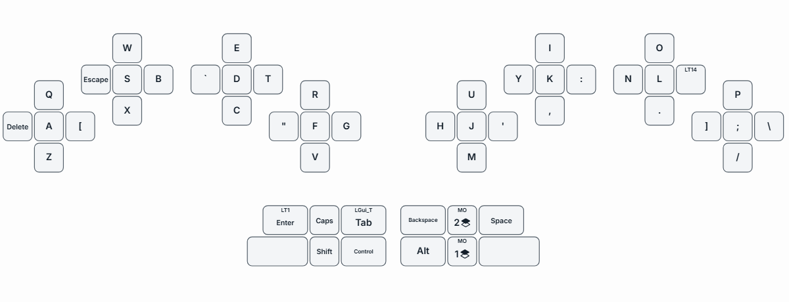

**Keybard Host** is a small desktop app that shows your layout above your other windows. It follows the layer you are on, so you can glance at it while you type in any app.

It only reads the keyboard. It never changes your layout or flashes firmware. It keeps its own settings.

In Keybard, **Overlay** in the left navigation (below **Layouts**) opens a small dialog. It offers the download and connects Keybard to Keybard Host.

## Install it on Windows

Keybard Host is a portable ZIP for 64-bit Windows 10 and 11. It isn't signed, so Windows may warn you.

<!-- VERIFY: the vLaunch2.3 release ships a portable ZIP (RELEASE-NOTES.md, HOST_DOWNLOAD in HostInstall.tsx). The repo also has a Windows installer build. Should these docs describe an installer instead? -->

1. In Keybard, choose **Overlay**, then **Download for Windows**. Or download **KeybardHost-Windows.zip** from the [latest Keybard Host release](https://github.com/svalboard/keybard/releases/latest).
2. Extract the whole ZIP to a folder you'll keep. Run **Start-Windows.cmd**.
3. The first start downloads its own copy of Python and Qt, so you need to be online. It needs no administrator rights and makes no system changes.
4. Keybard Host sits in the system tray and opens Keybard.

## Connect it to Keybard

1. In Keybard (Chrome or Edge), connect your keyboard.
2. Choose **Overlay**, then **Connect**.
3. If the browser asks whether the site can access apps on this device, allow it.

Once connected, the dialog shows the board Keybard Host is following and a **Disconnect** button.

Connecting lets the overlay keep up with your edits. About a second after a change reaches the keyboard, the overlay re-reads the layout. In Manual Updates, apply your changes first. Connecting also gives the overlay Keybard's keyboard language.

If you have more than one Svalboard, choose yours from **Board** in the overlay's **⋯** menu or the tray icon. Keybard Host remembers it.

## Move, resize and hide it

The grips sit above the overlay's corner.

- Drag the move grip to move the overlay.
- Drag the resize grip: up or right makes it bigger, down or left smaller.
- The collapse button hides the overlay and leaves just the grips. Click it again to bring the overlay back.
- **Show overlay** in the tray menu hides it completely, or shows it again.

Clicks anywhere else on the overlay, keys included, go through to the window underneath.

## Overlay settings

The overlay's **⋯** menu, above its corner, and the tray icon hold its settings:

- **Board**: the Svalboard to follow, or **Disconnect**.
- **Style**: Dark, Subtle, Outline only, Light or High contrast.
- **Outline shadow**: a contrasting shadow around legends and key outlines, readable on any background. On by default.
- **Colors…**: key fill, outline and legend colors and opacity, outline width, outline shadow, and the layer-change and held-key colors. Changes show as you make them. **Reset to default look** undoes them.
- **Layer highlight**: Off, Flash or Fade when the layer changes.
- **Highlight held keys**: lights the keys you're holding. On by default. Very quick taps can be missed, and it doesn't show macro or combo output.
- **Hands**: both halves, or one.
- **Capital letters**: shows letter keys in capitals.
- **Adaptive contrast** (Windows): restyles each key for the background behind it.
- **Place at bottom** and **Reload board layout**.

Shifted legends follow your computer's Shift and Caps Lock.

For layout changes made outside Keybard, or if the overlay looks out of date, choose **Reload board layout** from the overlay's menu or the tray.

## Versions and updates

The Overlay dialog shows which Keybard Host is connected. If it's older than the current release, the dialog links to the new one. The tray icon's tooltip shows your version too.

Updating Keybard doesn't update Keybard Host. To update it, quit from the tray, extract the new release to a new folder, and run it. Your settings carry over.

## Other platforms

- **Linux**: runs from source. Wayland limits placement, stacking and click-through.
- **macOS**: the ZIP includes `start-macos.sh` for macOS 13 or later with Python 3.10 or later. It hasn't been tested on a Mac yet.
