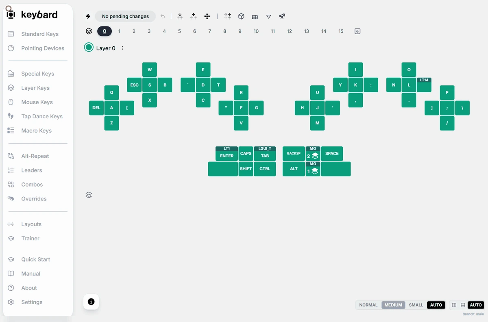

Open **Pointing Devices** in the left navigation. Connect the board first: the settings come from the board, so an example or a loaded file shows only the assignable keys. The settings depend on the pointing device installed, so your panel may differ from the one shown here.

## What's in the panel

- **Mouse Buttons**, and **Sniper Keys** and **Boost** keys to assign.
- **Left Pointer** and **Right Pointer**: DPI and **Scroll Mode** for each side.
- **Auto Mouse**: **Enable Auto Mouse**, which pointer turns on the mouse layer, the activation threshold and decay, and **Layer Timeout**.
- **Scroll Settings**: **Natural Scroll**, axis lock and other scroll options.

**Layer Timeout** can be 200, 300, 400, 500 or 800 ms, or Infinite. The default is 500 ms.

## Set up pointing step by step

1. Start with plain pointer movement. Change the left or right DPI in small steps. Apply the change in Manual Updates.
2. Test scrolling and its direction. Check per-side scrolling, axis lock and **Natural Scroll**.
3. Assign a **Sniper** key to slow the pointer for precise work. **Boost** speeds it up. The 2x, 3x and 5x versions set how much. Hold the key to use it; the TG versions (such as **2xTG**) toggle it on and off instead.
4. If you use Auto Mouse, make sure the mouse layer has the mouse buttons you need and an easy way back to typing. Check which pointer can turn it on. Then tune the threshold, decay and timeout one at a time.
5. Check movement, scrolling and getting back to typing. Then export a backup.

The mouse layer must stay the last layer.

Don't copy a DPI number from one kind of sensor to another and expect the same speed.

## Svalboard keys in Mouse Keys

**Mouse Keys** has keyboard-driven mouse movement, wheel and button keys. These are separate from the sensor's DPI.

It also has Svalboard's own keys, including:

- **Left DPI +**, **Left DPI -**, **Right DPI +** and **Right DPI -**
- **Scroll Left Toggle**, **Scroll Right Toggle**, **Scroll Toggle** and **Scroll Toggle Hold**
- **Axis Scroll Lock**
- **Fix Drift**: recalibrates a TrackPoint
- **AutoMouse Toggle**: turns Auto Mouse on or off
- **Mouse Key Timer**: steps through the same timeouts as **Layer Timeout**

The keys shown depend on the board's firmware.

## Which pointing module each hand has

On vNext1 firmware or later, Keybard detects the pointing module on each half. **Settings → Fragments** lists it under **Left** and **Right**, marked **Locked**. You can't change it there: it follows the hardware.

<!-- VERIFY: vLaunch2 doesn't report its pointing hardware; vNext1 does. But vNext1 has one file per side for every module, so the "Wrong pointing-device firmware" case below can't come up on any released firmware: only "Pointing device not picked up" can. Keep the next section, cut it to the not-picked-up case, or hold it until a per-module release reports its hardware? -->

## Wrong pointing-device firmware

Each half's firmware is built for one kind of pointing device, or for none. When you connect, Keybard checks this. If a half doesn't match, it shows **Wrong pointing-device firmware**. The dialog says which half is wrong, which device is attached, and the exact `.uf2` file that fixes it.

To fix it, download that file from the latest Svalboard firmware release and flash it to that half. See [Flashing firmware](/firmware/flashing/). Export a `.svil` first: flashing resets the board's settings.

The dialog can also say a half has no pointing device answering. If that half has one, check its cable. If it has none, flash the file the dialog names.

If the dialog says **Pointing device not picked up**, the firmware is right but the device didn't start. Check its cable, then unplug that half and plug it back in.

The warning shows once per connection. Choose **OK** to close it.
