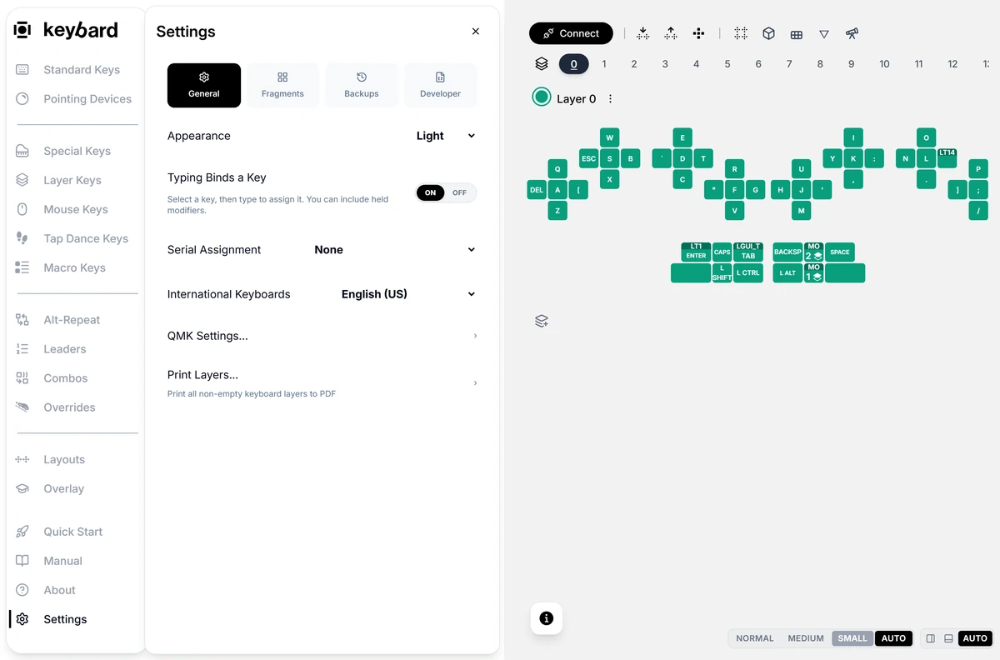
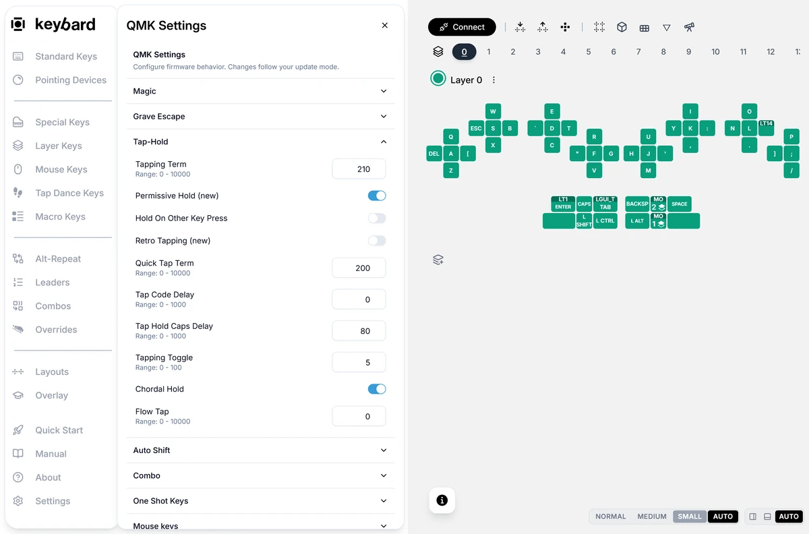
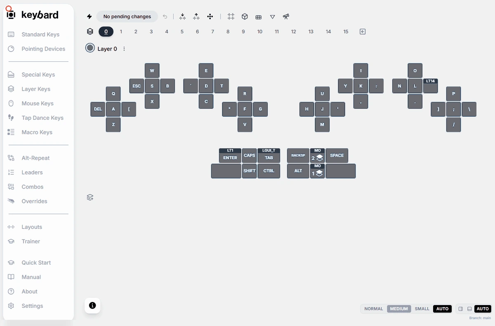
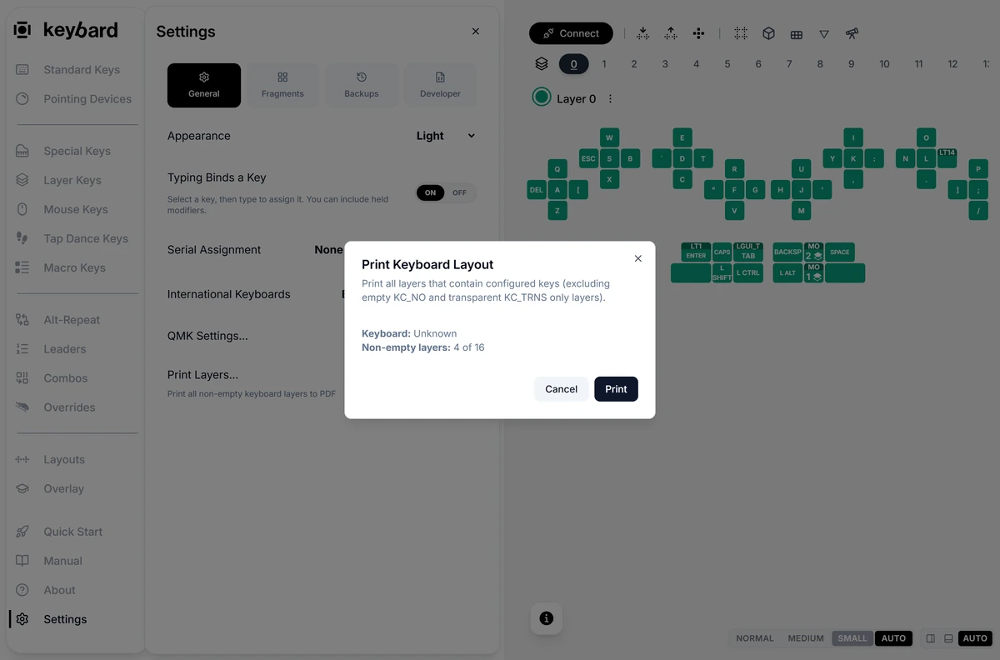

Open **Settings** at the bottom of the left navigation. It has four sections: **General**, **Fragments**, **Backups** and **Developer**. Backups are covered in [Backups and files](/keybard/backups/).

<!-- VERIFY: Settings → Developer holds tools that aren't public. This page names the section but doesn't describe it. Should it be left out entirely? -->

## General

- **Board name** (connected only): see [Board name](#board-name).
- **Appearance**: System, Light or Dark.
- **Typing Binds a Key**: when on, pressing a key on your keyboard assigns it to the selected position. On by default.
- **Serial Assignment**: after you assign a key, Keybard selects the next position, in the order you choose. With **None**, the default, the selection clears instead.
- **International Keyboards**: match this to your computer's keyboard layout so Keybard shows the right characters. It doesn't change the layout on your computer.
- **QMK Settings...**: timing and other firmware settings. See [Typing feel](#typing-feel).
- **Print Layers...**: see [Print your layers](#print-your-layers).

Appearance, Typing Binds a Key, Serial Assignment and International Keyboards are saved in this browser, not on the board.

## Board name

**Board name** sets how your computer and browser show the keyboard. Type a name and choose **Save now**. It is written right away, even in Manual Updates.

Restart the keyboard for your computer to show the new name. Keybard offers **Restart keyboard**. Apply or export your pending edits first.

The name stays on the keyboard across firmware updates. It is separate from your layout backups.

## Typing feel

Open **Settings → General → QMK Settings...** while connected. Export a backup first. Change one setting, apply it, and test both slow, deliberate presses and normal typing.

**Tap-Hold**:

- **Tapping Term**: how long a press can last and still count as a tap.
- **Quick Tap Term**: affects tapping a dual-role key twice quickly.
- **Permissive Hold (new)**, **Hold On Other Key Press** and **Retro Tapping (new)**: how other key presses and releases affect the tap-or-hold decision.
- **Chordal Hold**: uses which hand each key is on to decide.
- **Flow Tap**: favors taps during fast typing. 0 turns it off.
- **Tap Code Delay**, **Tap Hold Caps Delay** and **Tapping Toggle**: generated tap length, Caps Lock tap length, and the number of taps for a **TT** key. Their defaults are 0 ms, 80 ms and 5 taps.

Other sections:

- **Grave Escape**: "Always send Escape" options for Alt, Control, GUI and Shift.
- **Combo**: the time window for combos.
- **One Shot Keys**: see [One-shot settings](/keybard/behaviors/#one-shot-settings).
- **Leader Key**: the leader timeout and per-key timing.

:::caution
A setting on screen isn't proof the feature is in your firmware. Standard Svalboard QMK builds don't include Auto Shift, and some mouse-key settings have no effect.
:::

## Fragments: your finger clusters

**Settings → Fragments** tells Keybard which clusters are installed, so it draws your board correctly. It doesn't rewire anything.

Every finger has a 5-key cluster by default, for 52 keys. 6-key clusters add a second South key; with them on some or all fingers, a board has 56 to 60 keys.

Choose a preset at the top:

| Preset | Clusters |
| --- | --- |
| **Default** | 5-key finger clusters everywhere. |
| **6-key** | 6-key finger clusters everywhere. |
| **Fang** | 6-key on index and pinky, 5-key on middle and ring. |

Or set each finger under **Left** and **Right**. The thumbs always use the thumb cluster. On a connected board, the change is written like any other edit.

On vNext1 firmware or later, Keybard also lists each hand's pointing module here, marked **Locked**. See [Pointing devices](/keybard/pointing/#which-pointing-module-each-hand-has).

## Check every key with Matrix Tester

1. Connect the board and choose **Matrix Tester** in the toolbar.
2. Press each finger direction and each thumb key. Hold each briefly so the display catches it. Check that the highlighted position is the one you pressed.
3. **Clear Matrix** clears the display so you can start again. It doesn't change your layout or settings.
4. Choose **Exit Matrix Tester** to return to editing.

Matrix Tester shows switches, not what a key types. Very quick taps can fall between updates. If a switch shows up but types the wrong thing, check its layer and binding.

## Print your layers

1. Open **Settings → General → Print Layers...**.
2. Check the number of non-empty layers and choose **Print**.
3. Print from your browser's print dialog, or save a PDF.

A printout is a reference card, not a backup. Export a `.svil` as well.
