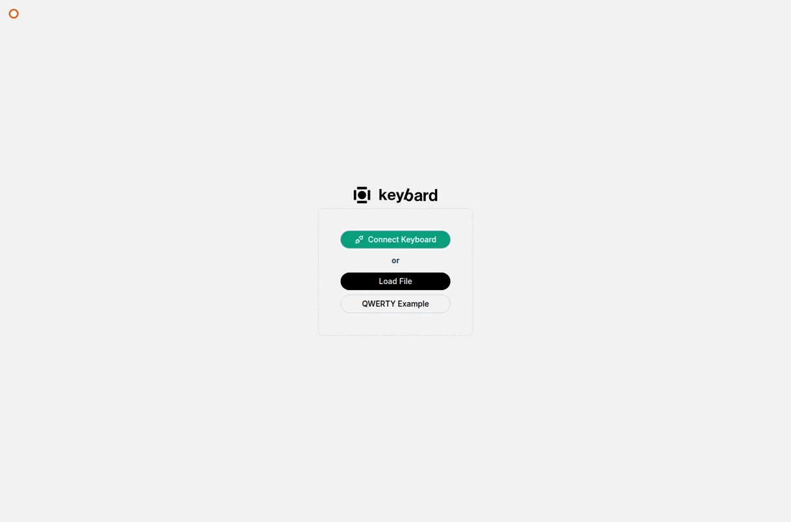

## Keybard won't connect

- Use Chrome or Edge on a desktop computer. Firefox and Safari don't support WebHID.
- Use a USB data cable, not a charge-only one.
- Check that you picked the right device in the browser's chooser.
- Close other configuration apps that may be holding the keyboard, then try again.
- The board needs Svalboard QMK firmware. See [Moving from Vial](/firmware/#moving-from-vial) if it is on Vial.
- On Linux, add [the udev rule](/firmware/#linux-the-udev-rule) so your browser can open the keyboard.

A browser permission you granted before doesn't prove the cable, firmware or connection are working.

## The layout changed, but typing didn't

- Check whether you are editing an offline draft, or have pending edits in Manual Updates.
- Check that the keyboard is on the layer you edited.
- A transparent key uses the binding from a lower layer.
- A layer-tap key waits to tell a tap from a hold.

## Typing changed a key

**Typing Binds a Key** assigns the key you press to the selected position. Deselect before typing, or turn it off in **Settings → General**.

In Manual Updates, discard the unwanted pending edits. If the change was already applied, set the key back yourself: discarding doesn't undo applied changes.

## A save failed

Read the **Not saved** message. In Live Updating, the toolbar also shows **Changes not saved**. Your pending edits remain, and some earlier writes may already have succeeded.

- If the board is still connected, choose **Retry**.
- If Keybard says the keyboard can't save changes, see the next section.
- If the board disconnected, **export the draft before reconnecting**. Reconnecting reads the board again and can discard pending edits.

An automatic backup saved after your edits also holds them, marked **Unsent**. See [Backups and files](/keybard/backups/#automatic-backups).

## "Your keyboard can't save changes"

Changes may appear in Keybard, or even work for now, but the board will lose them when it restarts.

1. Choose **OK** to close the warning.
2. Export the current draft before unplugging, if it holds work you want.
3. Unplug the keyboard, plug it back in, and reconnect.
4. Make the changes again, or import your saved draft, and apply them. Check that saving succeeds.

Closing the warning doesn't fix anything by itself.

## "Your keyboard's settings were reset"

The board couldn't read its saved settings and started from defaults.

1. Choose **OK**.
2. Choose **Import Layout** and select your saved `.svil`. Or open **Settings → Backups** and **Restore** a snapshot from before the reset.
3. Review and apply the import, then test your important keys.

Choosing **OK** only clears the notice. It doesn't restore your layout.

## A name won't save

Layer, macro and tap-dance names can be up to 16 bytes. Accented letters and emoji use several bytes each. Shorten the name. The board name has its own limit.

## Controls or layers seem to be missing

- Click the logo at the top of the left navigation to show its labels.
- If the toolbar is collapsed, choose **Show editor controls**.
- Choose **Show All Layers** if layers are hidden.
- Some settings appear only with a connected board, or only with certain firmware or hardware.
