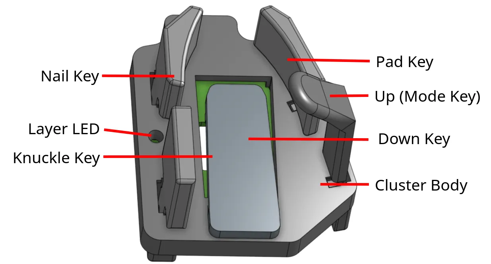

Your order includes a packing slip. It has a printable keymap of the default layout: [packing slip](http://www.svalboard.com/packing-slip).

1. Insert all thumb keys. The Nail key is mirrored for left and right.

   

   <!-- VERIFY: this diagram labels the Up key "Up (Mode Key)". Thumb Up layer switching is gone and the Up keys ship blank. Keep this image, or replace it with one labeled just "Up"? -->

2. Connect the two halves with a USB-C cable between the ports marked **S** (or **↔**). This is the split cable.
3. Connect one half to your computer with the port marked **U**. This is the main half.
   - If you have a TrackPoint, the TrackPoint half must be the main half.
   - Otherwise, make the half with your main pointing device the main half. The main half performs better.
4. Open [Keybard](https://keybard.svalboard.com) and check every key in its **Matrix Tester** (see [Check every key with Matrix Tester](/keybard/settings/#check-every-key-with-matrix-tester)). On Vial, use Vial's Matrix Tester (see [The Vial app](/vial/app/)).
5. Fit the board to your hands (see [Fit](/hardware/fit/)). Start with the [fit video playlist](https://www.youtube.com/watch?v=ArXnZVQM3LM&list=PL_Jqu5bq_U_CQBhYryllArikWe-ns3g8q).

Changes you make in Keybard take effect on the keyboard right away. No flashing needed.

Not sure which firmware your board runs? See [Which firmware](/start/which-firmware/).
